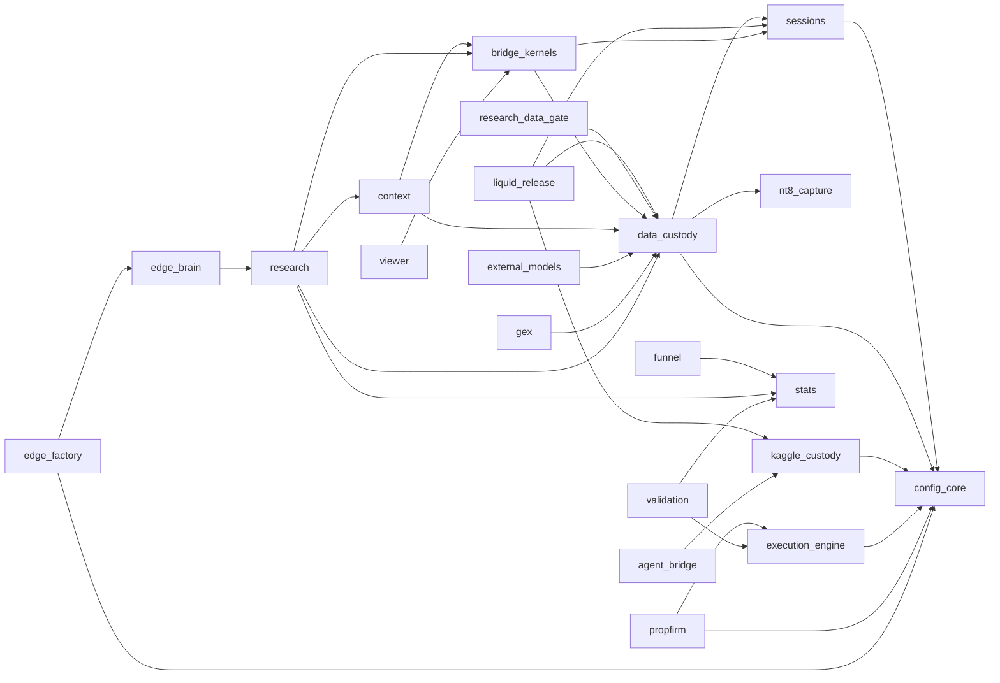

# Mapa de modulos de EdgeLab

> Generado por `tools/check_modules.py --write` desde `config/modules.json`. **No editar a mano**: cambia el registro y regenera.

Capas (una dependencia nunca apunta a una capa superior):

- **0** — Fuentes externas y captura
- **1** — Configuracion, instrumentos y sesiones
- **2** — Datos y custodia
- **3** — Indicadores y kernels
- **4** — Contexto, estadistica y busqueda
- **5** — Ejecucion y validacion
- **6** — Memoria y gobernanza
- **7** — Operacion e interfaces

## Modulos

| Capa | Id | Modulo | Estado | Funcion | Depende de | Doc | Tests |
|---|---|---|---|---|---|---|---|
| 0 | `nt8-capture` | Captura NT8 | core | Indicadores y AddOns C# que exportan ticks, barras, zonas y L2 desde NinjaTrader 8; lectores de exports. | - | `docs/nt8_bridge.md` | `tests/data` |
| 1 | `config-core` | Configuracion e instrumentos | core | Rutas portables, especificaciones de contrato (tick, valor, comisiones) y configuracion unica. Punto unico de verdad para parametros de instrumento. | - | `docs/research/HANDOFF_2026-10-14_DATOS_L2_Y_INTEGRACION.md` | `tests/foundation` |
| 1 | `sessions` | Sesiones y regimenes | core | Ventanas intradia, matrices de sesion y estado de regimen causal. | config-core | `docs/research/cme_equity_index_calendar_20260902` | `tests/data` |
| 2 | `data-custody` | Datos y custodia | core | Contratos continuos, regimen de contrato, calendario CME, compuertas de sesion y de datos de research (fail-closed), identidad de eventos, L2. | config-core, sessions, nt8-capture | `docs/nt8_bridge.md` | `tests/data` |
| 2 | `kaggle-custody` | Custodia y ejecucion en Kaggle | core | Identidad, integridad, inventario, sellado y lectura en streaming de datasets Kaggle; publicacion y etiquetado del espacio. | config-core | `docs/infra/KAGGLE_BORRADO_CANDIDATOS_20261014.md` | `tests/data` |
| 2 | `liquid-release` | Release liquida de ticks | core | Construye, verifica, audita y publica la release canonica liquid_tick_v1: un contrato liquido por sesion, doble reloj, sin holdout, con manifiesto y SHA-256. Lector con preflight de ambos relojes. Incluye el auditor independiente de contenido (originado en el agente de Notion, commit 5aac8bb3) que corre dentro de Kaggle y emite un recibo agregado. | data-custody, sessions, kaggle-custody | `docs/infra/LIQUID_RELEASE_20261014.md` | `tests/data`, `tests/test_liquid_release_payload_audit.py` |
| 2 | `research-data-gate` | Compuerta de datos de research (linea main) | core | Compuerta opt-in fail-closed para lectores de datos de research y guard de acceso Kaggle; los lectores legacy aun no estan cableados. Traído de main el 2026-10-14. | data-custody | `docs/research/INVENTARIO_LINEA_MAIN_20261014.md` | **sin tests** |
| 3 | `bridge-kernels` | Barras, footprint e indicadores (paridad con NT8) | core | Construye barras y footprint canonicos, kernels de indicadores en Python y verifica paridad contra los oraculos de NT8. | data-custody, sessions | `docs/nt8_indicator_parity_contract.md` | `tests/bridge` |
| 4 | `context` | Contexto causal | experimental | Constructores de contexto target-free (HMM, compuerta L2) para condicionar mediciones. | bridge-kernels, data-custody | `docs/research/PROTOCOLO_CONTEXTOS_L2_NQ_20260928.md` | `tests/research` |
| 4 | `external-models` | Modelos externos | experimental | Features de modelos preentrenados (Kronos y sucesores) con causalidad y almacen point-in-time. | data-custody | `docs/external_model_contract.md` | `tests/external` |
| 4 | `funnel` | Funnel exploratorio CPU (linea main) | experimental | Screening exploratorio de CPU con separacion de etapas D0/D1; paridad GPU pendiente. Traído de main el 2026-10-14 (PR #63-#106, linea AVZVOL). | stats | `docs/research/INVENTARIO_LINEA_MAIN_20261014.md` | **sin tests** |
| 4 | `gex` | GEX (exposicion gamma) | experimental | Reconstruccion diaria de niveles de gamma para condicionar regimenes. | data-custody | `docs/research/GEX_FUENTES_Y_GATES_2026-08-13.md` | **sin tests** |
| 4 | `research` | Embudo de investigacion | core | Campanas de medicion pre-registradas: nulos, geometria de zonas, embudos por familia, costos, potencia. Produce actas; no promueve edges por si mismo. | data-custody, bridge-kernels, stats, context | `docs/research_funnel_playbook.md` | `tests/research` |
| 4 | `stats` | Estadistica de validacion | core | Bootstrap estacionario, estimand por cluster/sesion, efecto minimo detectable y primitivos de auditoria estadistica (DSR, MCPT, PBO). | - | `docs/edge_validation_contract.md` | `tests/stats` |
| 5 | `execution-engine` | Motor de ejecucion tick | core | Motor compartido de fills a nivel tick (entrada al tick siguiente, ask/bid, TP con trade-through, costos). Se escribe una vez; las estrategias solo emiten senales. | config-core | `CONTRATO_LLM.md` | `tests/foundation` |
| 5 | `propfirm` | Prop firms y costos de cuenta | experimental | Reglas de props como datos, simulador del ciclo evaluacion-fondeo-retiro y esperanza matematica; referencia de comisiones. | config-core, execution-engine | `docs/research/REFERENCIA_COSTOS_PROPS_BROKERS_20261014.md` | `tests/propfirm` |
| 5 | `validation` | Validacion de estrategias | core | Arnes de auditoria: prefix_check (sin lookahead), mirror_check (simetria), MCPT, PBO, SPA y walk-forward sobre senales puras. | execution-engine, stats | `docs/edge_validation_contract.md` | `tests/foundation` |
| 6 | `component-registry` | Registro de componentes (linea main) | legacy | Catalogo previo de 17 componentes con chequeo de navegacion offline (PASS_NAVIGATION_ONLY). Lo supera config/modules.json como registro canonico; se conserva por sus pruebas de navegacion. | - | `docs/research/INVENTARIO_LINEA_MAIN_20261014.md` | **sin tests** |
| 6 | `edge-brain` | Memoria de investigacion (Edge Brain) | experimental | Hipocampo, ledger de resultados, invalidaciones, elegibilidad, cobertura y memoria de episodios: evita repetir lo muerto y conserva el linaje. | research | `docs/research/HFT_ZONAS_ES_MEDIDO_Y_NO_MEDIDO.md` | `tests` |
| 6 | `edge-factory` | Fabrica de hipotesis | experimental | Orquestador y esquemas para generar y registrar hipotesis con justificacion economica y condicion de refutacion. | edge-brain, config-core | `docs/HIPOTESIS_PENDIENTES.md` | `tests` |
| 6 | `governance` | Gobernanza y documentacion | core | North Star, protocolo de documentacion, registro de edges, canal auditor, contratos de validacion y compuertas de holdout. Define las reglas; ningun modulo las sobrescribe. | - | `docs/DOCUMENTATION_PROTOCOL.md` | `tests/test_north_star_hash.py` |
| 7 | `agent-bridge` | Puente multi-IA (Drive/Kaggle) | experimental | Permite que agentes sin red o sin datos (Gemini, Notion) pidan lecturas y kernels a la PC local por una carpeta de Drive, con politica de acciones permitidas y parches solo para revision. | kaggle-custody | `docs/research/HANDOFF_2026-10-14_DATOS_L2_Y_INTEGRACION.md` | `tests/bridge` |
| 7 | `notion-workers` | Workers de Notion (linea main) | experimental | Integraciones de Notion (auditor y operaciones de investigacion). Traidos de main el 2026-10-14; el auditor de datos vive ademas en la rama feat/research-ops-supervisor-mvp. | - | `docs/research/INVENTARIO_LINEA_MAIN_20261014.md` | **sin tests** |
| 7 | `viewer` | Visor | experimental | Visualizacion de barras, zonas y L2 para inspeccion humana. | bridge-kernels | `docs/research/VIEWER_UNIFICATION_PROPOSAL_20260921.md` | **sin tests** |

## Conexiones (flujo de datos)

(La flecha va del consumidor al proveedor.)

## Entradas y salidas por modulo

- **nt8-capture** — entra: NinjaTrader 8; sale: exports de ticks, CSV de oraculo, L2 CSV.
- **config-core** — entra: config/*.toml; sale: Config, especificaciones de instrumento.
- **sessions** — entra: calendario de sesiones, precios; sale: matrices de sesion, estado de regimen.
- **data-custody** — entra: exports NT8, calendario oficial CME; sale: series de contrato, decisiones de sesion, gates de datos.
- **kaggle-custody** — entra: datasets Kaggle; sale: inventarios, sellos, indice del espacio.
- **liquid-release** — entra: exports NT8 por contrato, calendario; sale: release_manifest.json, Parquet por activo, metadata/*.
- **research-data-gate** — entra: pines SHA-256, manifiestos de campana; sale: admision de lectura.
- **bridge-kernels** — entra: ticks, oraculos NT8; sale: barras, zonas, reportes de paridad.
- **context** — entra: barras, L2; sale: etiquetas de contexto.
- **external-models** — entra: series; sale: features PIT.
- **funnel** — entra: tablas de eventos; sale: screens exploratorios.
- **gex** — entra: cadenas de opciones; sale: niveles GEX diarios.
- **research** — entra: release de ticks, manifiestos de campana; sale: actas MEDIDO/NO MEDIDO, landscapes target-free.
- **stats** — entra: series de resultados; sale: IC, p-valores, MDE.
- **execution-engine** — entra: senales (idx, dirs), ticks con bid/ask; sale: ledger de trades.
- **propfirm** — entra: reglas scrapeadas, resultados de estrategia; sale: EV por cuenta, filtros de admisibilidad.
- **validation** — entra: funciones de senal; sale: veredicto de preflight y de robustez.
- **component-registry** — entra: arbol del repo; sale: PASS_NAVIGATION_ONLY.
- **edge-brain** — entra: actas, resultados; sale: linaje, invalidaciones, elegibilidad.
- **edge-factory** — entra: ideas, especificaciones de instrumento; sale: hipotesis registradas.
- **governance** — entra: decisiones de Nico; sale: reglas, estado vivo.
- **agent-bridge** — entra: pedidos JSON; sale: respuestas JSON, snapshots de codigo.
- **notion-workers** — entra: paginas de Notion; sale: auditorias.
- **viewer** — entra: bundles de barras y zonas; sale: vistas HTML.
