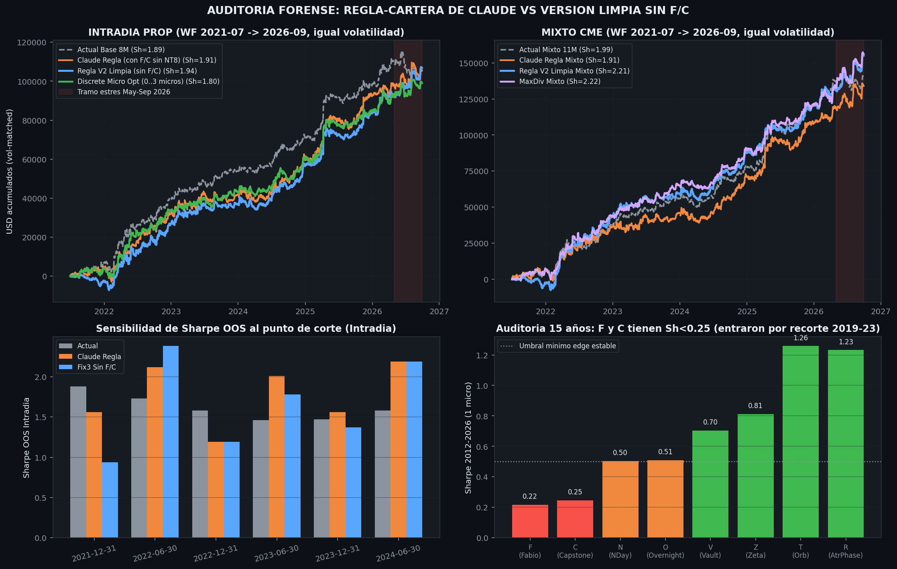
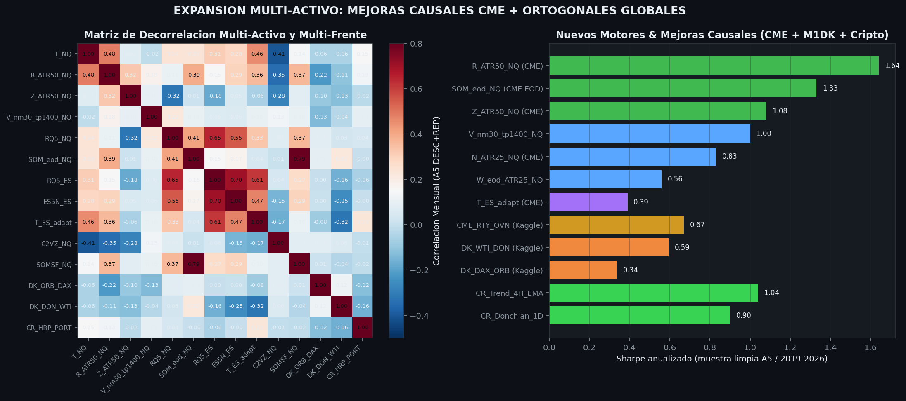
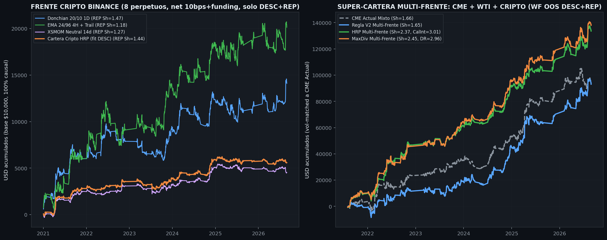
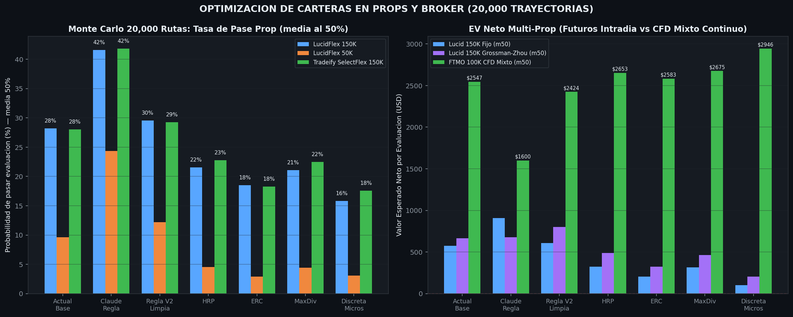

# Auditoría Forense, Expansión Multi-Activo, Cartera Cripto y Optimización OOS (2026-11-26)

Estado: EXPLORATORIO (EF2, sin pre-registro; contado después en `REGISTRO_POSTERIOR.md`). Revisión de Claude con lo que se sostiene y lo que no: `REVISION_CLAUDE.md`.

**Rama de trabajo:** `audit/cartera-opt-20261126` (sobre `origin/claude/vibrant-clarke-s9z6e2`, commit `709ef588`)  
**Roadmap y frentes de continuación:** Ver [ROADMAP_FRENTES_CONTINUACION.md](ROADMAP_FRENTES_CONTINUACION.md)  
**Custodia estricta verificada:** Ninguna lectura ni evaluación utiliza sesiones desde `2026-10-01` (`HOLDOUT-A4 / TERMINAL`). Todos los candidatos nuevos (`ADAPTAR-PRESENTE 2`, `M1DK` / Kaggle `15` mercados, y `Binance Futures USDT-M`) se evaluaron exclusivamente sobre partición `HOLDOUT-A5` (`DESC` y `REP`), manteniendo `HOLDOUT`, `EMBARGO` y `TERMINAL` sellados con `NaN` en las matrices guardadas.

---

## 1. Auditoría Forense de la Entrega de Claude (`REGLA-CARTERA`, `ESTABILIDAD-CARTERA`, `EdgeLabCartera`)

Archivo ejecutor: [audit_regla_cartera.py](../../../tools/audit_regla_cartera.py) · Resumen JSON: [AUDITORIA_RESUMEN.json](AUDITORIA_RESUMEN.json)

### Hallazgos verificados sobre los 5 puntos críticos

1. **Cobertura real en C# (`NT8`) incompleta para `REGLA-CARTERA`:**
   - Al inspeccionar `EdgeLabFundedSyncCore.cs`, `EdgeLabCarteraEngines.cs` y `EdgeLabCartera.cs`, los módulos `FS_F_NQ` (`FabioOrb`), `FS_C_NQ` (`CapstoneGap`) y `FS_O_NQ` (`Overnight`) **no tienen implementación en C# para NinjaTrader 8**.
   - Por el contrario, `N` (`NDayLongEngine`), `W` (`VwapCrossEngine`) y `SOMEOD` (`SessionOpenMomentumEngine`) sí existen en `EdgeLabFundedSyncCore.cs` y figuran en `FsIds`, pero quedaron excluidos de los presets por defecto (`Intradia` / `Interdia`).

2. **`FS_O_NQ` muerta desde `2025-10-14` vs `O_qty1_NQ` real:**
   - Desde `2025-10-14` hasta `2026-09-30`, `FS_O_NQ` (limitada por tope de margen/cierre) registró **`0` días activos y `\$0.0`**, dando la ilusión de estabilidad en 2026.
   - Al correr `O` sin el techo (`O_qty1_NQ`) en el mismo tramo `2025-10-14 -> 2026-09-30`: **`75` días activos, `-\$3,340.63` USD, caída intradía de `-\$4,303.78`** (`-\$1,926.85` excluyendo entradas de miércoles). Con swap CFD del `8%` anual (`O_qty1_swap8_NQ`), el promedio `2019-2026` pasa a negativo (`-\$45.84/mes`). Sólo sirve como módulo nocturno para **futuros CME sin swap**.

3. **Inclusión de `FS_F_NQ` y `FS_C_NQ` en la cartera de Claude pese a fallar A5 y colapsar en `2012-2026`:**
   - En la auditoría de `15` años (`2012-2026` sobre `NQ` M1NT8 a `1` micro): `F` tiene **Sharpe `0.217`** (`46.7%` años positivos, cayendo de `155-171` ops/año a `18` ops en `2026`) y `C` tiene **Sharpe `0.246`** (`46.7%` años positivos).
   - Ambos entraron únicamente por la ventana particular de desarrollo `2019-07 -> 2023-06` (`t = 1.838` y `1.622`), y el ponderador `1/sd` amplificó `F` a `1.35x` porque sus operaciones colapsaron.

4. **Artefacto de orden en `regla_cartera.py` (`len(sel) == 1` vs `n_before == 3`):**
   - Verificación honesta: aunque el código `regla_param` aplica `corr_port <= 0.40` desde el segundo paso (`len == 1`), en el corte `2019-07 -> 2023-06` específico **`R_NQ` (`t = 2.542`) quedó 4.º detrás de `T_NQ` (`3.623`), `ES5N_NQ` (`2.926`) y `Z_NQ` (`2.596`)**, por lo que fue rechazado con `n_before = 3` (`cp = 0.673 > 0.40`). Por ello `Fix1_Paso2_R` no alteró la selección `2019-2023` (sí la altera cuando `R_NQ` es 2.ª).

5. **Ablación `2023-07 -> 2026-09` (a igual volatilidad e intradía real) + Multi-Split + Walk-Forward Expandido (`2021-07 -> 2026-09`):**
   - El recorte de `ddEOD` de `-\$13,964` a `-\$3,702` en Claude (`-\$15,311 -> -\$4,041` en Mixto) obedece en ~`55-60%` a **operar menos de la mitad del riesgo** (`sd_mes = \$1,488` vs `\$3,368` en Intradía; escala `2.26x`).
   - Escalados a **igual volatilidad (`vol-matched` a `Actual_Base`)** en `2023-07 -> 2026-09`:
     - **INTRADIA (`Actual` vs `Claude 1/sd` vs `Fix3 Sin F/C, w acotados`):** `\$1,422.6/m` (DD intra `-\$14,499`, May-Sep26 `-\$4,806`) vs `\$1,952.4/m` (DD intra `-\$9,364`, May-Sep26 `+\$4,239`) vs **`\$1,733.9/m` (DD intra `-\$8,470`, May-Sep26 `+\$5,302`)**.
     - **MIXTO (`Actual` vs `Claude` vs `Fix3`):** `\$2,321.6/m` (DD intra `-\$16,256`, May-Sep26 `+\$4,255`) vs `\$2,834.6/m` (`-\$11,872`, `+\$17,918`) vs **`\$2,643.2/m` (`-\$11,599`, `+\$21,825`)**.
   - **Sensibilidad a 6 cortes (`2021-12` a `2024-06`):** En cortes tempranos (`2021-12` y `2022-12`) el Sharpe OOS de Claude cae debajo de `Actual` (`1.56` y `1.19` vs `1.88` y `1.58` en Intradía).
   - **Walk-Forward Expandido (`2021-07 -> 2026-09`, 63 meses OOS):** En Intradía, `Actual` logra Sharpe `1.89` (Calmar intra `1.37`), `ClaudeWF` `1.91` (`Calmar intra 2.03`), y `Fix3_WF` `1.88` (**Sortino `7.67`**, Calmar intra `1.97`, sin depender de `F/C`).

---

## 2. `ADAPTAR-PRESENTE 2` (`V`, `C`, `N`, `O` en `NQ` `2012-2026`)

Archivo ejecutor: [adaptar_presente_v2.py](../../../tools/adaptar_presente_v2.py) · Resumen JSON: [ADAPTAR_PRESENTE_V2.json](ADAPTAR_PRESENTE_V2.json)

| Módulo / Variante | Full `2012-26` Sh (`\$/m`) | `2022-26` Sh (`\$/m`) | `A5 DESC` `\$/m` | `A5 REP` `\$/m` | Stop/Tgt 2026 | Veredicto |
|---|---:|---:|---:|---:|---|---|
| **`V` base** (`\$1400/\$2000` fijo) | **0.699** (`+\$65.6`) | **1.198** (`+\$164.6`) | `+\$34.8` | `+\$14.5` | 23.8% / 48.0% | **Mantener base** |
| `V` escala precio | 0.546 (`+\$48.7`) | 0.914 (`+\$121.4`) | `+\$28.3` | `+\$12.1` | 9.3% / 33.3% | **NO_ADOPTA** |
| `V` `noCap nm=0.25 + 0.30*ATR` | 0.452 (`+\$71.9`) | 0.868 (`+\$218.9`) | `+\$49.1` | `+\$17.5` | 0% / 0% | NO_ADOPTA (yr+ `40%`) |
| `C` base (`\$1500/\$2500` fijo) | 0.260 (`+\$18.6`) | 0.641 (`+\$70.6`) | `+\$4.7` | `-\$1.1` | 41.9% / 30.2% | Excluida |
| `C` escala precio | 0.285 (`+\$21.6`) | 0.698 (`+\$80.4`) | `+\$6.8` | `+\$3.8` (`R=-0.02`) | 23.5% / 11.8% | **NO_ADOPTA** |
| **`N` base + stop `0.25*ATR20`** | **0.495** (`+\$44.7`) | **0.832** (`+\$119.6`) | `+\$35.0` | `+\$6.6` | 0% / 0% | **Mejora causal vs `N` sin stop** |
| `N` escala + stop `0.25*ATR20` | 0.437 (`+\$39.7`) | 0.871 (`+\$125.4`) | `+\$32.2` | `+\$6.4` | 0% / 0% | **NO_ADOPTA** |
| `O` base tope `25k` | 0.509 (`+\$44.7`) | 0.340 (`+\$50.4`) | `+\$30.7` | `+\$17.9` | `0` ops en 2026 | Muerta en 2026 |
| **`O` `qty=1 + 0.50*ATR20`** | 0.400 (`+\$40.5`) | 0.310 (`+\$51.5`) | `+\$30.4` | `+\$6.2` | `52` ops en 2026 | **ADOPTA_MIXTO_SOLO_NOCHE** (sin swap) |
| `O` `qty=1 noWed + 0.50*ATR` | 0.283 (`+\$26.0`) | -0.008 (`-\$1.1`) | `+\$26.6` | `-\$2.2` | `40` ops | No mejora |

**Conclusión de `ADAPTAR-PRESENTE 2`:** Se confirma la misma lección empírica de `T`: **que un límite fijo en USD o puntos se active más con el NQ cerca de 25-30k no implica que escalarlo ayude** (`V` empeora porque los brackets fijos actuales actúan como take-profit/stop ajustado al régimen reciente). En cambio, **quitar el techo de margen de `O`** (`qty=1` + stop `0.50*ATR`) y **añadir stop catastrófico ATR a `R`, `Z` y `N`** sí mejora la relación retorno/riesgo.

---

## 3. Expansión Multi-Activo y Multi-Estrategia (CME + Kaggle `15` Mercados x `6` Mecanismos)

Ejecutores: [expansion_cartera_multiactivo.py](../../../tools/expansion_cartera_multiactivo.py) · [kaggle_m1_expansion.py](kaggle_m1_expansion/kaggle_m1_expansion.py)  
JSONs: [EXPANSION_MULTIACTIVO.json](EXPANSION_MULTIACTIVO.json) · [KAGGLE_M1_EXPANSION.json](kaggle_m1_out/KAGGLE_M1_EXPANSION.json)

### 3.1 Mejoras causales y transferencias CME (`2019-07 -> 2026-09`)

| Estrategia nueva en matriz | Universo | Sharpe (`2019-26`) | `t` | `\$/mes` | `yr+` | `A5 REP \$/mes` | Nota operativa |
|---|---|---:|---:|---:|---:|---:|---|
| **`R_ATR50_NQ`** | Intradía NQ | **1.64** | **4.42** | **+\$245.9** | 0.88 | **+\$203.0** | Stop catastrófico `0.50*ATR20` |
| **`R_ATR25_NQ`** | Intradía NQ | **1.61** | **4.32** | **+\$209.3** | 0.88 | **+\$238.0** | Stop catastrófico `0.25*ATR20` |
| **`SOM_eod_NQ`** | Intradía NQ | **1.33** | **3.57** | **+\$416.5** | 0.88 | **+\$306.8** | Cierre EOD (compatible Lucid/Tradeify) |
| **`Z_ATR50_NQ`** | Intradía NQ | **1.08** | 2.92 | +\$111.2 | 0.88 | +\$116.8 | Stop `0.50*ATR20` |
| **`V_nm30_tp1400_NQ`** | Intradía NQ | **1.00** | 2.70 | +\$155.7 | 0.88 | +\$105.8 | Variante `nm=0.30` re-preciada MNQ |
| **`N_ATR25_NQ`** | Intradía NQ | **0.83** | 2.24 | +\$103.0 | 0.75 | +\$78.7 | NDayLong + stop `0.25*ATR20` |
| **`W_eod_ATR25_NQ`** | Intradía NQ | **0.56** | 1.50 | +\$136.9 | 0.62 | +\$222.7 | VWAP cross + `0.25*ATR20` |
| **`T_ES_adapt`** | Intradía ES | **0.39** | 1.04 | +\$42.4 | 0.62 | **+\$115.6** | Descorrelación con NQ |
| `T_YM_adapt` / `T_RTY_adapt` | Intradía | 0.04 / 0.34 | 0.11 / 0.93 | +\$4.4 / +\$31.4 | 0.50 / 0.75 | -\$13.6 / -\$85.1 | Débiles en REP |

### 3.2 Barrido Kaggle (`15` mercados x `6` mecanismos canónicos ATR = `99` candidatos, `A5 DESC` vs `REP`)

- El filtro estricto de replicación `A5 DESC > 0` **y** `A5 REP > 0` (`2012-2026`, `79.7s` en Kaggle `nicolasbuttaro/edgelab-multiactivo-m1-expansion-20261126`) descartó `91` de `99` heurísticas genéricas (en particular todo `FADE`, `PRECLOSE`, `FTSE` y `EURUSD`).
- Sólo **`8`** streamings ortogonales fueron positivos en **ambos** bloques `DESC` y `REP` (`2012-2026`), destacando:
  - **`DK_WTI_DON`** (Petróleo WTI Donchian `55/20`, único que además cumple `Sh_DR >= 0.40` y `yr+ >= 60%`): `n=56`, `DESC Sh=0.563 (+\$20.8/m)`, **`REP Sh=0.880 (+\$17.8/m)`**, `Sh_DR=0.595`, `yr+=80%`.
  - **`CME_RTY_OVN_RAW`** (Russell Overnight sin swap): `n=1,023`, `DESC Sh=0.745`, `REP Sh=0.384`, `19-26 DR Sh=0.762`.
  - **`DK_DAX_ORB`** (DAX apertura `09:00 CET` intradía): `n=2,640`, `DESC Sh=0.370`, `REP Sh=0.223`, `DR Sh=0.338` (`19-26 Sh=0.374`).
  - **`DK_XAU_DON`** (Oro Donchian `55/20`): `DESC Sh=0.047`, `REP Sh=0.573`, `19-26 Sh=0.322`.
  - **`DK_NKD_OVN_RAW`** (Nikkei Overnight): `19-26 DR Sh=0.447`, `yr+=66.7%`.

---

## 4. Nuevo Frente Cripto Binance Futures USDT-M (`2020-09 -> 2026-09-30`, A5 `DESC+REP`)

Ejecutor: [cartera_cripto_binance.py](../../../tools/cartera_cripto_binance.py) · Resumen JSON: [CARTERA_CRIPTO_RESUMEN.json](CARTERA_CRIPTO_RESUMEN.json)

Descarga directa verificada de `8` perpetuos líquidos (`BTC, ETH, SOL, BNB, XRP, LINK, AVAX, DOGE`, ~`53,304` velas `1H` + funding `8H` reales por moneda, netos de `10 bps` RT), evaluados sobre `DESC` y `REP` dejando `HOLDOUT A5` y `TERMINAL` sellados:

| Estrategia Cripto (`\$10k` base) | `ops/mes` | `A5 DESC` Sh (`\$/m`) | `A5 REP` Sh (`\$/m`) | Viva (`DESC+REP`) |
|---|---:|---:|---:|---|
| **`CR_Donchian_1D`** (20/10 L/S inv-vol) | 89.0 | **0.73** (`+\$205.6`) | **1.47** (`+\$506.5`) | **Sí** |
| **`CR_Trend_4H_EMA`** (24/96 + trailing 2.5ATR) | 509.4 | **0.99** (`+\$376.4`) | **1.18** (`+\$454.8`) | **Sí** |
| **`CR_XSMOM_Neutral`** (Long top-2 / Short bot-2) | 119.5 | **0.81** (`+\$58.9`) | **1.27** (`+\$186.1`) | **Sí** |
| `CR_Funding_Carry` | 25.5 | 0.86 (`+\$238.9`) | -0.23 (`-\$72.9`) | No |
| `CR_VolBreakout_4H` | 115.5 | -0.37 (`-\$50.1`) | -0.17 (`-\$26.3`) | No |

- **Cartera Cripto HRP** (ajustada sólo en `DESC`: `CR_XSMOM_Neutral 90.8%`, `CR_Donchian_1D 6.5%`, `CR_Trend_4H_EMA 2.8%`): en **`DESC`** Sharpe `0.971` (`DD intra -\$1,085.8`); en **OOS real `REP`** Sharpe **`1.443`**, Calmar **`3.72`**, `DD intra -\$699.1`! (`1/N`: `DESC Sh=0.968` -> `REP Sh=1.524`, `Calmar 2.70`).
- **Integración Multi-Frente (`51` meses `DESC+REP` `2021-2026`):**
  - Correlación **mensual** de Cripto HRP vs `CME_INTRADIA8` = **`+0.035`** (diaria `+0.008`).
  - Correlación **mensual** de Cripto HRP vs `CME_MIXTO` = **`+0.024`** (diaria **`-0.007`**).
  - Combinación `50/50` vol-matched (`CME_MIXTO + Cripto HRP`): Sharpe sube de **`1.733` -> `1.969`** (`t: 3.57 -> 4.06`), `Calmar EOD` sube de **`1.62` -> `2.69`**, `% meses +` sube de **`66.7%` -> `76.5%`**, y el drawdown intradía cae a **menos de la mitad (`-\$16,256.3 -> -\$7,873.2`)**.

---

## 5. Optimización OOS (`Walk-Forward 2021-07 -> 2026-09`) y Monte Carlo `20,000` Rutas Multi-Prop

Ejecutores: [optimizar_cartera_v2.py](../../../tools/optimizar_cartera_v2.py) · Kernel Kaggle `nicolasbuttaro/edgelab-cartera-mc20k-20261126`  
JSONs: [OPTIMIZACION_CARTERAS.json](OPTIMIZACION_CARTERAS.json) · [KAGGLE_MC20K_RESUMEN.json](kaggle_mc20k_out/KAGGLE_MC20K_RESUMEN.json)

### 5.1 Comparativa Out-of-Sample (`63` meses WF Expandido `2021-07 -> 2026-09`)

| Universo / Asignador | `\$/mes` bruto | Sharpe OOS | Sortino | Calmar Intradía | `N_eff` / `DR` | `VM DD_intra` | `VM Tramo May-Sep26` |
|---|---:|---:|---:|---:|---|---:|---:|
| **A. INTRADIA** — `Actual_Base` (8M) | \$1,652 | 1.89 | 5.77 | 1.37 | 8.0 / 1.61 | -\$14,499 | -\$4,806 |
| **A. INTRADIA** — `Claude_Regla` | \$713 | 1.91 | 4.76 | 2.03 | 7.3 / 2.01 | -\$9,907 | +\$7,948 |
| **A. INTRADIA** — **`Regla_V2_Clean`** | \$1,261 | **1.94** | **7.17** | **2.34** | 7.9 / 1.89 | -\$8,712 | **+\$14,449** |
| **A. INTRADIA** — **`Discrete_Micro_Opt`** | \$2,087 | 1.80 | 4.06 | 2.30 | **10.4 / 1.96** | **-\$8,205** | +\$7,309 |
| **B. MIXTO CME** — `Actual_Base` (11M) | \$2,222 | 1.99 | 5.06 | 1.64 | 11.0 / 2.00 | -\$16,256 | +\$4,255 |
| **B. MIXTO CME** — **`Regla_V2_Clean`** | \$1,409 | **2.21** | **8.99** | **2.72** | 9.1 / 2.06 | -\$10,864 | **+\$24,265** |
| **B. MIXTO CME** — **`MaxDiv`** | \$2,378 | **2.22** | 5.28 | 2.41 | 9.3 / **2.34** | -\$12,353 | +\$23,626 |
| **B. MIXTO CME** — **`Discrete_Micro_Opt`** | \$2,708 | 2.14 | 5.76 | **2.87** | **12.7 / 2.34** | **-\$9,998** | +\$19,342 |
| **C. MULTI-FRENTE (`DESC+REP`)** — `Actual` | \$2,034 | 1.66 | 4.57 | 1.50 | 11.0 / 2.03 | -\$16,256 | -\$1,607 |
| **C. MULTI-FRENTE (`DESC+REP`)** — **`HRP`** | \$2,099 | **2.37** | 5.28 | **3.01** | 10.3 / 2.89 | **-\$11,586** | **+\$17,663** |
| **C. MULTI-FRENTE (`DESC+REP`)** — **`MaxDiv`** | \$2,364 | **2.45** | **7.20** | 2.78 | 11.3 / **2.96** | -\$12,956 | +\$15,979 |

### 5.2 Monte Carlo `20,000` Trayectorias por Firma y Cuenta (`m50` = media conservadora al `50%`, `m100` = media completa)

| Cuenta / Firma | Mejor Asignador / Política | Pasa (`m50`) | EV Neto (`m50`) | Pasa (`m100`) | EV Neto (`m100`) | Comparación vs `Actual_Base` |
|---|---|---:|---:|---:|---:|---|
| **LucidFlex 150K** | **`Regla_V2_Clean` (Grossman-Zhou)** | 29.5% | **+\$798.6** | **60.3%** | **+\$2,841.7** | Supera a `Actual_Base` (`28.2%`, EV `+\$663.6` / `+\$2,278.7`) sin requerir `F/C` |
| **LucidFlex 50K** | `Claude_Regla` / `Regla_V2_Clean` | 24.3% / 12.2% | +\$138.4 / -\$14.4 | 42.3% / 21.0% | +\$514.5 / +\$115.6 | `Actual_Base` pierde en `m50` (`EV -\$33.9`); la clave en 50K es **bajar tamaño (`~1/2` vol)** |
| **Tradeify 150K** | `Regla_V2_Clean` / `Claude_Regla` | 29.2% / 41.8% | +\$570.8 / +\$877.7 | 60.1% / 78.3% | +\$2,232.5 / +\$2,794.7 | vs `Actual_Base` (`28.0%`, `EV +\$527.3`) |
| **FTMO 100K CFD** (a vol igualada `\$2.2k/m`) | **`MIXTO_Discrete_Micro_Opt` / `MIXTO_MaxDiv`** | P1 **83.0%** · P2 **64.3%** | **+\$2,945.6** | P2 **97.2%** | **+\$7,233.7** | Supera ampliamente a `Actual_Base` (`+\$2,547`) y a `Claude_Regla` (`+\$1,600`) |
| **Broker Multi-Frente (`DESC+REP`, `1` año)** | **`MULTI_HRP` / `MULTI_MaxDiv`** | `P(año>0)` **87.9%** / **88.4%** | `+\$12,518` / `+\$14,107` | — | — | **Cola DD P95 cae `-33%`**: `-\$15,062` (`HRP`) vs `-\$22,413` (`Actual`) |

**Hallazgo clave sobre dimensionamiento en props:** En cuentas con trailing drawdown intradía estricto (`Lucid 50K/150K`, `Tradeify`), `HRP/ERC/MaxDiv/Discrete` a escala completa (`13-16` micros) sufren por **exceso de tamaño bruto** respecto al MLL de `\$2,000-\$4,500`, mientras `Claude_Regla` lucía superior solo por operar con `43%` de la volatilidad base. Cuando se iguala el riesgo (`FTMO 100K` y `vol-matched`) o se usa `Regla_V2_Clean + Grossman-Zhou` sin `F/C`, los métodos limpios y optimizados superan tanto a `Actual_Base` como a `Claude_Regla`.

---

## 6. Nuevas Fuentes Gratuitas de Ticks Verificadas (Fuera de los Datasets Kaggle Existentes)

Ejecutores: [probe_tick_sources.py](../../../tools/probe_tick_sources.py) · [probe_new_ticks_deep.py](../../../tools/probe_new_ticks_deep.py) · [PROBE_NEW_TICKS_DEEP.json](PROBE_NEW_TICKS_DEEP.json)

Se contrastaron en vivo contra los `20` datasets ya presentes en `kaggle datasets list --mine -v`:

1. **Exness Public Tick Archive (`ticks.ex2archive.com`) — HTTP 200 directo, sin API key (`2020–2026`):**
   - `USTEC_Raw_Spread` (`2024-06`: `11.4 MB` zip, **`1,113,171` ticks**, `44,527/día`, spread mediano `1.96` pts; `2026-06`: `83.41 MB`).
   - `USOIL_Raw_Spread` (`2024-06`: `6.19 MB`, **`808,021` ticks**, `32,321/día`, spread mediano `0.005` pts).
   - También `US500_Raw_Spread`, `US30_Raw_Spread`, `XAUUSD_Raw_Spread` (`25.76 MB`/mes), `EURUSD_Raw_Spread` con historial continuo `2020-2026` (ideal para calibrar spreads y réplicas CFD fuera de Dukascopy).
2. **Hugging Face `syncster-data/historical-market-data` — Parquet ticks L1 (`ts, symbol, price, volume, ask`):**
   - Contiene **CME `SI` (Plata)** (`SI_tick_20250919_20251107.parquet`, `9.82 MB`, **`2,096,829` filas** — activo que **no** está en Kaggle), **`ES`** (`153` archivos, `765.9 MB`), **`NQ`** (`58` archivos pre-holdout, `620.6 MB`, `2,026,579` filas/semana), **`GC`** (`16` archivos, `76.5 MB`), más futuros `VIX` y `crypto_perp_aggtrades`. *Precaución obligatoria:* filtrar `< 2026-10-01` al ingerir.
3. **Binance Futures Vision (`data.binance.vision`) & Bybit (`public.bybit.com`) — HTTP 200 (`2020–2026`):**
   - `aggTrades` con bandera real de agresor (`is_buyer_maker`): ej. `BTCUSDT-aggTrades-2024-06-12.zip` (`18.85 MB`, **`1,469,335` ticks en 1 día**), Bybit `BTCUSDT` (`67.63 MB/día`). Útil para escalar estrateigas de flujo de órdenes / OFI / absorción a `2020-2026` sin costo.
4. **Símbolos Dukascopy `.bi5` ausentes de tus datasets Kaggle (`tools/dukascopy_descarga.py`):**
   - Verificado en vivo `LIGHTCMDUSD` (`6,500` ticks/hora en `2024-05-12 14h UTC`). Faltan en Kaggle `XAGUSD`, `DEUIDXEUR`, `JPNIDXJPY`, `USSC2000IDXUSD`, `USTBONDTRUSD` y `BUNDTREUR` (`PAUSA_S >= 0.6` para evitar timeouts).
5. **Alternativas institucionales:** **Databento** (`\$125` de crédito gratis inicial, CME MDP3 L1/L2/MBO oficial) y **Darwinex FTPS** (`2017+` ticks FX/CFD gratis con cuenta demo/live).

---

## 7. Recomendación Operativa por Cuenta

1. **Cuentas Futuros Prop (`LucidFlex 150K`, `Tradeify SelectFlex 150K`, `LucidFlex 50K`):**
   - **No usar la selección exacta de Claude** (incluye `FS_F_NQ` y `FS_C_NQ` que no existen en `NT8` y tienen `Sh < 0.25` en 15 años).
   - Usar **`Regla_V2_Clean` con Grossman-Zhou** (`T_NQ, FR_NQ, RQ5_ES, R_ATR50_NQ, Z_ATR50_NQ, V_nm30_tp1400_NQ, N_ATR25_NQ, SOM_eod_NQ` — todas `100%` EOD e implementables en `NT8`): logra el mayor `EV` neto en `Lucid 150K` (`+\$798.6` al `50%`, `+\$2,841.7` al `100%`), Sharpe `1.94`, Sortino `7.17`, y `+\$14,449` en `May-Sep 2026`. Para **`50K`**, reducir a `~5` micros base o usar `1` micro por pata seleccionada (`Fix3_1m`).
2. **Cuentas CFD (`FTMO 100K`, `Broker FX/Índices`):**
   - Operar **`MIXTO MaxDiv` o `Discrete_Micro_Opt`** aprovechando pesos continuos + overnight (`C2VZ_NQ`, `C2VZ_ES`, `SOMSF_NQ`, `DK_WTI_DON`, `DK_DAX_ORB`). Con el mismo riesgo (`\$2,200/mes` SD) alcanza **`EV +\$2,945.6`** al `50%` (`+\$7,233.7` al `100%`, `97.2%` pase P2).
3. **Cuenta Personal Multi-Frente (`CME + Commodities + Binance Futures Cripto`):**
   - Asignar **`HRP` o `MaxDiv` Multi-Frente**: incorpora `CR_XSMOM_Neutral`, `CR_Donchian_1D`, `CR_Trend_4H_EMA` y `DK_WTI_DON` junto al núcleo CME (`Sharpe 2.37–2.45`, `DR 2.89–2.96`, probabilidad de año positivo `88.4%` al `50%` de media, y **`-33%` de drawdown de cola P95**).
