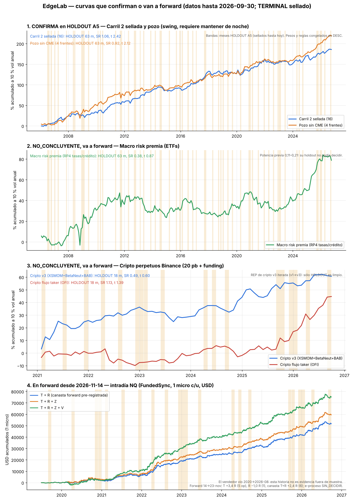

# Curvas que confirman o van a forward (2026-11-27)

Estado: VIGENTE — gráfico descriptivo de series ya publicadas (`holdout_a5_nocme_20261127`, `estabilidad_cartera_20261126`,
`regimen_forward_20261119`). No suma pruebas ni abre nada; datos hasta 2026-09-30, TERMINAL sellado. Regenerar con
`PYTHONPATH=. python tools/curvas_confirma_forward.py`.

| Panel | Qué es | Estado |
|---|---|---|
| 1 | Carril 2 sellada (16) y pozo sin CME | CONFIRMA en HOLDOUT A5: t 2,42 y t 2,12. Swing: requiere mantener de noche |
| 2 | Macro risk premia (RP4) | NO_CONCLUYENTE (t 0,87), sólo forward |
| 3 | Cripto v3 y flujo taker (OFI) | NO_CONCLUYENTE (t 0,60 y 1,39), sólo forward |
| 4 | T + R (+Z, +V) intradía NQ, 1 micro en USD | En forward desde 2026-11-14; la historia la vio el vendedor (hasta 2026-08) |

Las bandas marcan los meses HOLDOUT de A5. En los paneles 1–3, cada serie se escala a 10 % de volatilidad anual con su desvío de DESC.
