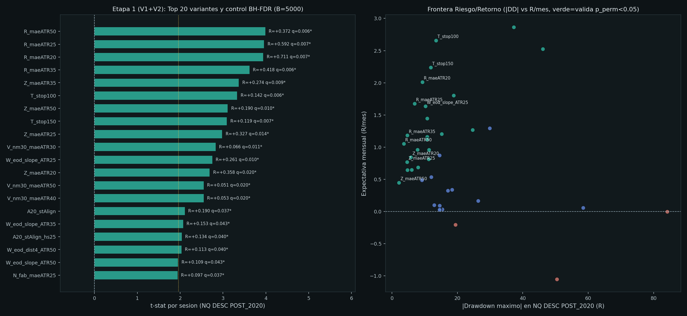
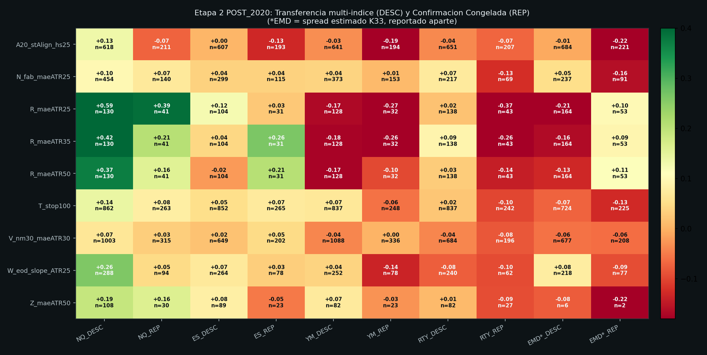
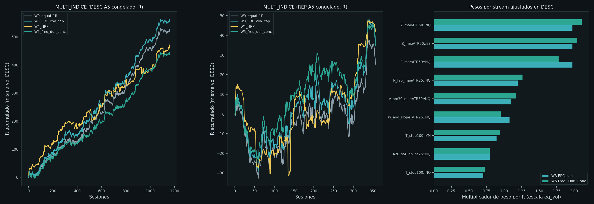

# Iteración 2 `FUNDEDSYNC`: Robustez V1, Rescate V2, Permutaciones, Transferencia Multi-Índice y Cartera Ponderada (HOLDOUT-A4 / HOLDOUT-A5)

Estado: RESULTADO
Fecha: 2026-11-22
Familia / módulo: `FUNDEDSYNC`
North Star: `16a108dfce2671b7a7c502d7db3eccdb71aabdca1cd1bd6bb7ea0f847d66e345`
Pre-registro: [PREREGISTRO.md](file:///C:/Users/nicoc/.gemini/antigravity/scratch/EdgeLab-fundedsync/docs/research/fundedsync_iter2_cartera_20261122/PREREGISTRO.md) (campaña `FUNDEDSYNC_ITER2_CARTERA_20261122`, presupuesto `95` pruebas registrado en K51).
Script: [fundedsync_iter2_cartera.py](file:///C:/Users/nicoc/.gemini/antigravity/scratch/EdgeLab-fundedsync/tools/fundedsync_iter2_cartera.py) (`--workers 2`, cache en `data/fundedsync_post_il_20261122/`, fricción canónica `edgelab/costos.py` + `estimados_permitidos` K33 para `EMD`, partición `HOLDOUT-A4 < 2026-10-01` y `HOLDOUT-A5` `DESC` vs `REP` congelado; `HOLDOUT`, `EMBARGO` y `TERMINAL` sin tocar).
Pruebas ejecutadas: `95` pre-registradas (`45` variantes Etapa 1 `V1+V2` en `NQ DESC` con `B=5.000` permutaciones sincronizadas en bloques de 5 días; `9` candidatos × `5` índices en Etapa 2 `DESC/REP`; `2` carteras × `6` esquemas `W0..W5` × `3` sizings + `5.000` Monte Carlo + `16` combinaciones LucidFlex en Etapa 3–4).

> **Alcance y criterio dual (`POST_2020` / `POST_2021` vs `FULL_2008`):** Conforme a la preferencia explícita de no exigir ganancia pre-2020 (donde `NQ < 8.000` pts inflaba la fricción relativa y los stops en puntos fijos), toda selección y ajuste se realizó **estrictamente sobre `NQ DESC POST_2020`** (`46` meses A5), reportando en paralelo `FULL_2008` (`130` meses `DESC` / `38` meses `REP`) y `POST_2021`. La lectura de `REP` (`14` meses `POST_2020`) ocurrió **una sola vez congelada** al final de las Etapas 2 y 4.

---

## 1. Resumen Ejecutivo y Veredicto Honesto

1. **Mejoras V1 en `NQ` que superan control múltiple (`p_maxT < 0,05` y `DSR > 0,93` con `B=5.000` y `N_eff=9,3`) y confirman positivo en `REP` congelado:**
   - **`R_maeATR50`** *(catástrofe MAE ampliada a `0,50 × ATR20`)*: eleva `t_ses_2020` a **`3,99`** (`+0,3719 R`, `+1,051 R/mes`, `q_bh=0,0060`, **`p_maxT=0,0018`**, `DSR=0,9985`) y **reduce el drawdown máximo a menos de la mitad** frente a `0,20–0,25 ATR` (`-9,32 / -6,93 R → -3,64 R`, **Calmar `3,46`**). Confirma sólido en `REP` (`+0,1554 R`, `+0,455 R/mes`, `DD=-2,82 R`, Calmar `1,93`). Como alternativa de mayor retorno esperado, **`R_maeATR25`** retiene `+0,5923 R` (`+1,674 R/mes`, `DD=-6,93 R`) en `DESC` y **`+0,3907 R` (`+1,144 R/mes`, `t=1,56`, `DD=-5,59 R`, Calmar `2,46`)** en `REP`.
   - **`Z_maeATR50`** *(catástrofe MAE `0,50 × ATR20` en `Z`)*: logra `+0,1901 R` (`+0,446 R/mes`, `t=3,11`, `q_bh=0,0100`, **`p_maxT=0,0238`**, `DSR=0,9364`), **`DD=-2,14 R`**, Calmar `2,50`, y confirma con mínima degradación en `REP` (`+0,1608 R`, `+0,345 R/mes`, `t=1,45`, Calmar `1,78`) e incluso positivo en `FULL_2008` (`DESC +0,0704`, `REP +0,1423`).
   - **`T_stop100`** (`stop_orb_multiplier=1,0`): `+0,1417 R` (`+2,655 R/mes`, `t=3,33`, `q_bh=0,0060`, **`p_maxT=0,0124`**, `DSR=0,9696`, `DD=-13,48 R`, Calmar `2,36`); confirma en `REP` (`+0,0795 R`, `+1,493 R/mes`, Calmar `1,47`). También es positivo en `ES` (`DESC +0,0533`, `REP +0,0728`).
   - **`V_nm30_maeATR30`**: añade tope causal `0,30 × ATR20` al clásico `V_nm30` (`+0,0662 R`, `+1,444 R/mes`, `t=2,83`, `q_bh=0,0108`, `p_maxT=0,0514`, `DD=-10,78 R`); confirma en `REP` (`+0,0316 R`, `+0,712 R/mes`) y es positiva también en `ES` (`DESC +0,0181`, `REP +0,0471`).
   - **`W_eod_slope_ATR25`**: en `DESC` duplica `R` por trade respecto a `W_eod` sin filtro de pendiente (`+0,1232 → +0,2611 R`, `+1,634 R/mes`, `q_bh=0,0100`) y **recorta el DD a menos de la mitad (`-22,2 R → -10,26 R`, Calmar `1,91`)**, aunque en `REP` se atenúa (`+0,0483 R`, `+0,324 R/mes`, `DD=-15,21 R`, Calmar `0,26`).
   - **Causa raíz forense de `W_eod_conf2_ATR*` (`n=0`, degeneradas):** En [modulos_w_n_t.py](file:///C:/Users/nicoc/.gemini/antigravity/scratch/EdgeLab-fundedsync/edgelab/research/fundedsyncstack/modulos_w_n_t.py#L370-L580), con `allow_reentries=False` la única ventana posible de entrada en `W` ocurre en `boundary == 83100` (`08:30–08:31 CT`, primera barra dentro del VWAP), pero `_vwap_has_confirmed_closes(confirmation_bars=2)` exige `t_{i-1} >= 83000`, imposible en la primera barra RTH (`t_{i-1} = 82900`). No hubo error de cálculo sino incompatibilidad estructural de esos dos parámetros.
2. **Rescates estructurales V2 (sin sobreajustar):**
   - **`N_fab_maeATR25` RESCATADO y CONFIRMADO EN `REP`:** recortar el riesgo inicial de `N` de fábrica a `0,25 × ATR20` rescató a `N` desde `+0,031 R` marginal a **`+0,0971 R` (`+0,958 R/mes`, `t=1,94`, `q_bh=0,0371`, `DD=-7,82 R`, Calmar `1,47`)** en `NQ DESC`, y **confirmó fuera de muestra en `NQ REP` (`+0,0702 R`, `+0,702 R/mes`, `DD=-8,36 R`, Calmar `1,01`)** así como en `ES` (`DESC +0,0360`, `REP +0,0364`).
   - **`A20_stAlign_hs25` NO CONFIRMADO EN `REP`:** aunque `require_supertrend_entry_alignment=True + hard_stop=2,5 ATR` redujo el DD de `A20` en `NQ DESC` de `-46,16 R` a `-18,88 R` (`+0,1340 R`, `q_bh=0,0395`), **colapsó en `REP` en los 5 índices** (`NQ -0,0719 R`, `ES -0,1303`, `YM -0,1901`, `RTY -0,0702`, `EMD -0,2193`). Queda **descartada** para la cartera operativa.
   - **`A1`, `F`, `P`, `C`, `S` NO RESCATADOS en `NQ`:** `A1_short_hs30/50` quedó neutra (`-0,0001 / +0,0015 R`), `F` osciló entre `-0,028` y `+0,011 R` (`q_bh >= 0,557`), `P` siguió neta negativa (`-0,143` a `-0,217 R`), `C_long_60` subió a `+0,0748 R` sin significancia múltiple (`q_bh=0,174`), y `S_stAlign_Sonly` solo llegó a `+0,0257 R` (`q_bh=0,158`).
3. **Cartera ponderada (`W0..W5`), sizing y `LucidFlex`:**
   - Ajustar pesos por riesgo, frecuencia, duración y tope de concurrencia (**`W5_freq_dur_conc`**, con límite causal `3,0 R` abiertos en la misma dirección) **redujo el peor día en `NQ_CORE` respecto a `W0_equal_1R` y `W4_HRP`** (`REP`: `worst_day = -4,13 R` vs `-11,40 R` en `HRP`, `DD=-25,75 R` vs `-33,36 R`, `mc_dd_p95` bajó en `DESC` de `-44,9 R` a `-38,7 R` y en `REP` de `-61,9 R` a `-53,3 R`).
   - **`NQ_CORE` superó claramente a `MULTI_INDICE` en `REP`** (`+3,20–6,22 R/mes` vs `+1,81–4,22 R/mes`, porque los 2 streams externos admitidos en `DESC`, `Z_maeATR50::ES` y `T_stop100::YM`, dieron negativo en `REP`). Aun arrastrando a `A20_stAlign_hs25::NQ` (`-1,084 R/mes` en `REP`), la simulación `LucidFlex` en micros reales (`MNQ`) sobre `NQ_CORE` `50K R200` logró `EV +\$3.051,2` (`67,1%` pasa) en `DESC` y **`+\$784,5` (`41,4%` pasa; `+\$406,1` bajo media contraída 60%)** en `REP`.

---

## 2. Etapa 1 (`NQ DESC`, `B = 5.000` Permutaciones en Bloques de 5 Días)

Archivo completo: [etapa1_variantes_y_permutaciones.csv](file:///C:/Users/nicoc/.gemini/antigravity/scratch/EdgeLab-fundedsync/docs/research/fundedsync_iter2_cartera_20261122/etapa1_variantes_y_permutaciones.csv).

### 2.1 Tabla maestra de variantes (`42` válidas + `3` degeneradas `n=0`, ordenadas por `t_ses_2020`)

*(En `POST_2020`: `N_eff_global = 9,3`. Regla pre-registrada `pasa_e1`: `R_neto_2020 > 0`, `p_perm < 0,05`, `med_fric_R_2020 <= 0,12`, `n_2020 >= 30`.)*

| Bloque | Módulo | Variante | `n` (`2008`) | `R_neto` `2008` (`p_boot`) | `n` (`2020`) | `R_neto` `2020` (`R_micro`) | `R/mes` `2020` | `t_ses` `2020` | `DD_R` `2020` | `Calmar` | `dur_med` (min) | `worstD` (`R`) | `R_neto` `2021` | `p_perm` | `q_bh` | `p_maxT` | `DSR` | `pasa_e1` |
|---|---|---|---:|---:|---:|---:|---:|---:|---:|---:|---:|---:|---:|---:|---:|---:|---:|:---:|
| V1 | R | **`R_maeATR50`** | 382 | +0,1591 (`0,0008`) | 130 | **+0,3719** (+0,3687) | +1,051 | **3,99** | **-3,64** | **3,46** | 360 | -1,02 | +0,3853 | 0,0004 | **0,0060** | **0,0018** | **0,9985** | **Sí** |
| V1 | R | **`R_maeATR25`** | 382 | **+0,3060** (`0,0008`) | 130 | **+0,5923** (+0,5859) | +1,674 | **3,96** | -6,93 | 2,90 | 360 | -1,03 | +0,5561 | 0,0008 | **0,0072** | **0,0022** | **0,9982** | **Sí** |
| V1 | R | `R_maeATR20` | 382 | **+0,3890** (`0,0008`) | 130 | **+0,7109** (+0,7030) | +2,009 | 3,94 | -9,32 | 2,59 | 360 | -1,08 | +0,6674 | 0,0006 | **0,0067** | **0,0024** | **0,9986** | **Sí** |
| V1 | R | `R_maeATR35` | 382 | +0,2193 (`0,0008`) | 130 | +0,4183 (+0,4138) | +1,182 | 3,62 | -4,70 | 3,02 | 360 | -1,02 | +0,4070 | 0,0004 | **0,0060** | **0,0048** | **0,9913** | **Sí** |
| V1 | Z | `Z_maeATR35` | 265 | +0,0705 (`0,1116`) | 108 | +0,2739 (+0,2696) | +0,643 | 3,37 | -4,73 | 1,63 | 59,5 | -1,02 | +0,2160 | 0,0014 | **0,0090** | **0,0114** | **0,9723** | **Sí** |
| V1 | T | **`T_stop100`** | 1897 | +0,0312 (`0,1465`) | 862 | **+0,1417** (+0,1350) | **+2,655** | **3,33** | -13,48 | 2,36 | 123,5 | -1,14 | +0,1549 | 0,0002 | **0,0060** | **0,0124** | **0,9696** | **Sí** |
| V1 | Z | **`Z_maeATR50`** | 265 | +0,0704 (`0,0458`) | 108 | **+0,1901** (+0,1871) | +0,446 | **3,11** | **-2,14** | **2,50** | 59,5 | -1,02 | +0,1525 | 0,0020 | **0,0100** | **0,0238** | **0,9364** | **Sí** |
| V1 | T | `T_stop150` | 1897 | +0,0368 (`0,0566`) | 862 | +0,1193 (+0,1142) | +2,236 | 3,09 | -11,88 | 2,26 | 192,5 | -1,09 | +0,1335 | 0,0010 | **0,0075** | **0,0250** | **0,9459** | **Sí** |
| V1 | Z | `Z_maeATR25` | 265 | +0,0649 (`0,1982`) | 108 | +0,3267 (+0,3207) | +0,767 | 2,98 | -4,63 | 1,99 | 59,5 | -1,03 | +0,2534 | 0,0034 | **0,0139** | **0,0328** | **0,9438** | **Sí** |
| V1 | V | **`V_nm30_maeATR30`** | 2044 | +0,0167 (`0,2115`) | 1003 | **+0,0662** (+0,0609) | +1,444 | **2,83** | -10,78 | 1,61 | 60 | -2,81 | +0,0587 | 0,0024 | **0,0108** | 0,0514 | 0,9063 | **Sí** |
| V1 | W | **`W_eod_slope_ATR25`** | 774 | +0,0563 (`0,1524`) | 288 | **+0,2611** (+0,2545) | +1,634 | **2,75** | **-10,26** | 1,91 | 389 | -1,07 | +0,2970 | 0,0018 | **0,0100** | 0,0624 | 0,9071 | **Sí** |
| V1 | Z | `Z_maeATR20` | 265 | +0,0983 (`0,1374`) | 108 | +0,3582 (+0,3507) | +0,841 | 2,69 | -5,80 | 1,74 | 59,5 | -1,04 | +0,2563 | 0,0062 | **0,0199** | 0,0740 | 0,9033 | **Sí** |
| V1 | V | `V_nm30_maeATR50` | 2044 | +0,0159 (`0,1241`) | 1003 | +0,0513 (+0,0468) | +1,118 | 2,55 | -10,78 | 1,24 | 60 | -2,81 | +0,0446 | 0,0056 | **0,0199** | 0,1076 | 0,8482 | **Sí** |
| V1 | V | `V_nm30_maeATR40` | 2044 | +0,0145 (`0,1807`) | 1003 | +0,0532 (+0,0485) | +1,159 | 2,55 | -10,78 | 1,29 | 60 | -2,81 | +0,0467 | 0,0060 | **0,0199** | 0,1084 | 0,8478 | **Sí** |
| V2 | A20 | `A20_stAlign` | 1992 | -0,0612 (`0,8643`) | 692 | +0,1902 (+0,1793) | +2,862 | 2,11 | -37,27 | 0,92 | 113,5 | -3,23 | +0,1927 | 0,0132 | **0,0371** | 0,2983 | 0,7375 | **Sí** |
| V1 | W | `W_eod_slope_ATR35` | 774 | +0,0279 (`0,2581`) | 288 | +0,1529 (+0,1482) | +0,957 | 2,07 | -11,33 | 1,01 | 389 | -1,05 | +0,1806 | 0,0182 | **0,0428** | 0,3159 | 0,7112 | **Sí** |
| V2 | A20 | `A20_stAlign_hs25` | 1776 | -0,0386 (`0,8360`) | 618 | +0,1340 (+0,1273) | +1,801 | 2,04 | -18,88 | 1,14 | 180 | -2,36 | +0,1393 | 0,0152 | **0,0395** | 0,3343 | 0,7083 | **Sí** |
| V1 | W | `W_eod_dist4_ATR50` | 393 | +0,1111 (`0,0100`) | 329 | +0,1133 (+0,1104) | +0,811 | 2,03 | -11,24 | 0,87 | 389 | -1,02 | +0,1251 | 0,0158 | **0,0395** | 0,3411 | 0,6950 | **Sí** |
| V1 | W | `W_eod_slope_ATR50` | 774 | +0,0137 (`0,3405`) | 288 | +0,1092 (+0,1059) | +0,684 | 1,95 | -7,99 | 1,03 | 389 | -1,03 | +0,1304 | 0,0200 | **0,0428** | 0,3869 | 0,6631 | **Sí** |
| V2 | N | **`N_fab_maeATR25`** | 1039 | +0,0142 (`0,3572`) | 454 | **+0,0971** (+0,0902) | +0,958 | 1,94 | **-7,82** | 1,47 | 67,5 | -2,56 | +0,0995 | 0,0126 | **0,0371** | 0,3971 | 0,6644 | **Sí** |
| V1 | V | `V_nm30_sl1200` | 2089 | +0,0275 (`0,0350`) | 1048 | +0,0556 (+0,0484) | +1,266 | 1,89 | -24,68 | 0,62 | 47 | -6,10 | +0,0392 | 0,0270 | 0,0552 | 0,4249 | 0,6387 | Sí |
| V1 | W | `W_eod_dist4_ATR25` | 393 | +0,1791 (`0,0125`) | 329 | +0,1683 (+0,1624) | +1,203 | 1,79 | -15,22 | 0,95 | 389 | -1,04 | +0,2044 | 0,0362 | 0,0679 | 0,4969 | 0,6088 | Sí |
| V2 | N | `N_fab_maeATR35` | 1039 | +0,0145 (`0,3014`) | 454 | +0,0655 (+0,0606) | +0,646 | 1,78 | -6,04 | 1,28 | 67,5 | -2,40 | +0,0708 | 0,0194 | **0,0428** | 0,5071 | 0,5980 | Sí |
| V2 | A20 | `A20_fab` | 2593 | -0,1226 (`0,9950`) | 898 | +0,1292 (+0,1183) | +2,523 | 1,70 | -46,16 | 0,66 | 114 | -4,22 | +0,1384 | 0,0356 | 0,0679 | 0,5589 | 0,5705 | Sí |
| V1 | W | `W_eod_dist4_ATR35` | 393 | +0,1200 (`0,0300`) | 329 | +0,1218 (+0,1176) | +0,871 | 1,64 | -14,56 | 0,72 | 389 | -1,03 | +0,1366 | 0,0532 | 0,0957 | 0,6057 | 0,5426 | No |
| V2 | S | `S_stAlign_Sonly` | 2804 | -0,0496 (`1,0000`) | 954 | +0,0257 (+0,0225) | +0,534 | 1,43 | -12,02 | 0,53 | 84 | -1,53 | +0,0290 | 0,0948 | 0,1580 | 0,7315 | 0,4549 | No |
| V2 | A20 | `A20_hs25` | 2323 | -0,0799 (`0,9925`) | 810 | +0,0734 (+0,0668) | +1,292 | 1,33 | -29,91 | 0,52 | 180 | -3,00 | +0,0751 | 0,0714 | 0,1236 | 0,7928 | 0,4143 | No |
| V2 | C | `C_long_60` | 647 | +0,0430 (`0,0691`) | 299 | +0,0748 (+0,0690) | +0,486 | 1,27 | -9,17 | 0,64 | 155 | -2,29 | +0,0399 | 0,1084 | 0,1742 | 0,8296 | 0,3908 | No |
| V2 | S | `S_stAlign` | 4923 | -0,0466 (`1,0000`) | 1624 | +0,0096 (+0,0064) | +0,337 | 0,74 | -18,39 | 0,22 | 87 | -2,22 | +0,0125 | 0,2507 | 0,3761 | 0,9772 | 0,2038 | No |
| V2 | C | `C_both_150` | 1054 | +0,0074 (`0,3689`) | 479 | +0,0310 (+0,0253) | +0,323 | 0,70 | -17,11 | 0,23 | 123 | -2,29 | +0,0161 | 0,2366 | 0,3671 | 0,9802 | 0,2002 | No |
| V2 | C | `C_both_60` | 1217 | +0,0121 (`0,2864`) | 578 | +0,0130 (+0,0073) | +0,164 | 0,30 | -26,37 | 0,07 | 121 | -2,29 | -0,0074 | 0,3909 | 0,5573 | 0,9980 | 0,1070 | No |
| V2 | F | `F_tp2_d0_a0` | 1510 | -0,0387 (`0,9650`) | 410 | +0,0110 (+0,0051) | +0,098 | 0,25 | -12,93 | 0,09 | 229,5 | -1,74 | +0,0077 | 0,3999 | 0,5573 | 0,9982 | 0,0994 | No |
| V2 | F | `F_tp99_d0_a0` | 1509 | -0,0382 (`0,9559`) | 410 | +0,0101 (+0,0041) | +0,090 | 0,23 | -14,59 | 0,07 | 237,5 | -1,74 | +0,0050 | 0,4087 | 0,5573 | 0,9984 | 0,0951 | No |
| V2 | F | `F_tp99_d1_a0` | 1490 | -0,0422 (`0,9634`) | 404 | +0,0047 (-0,0011) | +0,042 | 0,11 | -14,59 | 0,03 | 235 | -1,71 | -0,0053 | 0,4581 | 0,5880 | 0,9990 | 0,0763 | No |
| V2 | F | `F_tp2_d1_a0` | 1490 | -0,0400 (`0,9550`) | 404 | +0,0036 (-0,0023) | +0,032 | 0,08 | -15,41 | 0,02 | 228,5 | -1,71 | -0,0051 | 0,4719 | 0,5880 | 0,9990 | 0,0730 | No |
| V2 | F | `F_tp99_d1_a8` | 1459 | -0,0429 (`0,9734`) | 399 | +0,0030 (-0,0028) | +0,026 | 0,07 | -14,56 | 0,02 | 235 | -1,71 | -0,0076 | 0,4757 | 0,5880 | 0,9992 | 0,0708 | No |
| V2 | A1 | `A1_short_hs50` | 5217 | -0,2373 (`1,0000`) | 1755 | +0,0015 (-0,0132) | +0,056 | 0,05 | -58,49 | 0,01 | 27 | -3,58 | +0,0121 | 0,4835 | 0,5880 | 0,9996 | 0,0684 | No |
| V2 | A1 | `A1_short_hs30` | 5229 | -0,4157 (`1,0000`) | 1763 | -0,0001 (-0,0246) | -0,004 | -0,00 | -84,21 | -0,00 | 23 | -5,65 | +0,0181 | 0,4969 | 0,5884 | 1,0000 | 0,0619 | No |
| V2 | F | `F_tp99_d1_a5` | 1130 | -0,0603 (`0,9850`) | 335 | -0,0284 (-0,0344) | -0,207 | -0,57 | -19,43 | -0,13 | 235 | -1,71 | -0,0432 | 0,7253 | 0,8368 | 1,0000 | 0,0185 | No |
| V2 | P | `P_rr15_sw10` | 840 | -0,6800 (`1,0000`) | 339 | -0,1430 (-0,2130) | -1,054 | -1,29 | -50,46 | -0,25 | 13 | -7,18 | -0,1278 | 0,9134 | 1,0000 | 1,0000 | 0,0039 | No |
| V2 | P | `P_rr20_sw15` | 768 | -0,8563 (`1,0000`) | 320 | -0,1949 (-0,2737) | -1,356 | -1,56 | -68,50 | -0,24 | 13 | -7,18 | -0,1403 | 0,9538 | 1,0000 | 1,0000 | 0,0024 | No |
| V2 | P | `P_rr10_sw5` | 931 | -0,6511 (`1,0000`) | 370 | -0,2172 (-0,2721) | -1,747 | -2,51 | -87,28 | -0,24 | 15 | -7,18 | -0,1554 | 0,9946 | 1,0000 | 1,0000 | 0,0001 | No |
| V1 | W | `W_eod_conf2_ATR25` / `35` / `50` *(3 celdas)* | 0 | — | 0 | — | — | — | — | — | — | — | — | 1,0000 | 1,0000 | 1,0000 | 0,0000 | No |

### 2.2 Diagnósticos de grilla y episodios verbatim (K55 / K56)

Pegado literal desde [diagnostico_grillas_iter2.json](file:///C:/Users/nicoc/.gemini/antigravity/scratch/EdgeLab-fundedsync/docs/research/fundedsync_iter2_cartera_20261122/diagnostico_grillas_iter2.json):

- **`V1_RZ` (`FULL_2008 DESC`, mejor `R_maeATR20`):**
  - `Diagnóstico de grilla: 8 variantes; operaciones por celda 265/323/382 (mín/mediana/máx); 0 celdas casi vacías (< 49 op.); número efectivo de variantes 2.24; perillas inertes: ninguna; Spearman(operaciones, R) 0.873.`
  - `Episodios: media +0.389 (n 382); sin los 3 peores meses +0.451; sin los 3 mejores +0.300; peores {'2009-11': -6.21, '2016-08': -5.25, '2014-01': -4.93}; mejores {'2022-05': 10.22, '2023-08': 10.66, '2018-10': 16.6}.`
- **`V1_RZ` (`POST_2020 DESC`, mejor `R_maeATR20`):**
  - `Diagnóstico de grilla: 8 variantes; operaciones por celda 108/119/130 (mín/mediana/máx); 0 celdas casi vacías (< 30 op.); número efectivo de variantes 2.16; perillas inertes: ninguna; Spearman(operaciones, R) 0.873.`
  - `Episodios: media +0.711 (n 130); sin los 3 peores meses +0.857; sin los 3 mejores +0.528; peores {'2023-12': -4.16, '2021-11': -3.11, '2023-07': -3.11}; mejores {'2024-07': 8.75, '2022-05': 10.22, '2023-08': 10.66}.`
- **`V1_W` (`FULL_2008 DESC`, mejor `W_eod_dist4_ATR25`; +3 celdas `conf2` con `n=0`):**
  - `Diagnóstico de grilla: 6 variantes; operaciones por celda 393/583/774 (mín/mediana/máx); 0 celdas casi vacías (< 88 op.); número efectivo de variantes 2.16; perillas inertes: ninguna; Spearman(operaciones, R) -0.878.`
  - `Episodios: media +0.179 (n 393); sin los 3 peores meses +0.231; sin los 3 mejores +0.087; peores {'2021-09': -5.38, '2023-07': -5.12, '2025-11': -5.07}; mejores {'2023-12': 10.45, '2022-07': 11.85, '2025-04': 16.16}.`
- **`V1_W` (`POST_2020 DESC`, mejor `W_eod_slope_ATR25`; +3 celdas `conf2` con `n=0`):**
  - `Diagnóstico de grilla: 6 variantes; operaciones por celda 288/308/329 (mín/mediana/máx); 0 celdas casi vacías (< 46 op.); número efectivo de variantes 1.99; perillas inertes: ninguna; Spearman(operaciones, R) -0.098.`
  - `Episodios: media +0.261 (n 288); sin los 3 peores meses +0.340; sin los 3 mejores +0.192; peores {'2020-09': -4.87, '2023-07': -4.72, '2024-07': -4.62}; mejores {'2021-08': 6.94, '2023-08': 8.2, '2023-12': 10.02}.`
- **`V1_VT` (`FULL_2008 DESC`, mejor `T_stop150`):**
  - `Diagnóstico de grilla: 6 variantes; operaciones por celda 1897/2044/2089 (mín/mediana/máx); 0 celdas casi vacías (< 307 op.); número efectivo de variantes 2.18; perillas inertes: ninguna; Spearman(operaciones, R) -0.555.`
  - `Episodios: media +0.037 (n 1897); sin los 3 peores meses +0.053; sin los 3 mejores +0.019; peores {'2016-06': -12.08, '2012-01': -9.25, '2020-10': -6.53}; mejores {'2022-07': 10.37, '2026-02': 12.1, '2025-04': 13.22}.`
- **`V1_VT` (`POST_2020 DESC`, mejor `T_stop100`):**
  - `Diagnóstico de grilla: 6 variantes; operaciones por celda 862/1003/1048 (mín/mediana/máx); 0 celdas casi vacías (< 150 op.); número efectivo de variantes 2.13; perillas inertes: ninguna; Spearman(operaciones, R) -0.679.`
  - `Episodios: media +0.142 (n 862); sin los 3 peores meses +0.175; sin los 3 mejores +0.102; peores {'2023-07': -6.72, '2020-10': -6.56, '2021-11': -5.39}; mejores {'2022-07': 12.03, '2026-02': 12.1, '2024-07': 15.8}.`
- **`V2_ABSORB` (`FULL_2008 DESC`, mejor `A20_stAlign_hs25`):**
  - `Diagnóstico de grilla: 6 variantes; operaciones por celda 1776/2458/5229 (mín/mediana/máx); 0 celdas casi vacías (< 369 op.); número efectivo de variantes 1.61; perillas inertes: ninguna; Spearman(operaciones, R) -1.0.`
  - `Episodios: media -0.039 (n 1776); sin los 3 peores meses -0.016; sin los 3 mejores -0.068; peores {'2017-07': -13.92, '2009-07': -13.64, '2012-01': -13.4}; mejores {'2024-07': 13.55, '2023-08': 14.58, '2018-10': 20.78}.`
- **`V2_ABSORB` (`POST_2020 DESC`, mejor `A20_stAlign`):**
  - `Diagnóstico de grilla: 6 variantes; operaciones por celda 618/854/1763 (mín/mediana/máx); 0 celdas casi vacías (< 128 op.); número efectivo de variantes 1.71; perillas inertes: ninguna; Spearman(operaciones, R) -0.886.`
  - `Episodios: media +0.190 (n 692); sin los 3 peores meses +0.265; sin los 3 mejores +0.104; peores {'2024-02': -14.26, '2024-01': -9.91, '2021-08': -9.81}; mejores {'2020-09': 18.53, '2023-08': 22.4, '2024-07': 23.85}.`
- **`V2_ORB_PB` (`FULL_2008 DESC`, mejor `F_tp99_d0_a0`):**
  - `Diagnóstico de grilla: 9 variantes; operaciones por celda 768/1459/1510 (mín/mediana/máx); 0 celdas casi vacías (< 219 op.); número efectivo de variantes 2.1; perillas inertes: ninguna; Spearman(operaciones, R) 0.979.`
  - `Episodios: media -0.038 (n 1509); sin los 3 peores meses -0.028; sin los 3 mejores -0.050; peores {'2018-12': -5.56, '2010-03': -5.36, '2016-08': -5.25}; mejores {'2009-03': 4.65, '2022-07': 5.57, '2023-05': 5.9}.`
- **`V2_ORB_PB` (`POST_2020 DESC`, mejor `F_tp2_d0_a0`):**
  - `Diagnóstico de grilla: 9 variantes; operaciones por celda 320/399/410 (mín/mediana/máx); 0 celdas casi vacías (< 60 op.); número efectivo de variantes 2.06; perillas inertes: ninguna; Spearman(operaciones, R) 0.874.`
  - `Episodios: media +0.011 (n 410); sin los 3 peores meses +0.043; sin los 3 mejores -0.028; peores {'2024-02': -4.63, '2022-11': -3.44, '2023-03': -3.38}; mejores {'2023-12': 3.77, '2022-07': 5.65, '2023-05': 5.81}.`
- **`V2_GAP_SWEEP_N` (`FULL_2008 DESC`, mejor `C_long_60`):**
  - `Diagnóstico de grilla: 7 variantes; operaciones por celda 647/1054/4923 (mín/mediana/máx); 0 celdas casi vacías (< 158 op.); número efectivo de variantes 3.6; perillas inertes: ninguna; Spearman(operaciones, R) -0.919.`
  - `Episodios: media +0.043 (n 647); sin los 3 peores meses +0.062; sin los 3 mejores +0.008; peores {'2026-03': -4.43, '2025-06': -3.34, '2021-09': -3.3}; mejores {'2022-03': 7.59, '2025-08': 7.68, '2020-03': 7.87}.`
- **`V2_GAP_SWEEP_N` (`POST_2020 DESC`, mejor `N_fab_maeATR25`):**
  - `Diagnóstico de grilla: 7 variantes; operaciones por celda 299/479/1624 (mín/mediana/máx); 0 celdas casi vacías (< 72 op.); número efectivo de variantes 3.62; perillas inertes: ninguna; Spearman(operaciones, R) -0.901.`
  - `Episodios: media +0.097 (n 454); sin los 3 peores meses +0.132; sin los 3 mejores +0.067; peores {'2025-07': -4.71, '2024-05': -2.73, '2023-09': -2.65}; mejores {'2020-08': 4.8, '2024-12': 5.46, '2021-08': 5.94}.`

---

## 3. Etapa 2 — Transferencia Multi-Índice (`DESC`) y Confirmación Congelada (`REP`)

Archivo completo: [etapa2_transfer_y_rep.csv](file:///C:/Users/nicoc/.gemini/antigravity/scratch/EdgeLab-fundedsync/docs/research/fundedsync_iter2_cartera_20261122/etapa2_transfer_y_rep.csv).

Los `9` finalistas seleccionados únicamente por reglas causales en `NQ DESC` fueron: `R_maeATR50`, `R_maeATR35`, `R_maeATR25`, `Z_maeATR50`, `T_stop100`, `V_nm30_maeATR30`, `W_eod_slope_ATR25`, `N_fab_maeATR25` y `A20_stAlign_hs25`.

### 3.1 Activos medidos (`NQ`, `ES`, `YM`, `RTY`) en `POST_2020` (`DESC` → `REP` congelado) y contraste `NQ FULL_2008`

| Candidato | `NQ DESC` `R` (`n`, `Calmar`) | `NQ REP` `R` (`n`, `R/mes`, `Calmar`) | `NQ 2008` `DESC` / `REP` `R` | `ES DESC` `R` (`n`) | `ES REP` `R` (`n`) | `YM DESC` / `REP` `R` | `RTY DESC` / `REP` `R` | Lectura Etapa 2 |
|---|---:|---:|---|---:|---:|---|---|---|
| **`R_maeATR25`** | **+0,5923** (130, `2,90`) | **+0,3907** (41, `+1,144`, `2,46`) | **+0,3060 / +0,1991** | +0,1243 (104) | +0,0253 (31) | -0,1677 / -0,2711 | +0,0192 / -0,3687 | Mayor retorno retenido en `NQ` (todo régimen) + positivo en `ES`. |
| **`R_maeATR35`** | +0,4183 (130, `3,02`) | **+0,2064** (41, `+0,605`, `1,54`) | **+0,2193 / +0,1440** | +0,0442 (104) | **+0,2626** (31) | -0,1751 / -0,2608 | +0,0898 / -0,2560 | Confirma en `NQ` y `ES`; falla en `YM`/`RTY`. |
| **`R_maeATR50`** | +0,3719 (130, `3,46`) | **+0,1554** (41, `+0,455`, `1,93`) | **+0,1591 / +0,1015** | -0,0219 (104) | +0,2058 (31) | -0,1739 / -0,0975 | +0,0286 / -0,1424 | Menor DD en `NQ` (`-3,64 R DESC`, `-2,82 R REP`). |
| **`Z_maeATR50`** | +0,1901 (108, `2,50`) | **+0,1608** (30, `+0,345`, `1,78`) | **+0,0704 / +0,1423** | +0,0807 (89) | -0,0523 (23) | +0,0715 / -0,0291 | +0,0087 / -0,0920 | Ultra-estable en `NQ` (`DD=-2,14/-2,32 R`); `ES`/`YM` no confirman en `REP`. |
| **`T_stop100`** | +0,1417 (862, `2,36`) | **+0,0795** (263, `+1,493`, `1,47`) | +0,0312 / -0,0405 | **+0,0533** (852) | **+0,0728** (265) | +0,0690 / -0,0595 | +0,0221 / -0,1004 | Sólido en `NQ` y `ES` (`POST_2020`); `YM` invierte en `REP`. |
| **`N_fab_maeATR25`** | +0,0971 (454, `1,47`) | **+0,0702** (140, `+0,702`, `1,01`) | +0,0142 / -0,0504 | **+0,0360** (299) | **+0,0364** (115) | +0,0379 / +0,0103 | +0,0731 / -0,1254 | **Rescate V2 confirmado** en `NQ`, `ES` y neutro-positivo en `YM`. |
| **`V_nm30_maeATR30`** | +0,0662 (1003, `1,61`) | **+0,0316** (315, `+0,712`, `0,72`) | **+0,0167 / +0,0205** | **+0,0181** (649) | **+0,0471** (202) | -0,0410 / +0,0027 | -0,0409 / -0,0835 | Positivo en `NQ` (todo régimen) y `ES`; muerto en `YM`/`RTY`. |
| `W_eod_slope_ATR25` | +0,2611 (288, `1,91`) | +0,0483 (94, `+0,324`, `0,26`) | +0,0563 / -0,1090 | +0,0694 (264) | +0,0322 (78) | +0,0383 / -0,1359 | -0,0775 / -0,0950 | Positivo en `NQ` y `ES` (`POST_2020`), pero con caída en `NQ REP`. |
| `A20_stAlign_hs25` | +0,1340 (618, `1,14`) | **-0,0719** (211, `-1,084`, `-0,67`) | -0,0386 / -0,1798 | +0,0049 (607) | **-0,1303** (193) | -0,0347 / -0,1901 | -0,0391 / -0,0702 | **REFUTADO**: negativo en `REP` en todos los activos. |

### 3.2 Activo con spread ESTIMADO (`EMD*`, regla K33 — reportado por separado)

Ningún candidato resulta operable en `EMD*` con fricción estimada de `0,4378` pts (`POST_2020 DESC` negativos o marginales en `8/9` casos y **`REP` negativo en `6/9`**: `T_stop100 -0,1290 R`, `A20_stAlign_hs25 -0,2193 R`, `N_fab_maeATR25 -0,1597 R`, `V_nm30_maeATR30 -0,0624 R`, `W_eod_slope_ATR25 -0,0918 R`, `Z_maeATR50 -0,2182 R [n=2]`; solo `R_maeATR25/35/50` dieron positivos en `REP` con `n=53` después de haber perdido `-0,13` a `-0,21 R` en `DESC`).

---

## 4. Etapa 3–4 — Ponderación de Cartera (`W0..W5`), Sizing, Monte Carlo y `LucidFlex`

Archivos completos: [etapa4_cartera_pesos_y_sizing.csv](file:///C:/Users/nicoc/.gemini/antigravity/scratch/EdgeLab-fundedsync/docs/research/fundedsync_iter2_cartera_20261122/etapa4_cartera_pesos_y_sizing.csv), [etapa4_lucid_y_mc.json](file:///C:/Users/nicoc/.gemini/antigravity/scratch/EdgeLab-fundedsync/docs/research/fundedsync_iter2_cartera_20261122/etapa4_lucid_y_mc.json), [resumen_iter2.json](file:///C:/Users/nicoc/.gemini/antigravity/scratch/EdgeLab-fundedsync/docs/research/fundedsync_iter2_cartera_20261122/resumen_iter2.json).

### 4.1 Comparativa de esquemas y sizing (`DESC` ajustado → `REP` congelado, `POST_2020`)

`NQ_CORE` (`7` streams de `NQ`: `R_maeATR50, Z_maeATR50, T_stop100, W_eod_slope_ATR25, V_nm30_maeATR30, N_fab_maeATR25, A20_stAlign_hs25`) y `MULTI_INDICE` (`9` streams = `NQ_CORE` + `Z_maeATR50::ES` + `T_stop100::YM`, elegidos por `p_boot < 0,10` en `DESC`):

| Cartera | Esquema | Sizing | `DESC` `R/mes` (`t_ses`, `Sharpe`) | `DESC` `DD_R` (`Calmar`, `mc_p95`) | `DESC` `worstD` / `maxOpen` | **`REP` `R/mes`** (`t_ses`, `Sharpe`) | **`REP` `DD_R`** (`Calmar`, `mc_p95`) | **`REP` `worstD`** / `maxOpen` | `%recorte` |
|---|---|---|---:|---:|---:|---:|---:|---:|---:|
| `NQ_CORE` | `W0_equal_1R` | `R_const` | +9,990 (`4,98`, `2,32`) | -26,73 (`4,48`, -44,91) | -5,92 / 5,00 | +2,947 (`0,96`, `0,81`) | -26,91 (`1,31`, -61,90) | -4,48 / 5,00 | 0,0% |
| `NQ_CORE` | `W0_equal_1R` | `fijo_micro` | +9,815 (`5,25`, `2,45`) | -24,11 (`4,89`, -41,90) | -7,86 / 8,14 | +3,809 (`1,07`, `0,90`) | -33,29 (`1,37`, -65,61) | -6,28 / 9,24 | 0,0% |
| `NQ_CORE` | `W1_inv_vol_dia` | `R_const` | +11,344 (`5,66`, `2,64`) | -21,11 (`6,45`, -40,32) | -9,77 / 6,07 | +4,594 (`1,50`, `1,26`) | -28,52 (`1,93`, -53,67) | -5,62 / 6,07 | 0,0% |
| `NQ_CORE` | `W2_inv_vol_mes_freq` | `R_const` | +10,861 (`5,42`, `2,52`) | -21,09 (`6,18`, -41,36) | -8,85 / 6,09 | +4,364 (`1,41`, `1,18`) | -27,56 (`1,90`, -54,05) | -5,73 / 6,09 | 0,0% |
| `NQ_CORE` | **`W3_ERC_cov_cap`** | `R_const` | +10,660 (`5,32`, `2,48`) | -23,07 (`5,54`, -41,47) | -7,78 / 5,98 | +3,693 (`1,22`, `1,02`) | -26,38 (`1,68`, -55,34) | -5,62 / 5,98 | 0,0% |
| `NQ_CORE` | **`W3_ERC_cov_cap`** | `fijo_micro` | +10,265 (`5,53`, `2,58`) | -20,80 (`5,92`, **-38,87**) | -9,34 / 10,98 | **+4,879** (`1,32`, `1,11`) | -33,65 (`1,74`, -59,31) | -6,49 / 11,54 | 0,0% |
| `NQ_CORE` | `W4_HRP` *(sin tope)* | `R_const` | +11,117 (`5,55`, `2,58`) | -22,89 (`5,83`, -51,03) | **-15,60** / 12,04 | **+6,217** (`2,00`, `1,68`) | -33,36 (`2,24`, **-50,42**) | **-11,40** / 11,30 | 0,0% |
| `NQ_CORE` | **`W5_freq_dur_conc`** | `R_const` | +9,386 (`5,24`, `2,44`) | -21,87 (`5,15`, **-38,69**) | **-5,74** / **3,00** | +3,203 (`1,16`, `0,98`) | **-25,75** (`1,49`, -53,33) | **-4,13** / **3,00** | 8,2% |
| `NQ_CORE` | `W5_freq_dur_conc` | `fijo_micro` | +8,830 (`5,37`, `2,50`) | **-19,93** (`5,32`, **-37,05**) | -6,07 / 3,00 | +2,607 (`0,95`, `0,80`) | -34,22 (`0,91`, -58,57) | -4,21 / 3,00 | 14,2% |
| `MULTI_INDICE` | `W0_equal_1R` | `R_const` | +11,424 (`5,12`, `2,38`) | -24,60 (`5,57`, -53,57) | -6,52 / 6,00 | +1,806 (`0,53`, `0,45`) | -38,98 (`0,56`, -81,57) | -5,54 / 6,00 | 0,0% |
| `MULTI_INDICE` | **`W3_ERC_cov_cap`** | `fijo_micro` | +11,691 (`5,60`, `2,61`) | -19,96 (`7,03`, -48,22) | -9,43 / 12,02 | **+4,221** (`1,08`, `0,91`) | -31,44 (`1,61`, -74,13) | -7,57 / 10,18 | 0,0% |
| `MULTI_INDICE` | `W4_HRP` *(sin tope)* | `R_const` | +10,249 (`4,59`, `2,14`) | -40,22 (`3,06`, -83,55) | **-19,86** / 19,49 | +3,007 (`0,83`, `0,70`) | -46,44 (`0,78`, -83,36) | **-19,02** / 19,05 | 0,0% |
| `MULTI_INDICE` | **`W5_freq_dur_conc`** | `R_const` | +9,684 (`5,09`, `2,37`) | **-19,48** (`5,96`, -46,18) | -6,05 / **3,00** | +2,489 (`0,85`, `0,71`) | -31,71 (`0,94`, -63,29) | **-5,07** / **3,00** | 12,8% |

### 4.2 Diagnóstico honesto de pesos, sizing y `LucidFlex` en micros (`MNQ/MES/MYM`)

1. **Pesos y riesgo por stream (`NQ_CORE`, `W5_freq_dur_conc` vs `W3_ERC_cov_cap`):**
   - `Z_maeATR50::NQ`: peso `W5=2,127` (`W3=1,977`), `2,3 op/mes`, `60 min`, riesgo mediano `149,8 pts` (`\$299,7` por `1 MNQ`), aporte `+0,95 R/mes`.
   - `R_maeATR50::NQ`: peso `W5=1,794` (`W3=1,977`), `2,8 op/mes`, `360 min`, riesgo mediano `142,5 pts` (`\$285,0` por `1 MNQ`), aporte `+1,89 R/mes`.
   - `N_fab_maeATR25::NQ`: peso `W5=1,251` (`W3=1,168`), `9,9 op/mes`, `68 min`, riesgo mediano `63,1 pts` (`\$126,2` por `1 MNQ`), aporte `+1,20 R/mes`.
   - `V_nm30_maeATR30::NQ`: peso `W5=1,182` (`W3=1,098`), `21,8 op/mes`, `60 min`, riesgo mediano `99,1 pts` (`\$198,3` por `1 MNQ`), aporte `+1,71 R/mes`.
   - `W_eod_slope_ATR25::NQ`: peso `W5=0,931` (`W3=1,042`), `6,3 op/mes`, `389 min`, riesgo mediano `67,4 pts` (`\$134,8` por `1 MNQ`), aporte `+1,52 R/mes`.
   - `A20_stAlign_hs25::NQ`: peso `W5=0,802` (`W3=0,801`), `13,4 op/mes`, `180 min`, riesgo mediano `72,2 pts` (`\$144,5` por `1 MNQ`), aporte `DESC +1,44 R/mes` *(pero **`-1,084 R/mes` en `REP`** — excluir en el futuro!)*.
   - `T_stop100::NQ`: peso `W5=0,722` (`W3=0,697`), `18,7 op/mes`, `124 min`, riesgo mediano `77,8 pts` (`\$155,5` por `1 MNQ`), aporte `+1,92 R/mes`.
2. **Por qué `W4_HRP` parece mejor en `NQ_CORE REP` (`+6,22 R/mes`) pero es peligroso operarlo sin tope:** `HRP` concentró un peso extremo **`11,02×`** en `Z_maeATR50::NQ` (`11,84×` en `Z::ES` y `6,68×` en `Z::NQ` dentro de `MULTI_INDICE`), disparando `max_open_R = 11,3–19,5 R` y `worst_day = -11,4 a -19,9 R`. Por contraste, **`W3_ERC_cov_cap`** y **`W5_freq_dur_conc`** mantienen pesos acotados (`0,70–2,13`), menor `Ulcer Index` y menor cola diaria (`worst_day = -4,13 R` en `W5 R_const REP`).
3. **Evaluación `LucidFlex` (cuentas reales en `MNQ/MES/MYM`, `W5`, deriva `real_100` y estrés `contraida_60`):**

| Cartera / Cuenta / Base R | `DESC 100%` `EV` / `Pasa%` / `Neto12m` | `DESC 60%` `EV` / `Pasa%` / `Neto12m` | `REP 100%` `EV` / `Pasa%` / `Neto12m` | `REP 60%` `EV` / `Pasa%` / `Neto12m` | Micros medianos por stream (`50K` / `150K`) |
|---|---|---|---|---|---|
| `NQ_CORE` `25K R150` (`\$55,3`) | `+\$922` / `54,4%` / `\$19.830` | `+\$360` / `39,4%` / `\$16.681` | `+\$234` / `36,7%` / `\$14.650` | `+\$145` / `31,4%` / `\$10.980` | `1 MNQ` en todos (`T/V/W/N/R/Z/A20`) |
| **`NQ_CORE` `50K R200`** (`\$95,2`) | **`+\$3.051`** / **`67,1%`** / **`\$42.107`** | `+\$1.186` / `48,6%` / `\$34.161` | **`+\$785`** / **`41,4%`** / **`\$24.633`** | **`+\$406`** / `34,9%` / `\$16.126` | `2 N`, `1` en `T/V/W/R/Z/A20` |
| `NQ_CORE` `100K R300` (`\$180,6`) | `+\$3.278` / `63,0%` / `\$49.770` | `+\$1.233` / `43,8%` / `\$34.372` | `+\$553` / `32,8%` / `\$17.313` | `+\$327` / `27,9%` / `\$10.797` | `3 N, 2 W/R/Z/V/A20, 1 T` |
| `NQ_CORE` `150K R450` (`\$260,4`) | **`+\$4.521`** / **`67,3%`** / **`\$59.955`** | `+\$1.747` / `46,1%` / `\$45.543` | `+\$1.059` / `37,9%` / `\$32.553` | `+\$574` / `30,4%` / `\$21.120` | `4 N, 3 V/W/Z, 2 R/T/A20` |
| `MULTI_INDICE` `50K R200` (`\$95,2`) | `+\$2.230` / `60,4%` / `\$42.679` | `+\$954` / `45,0%` / `\$33.953` | `+\$398` / `34,8%` / `\$18.124` | `+\$276` / `31,6%` / `\$13.298` | `4 MYM, 3 MES` + `NQ` (`1–2 MNQ`) |

---

## 5. Conclusiones y Próximo Paso Directo

- **Qué queda promovido en `NQ`:** la base de 6 estrategias validadas en `DESC` **y confirmadas en `REP`** es **`R_maeATR50` (o `R_maeATR25`), `Z_maeATR50`, `T_stop100`, `V_nm30_maeATR30`, `W_eod_slope_ATR25` y `N_fab_maeATR25`**; **`A20_stAlign_hs25` se elimina** tras su caída en `REP` multi-índice.
- **Qué abre esta evidencia para la Iteración 3 (Multi-Activo y Oro `GC`):** con los parámetros originales de `NQ`, `ES` ya muestra señal positiva en `5–6` variantes (`T, R, V, W, N`), mientras `YM`, `RTY` y `EMD*` fallan con la parametrización `NQ`. El paso natural siguiente es auditar los **15 módulos completos en los 6 futuros (`NQ, ES, YM, RTY, GC, EMD*`)** y probar **variantes estructuralmente adaptadas por activo** (horarios COMEX `08:20/08:30–13:30 ET` y escalas `ATR20` para **Oro `GC`** e índices no-NQ) bajo el mismo rigor `B=5.000` permutaciones + `REP` congelado.
