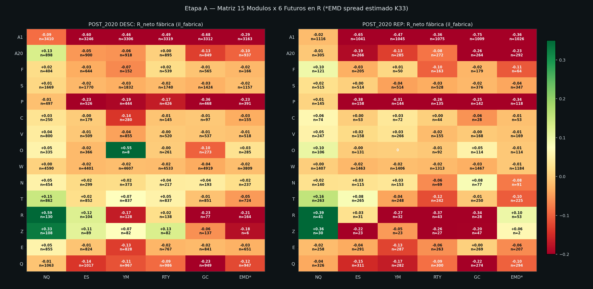
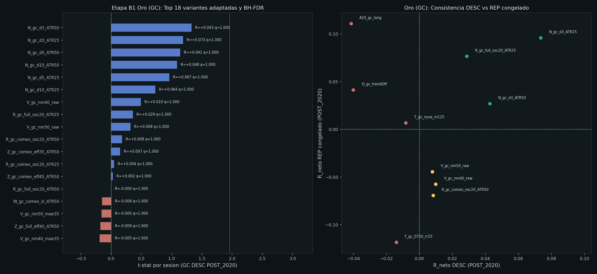
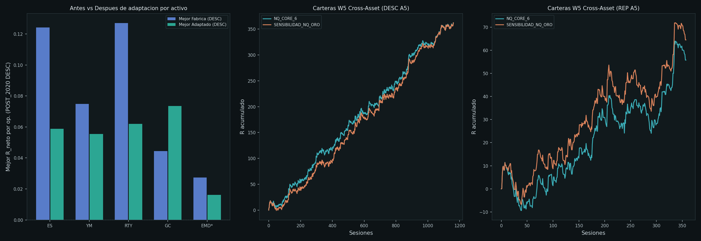

# Iteración 3 `FUNDEDSYNC`: Portabilidad Multi-Activo y Adaptación Estructural para Oro (`GC`) e Índices (`ES`, `YM`, `RTY`, `EMD*`) (HOLDOUT-A4 / HOLDOUT-A5)

Estado: RESULTADO
Fecha: 2026-11-22
Familia / módulo: `FUNDEDSYNC`
North Star: `16a108dfce2671b7a7c502d7db3eccdb71aabdca1cd1bd6bb7ea0f847d66e345`
Pre-registro: [PREREGISTRO.md](file:///C:/Users/nicoc/.gemini/antigravity/scratch/EdgeLab-fundedsync/docs/research/fundedsync_multiactivo_oro_20261122/PREREGISTRO.md) (campaña `FUNDEDSYNC_MULTIACTIVO_ORO_20261122`, presupuesto `198` pruebas registrado en K51)
Script: [fundedsync_multiactivo_oro.py](file:///C:/Users/nicoc/.gemini/antigravity/scratch/EdgeLab-fundedsync/tools/fundedsync_multiactivo_oro.py) (`--workers 2`, caché en `data/fundedsync_post_il_20261122/`, fricción medida de `config/costos/costos_canonicos.json` para `NQ/MNQ, ES/MES, YM/MYM, RTY, GC/MGC` y spread estimado K33 declarado para `EMD*`; blindaje estricto `HOLDOUT-A4 < 2026-10-01` y `HOLDOUT-A5` `DESC` vs `REP` congelado; `HOLDOUT`, `EMBARGO` y `TERMINAL` sin tocar)
Pruebas ejecutadas: `198` pre-registradas (`82` nuevas Etapa A + `60` Etapa B1 Oro `GC` + `48` Etapa B2 índices `ES/YM/RTY/EMD*` + `8` Etapa C cartera cross-asset `DESC → REP` y `LucidFlex`)

> **Criterio de evaluación y costos (K33):** En sintonía con Iteración 1–2, el análisis prioriza `POST_2020` (`2020-01 → 2026-09`, `46` meses `DESC` / `14` meses `REP`) sin exigir ganancia previa a 2020, reportando en paralelo `FULL_2008` (`2008 → 2026-09`) y `POST_2021` con total transparencia. **`EMD*` utiliza spread estimado (`0,4378 pts` RT)** permitido por K33, por lo que siempre se informa separado y queda excluido de toda cartera operable. **`RTY` carece de costo medido para `M2K`** y tampoco entra en la simulación de micros reales `LucidFlex` (`MNQ/MES/MYM/MGC`).

---

## 1. Resumen Ejecutivo y Respuesta Directa

1. **¿Qué estrategias de `FUNDEDSYNCSTACK` (`il_fabrica`) funcionan en varios activos y cuáles no?**
   - **`MULTI_ACTIVO` (`3` de `15`):** solo **`N` (`NQ, ES, YM, GC`)**, **`T` (`NQ, ES`)** y **`R` (`NQ, ES`)** logran expectativa neta `R_neto_mini > 0` con fricción `<= 0,12 R` tanto en `DESC` como en `REP` congelado `POST_2020` en más de un activo con costo medido. Aun así, fuera de `NQ`, las tres muestran potencia débil en el bloque reciente (`t_ses <= 0,95` por activo aislado).
   - **`ESPECIFICO_NQ` (`7` de `15`):** **`F, S, C, V, O, W, Z`** funcionan positivamente en `NQ` (`DESC` y `REP POST_2020`), pero no sostienen consistencia conjunta `DESC + REP` en otros activos (`Z` apunta positivo en `DESC` de `ES +0,1140`, `YM +0,0748` y `RTY +0,1270`, pero gira negativo en los tres `REP`: `-0,2212`, `-0,0515`, `-0,2576`; `V` y `W` pierden en `DESC` fuera de `NQ`; `O` en `YM` solo dispara `n=8` trades en `DESC` y `0` en `REP`).
   - **`SIN_VENTAJA_BASE` (`5` de `15`):** **`A1, A20, P, E, Q`** (`A1`, `P` y `Q` pierden prácticamente en los `6` futuros; `A20` y `E` solo dan positivo en `NQ DESC` pero fallan en `NQ REP` y en los `5` activos externos).
   - **`ORO_NATIVO` (`0` de `15`):** ningún módulo nace siendo robusto en Oro.

2. **¿Alguna estrategia funciona en Oro (`GC`) de fábrica o tras adaptar horarios, escala `ATR20` y reglas?**
   - **De fábrica:** casi toda la pila falla en `GC` (`A1 -0,6761 R`, `P -0,3572 R`, `Q -0,2328 R`, `R -0,2292 R`, `A20 -0,1294 R`, `O -0,0998 R`, `Z -0,0599 R`, `W -0,0356 R`, `S -0,0285 R`, `E -0,0214 R`, `T -0,0124 R` en `DESC POST_2020`). La única excepción nominal es **`N`**, con `+0,0444 R` (`t=+0,93`, `n=193`) en `DESC` y `+0,0839 R` (`n=77`) en `REP` (`+0,0820 / +0,1420 R` con overlay `0,25 ATR`), pero negativa en `FULL_2008` (`-0,0321 R`) y sin significancia estadística.
   - **Tras adaptar estructuralmente (`60` variantes en `5` grillas, Etapa B1):** **la hipótesis de rescate en Oro queda formalmente REFUTADA (`0 / 60` variantes pasan `p_perm < 0,05` o `q_bh < 0,10` con `B=5.000` y `N_eff=12,17`).** Cambiar horarios a COMEX (`08:20/08:30–13:30/16:00 ET`) o Londres (`03:00 ET`), adaptar escalas a `GC ATR20 = 27,01 pts`, reescalar `V/E/C` o probar simetrías en `A20/S/O/Q` no genera un edge robusto (`GC_ORB_TREND` `14/14` negativas; `GC_DIR_QASO` `8/8` negativas en `DESC`). La mejor variante relativa es **`N_gc_d3_ATR50`** (`+0,0427 R`, `t=1,33`, `p_perm=0,0818`, `q_bh=1,000`, `DSR=0,3625`), seguida de `N_gc_d3_ATR25` (`+0,0735 R`, `t=1,19`, `p_perm=0,1136`): ambas conservan signo en `REP POST_2020` (`+0,0268` y `+0,0958 R`), **pero** son negativas en `FULL_2008` (`-0,0296` y `-0,0596 R`) y K56 revela que `N_gc_d3_ATR25` cae a **`-0,010`** al excluir solo los 3 mejores meses alcistas del oro (`2022-03, 2023-10, 2023-03`).

3. **¿La adaptación por escala (`ATR20`) rescata portabilidad en los demás índices (`ES, YM, RTY, EMD*`)?**
   - **No (`0 / 48` variantes pasan `p_perm < 0,05` o `q_bh < 0,10`):** quitar el tope fijo `100 pts` de `T` y ajustar `stop_orb_multiplier=1,0` sube `ES__T_scaled_100` respecto a fábrica (`+0,0194 → +0,0549 R`, `p_perm=0,0952`), pero en `YM` (`+0,0554 R`, `p=0,0920`) y `RTY` (`+0,0493 R`, `p=0,0868`) no supera a fábrica ni pasa FDR (`q_bh >= 0,557`). Suavizar `R` y `Z` degrada su calidad y `E` sin delay de 14m sigue perdiendo en todos los activos.

4. **Impacto en Cartera Operable y `LucidFlex`:**
   - Al retirar el lastre de `A20` respecto de Iteración 2, el núcleo limpio **`NQ_CORE_6`** logra en `W5_freq_dur_conc (R_const)` **`+7,874 R/mes` (`t=5,13`, `DD=-13,28 R`, `Calmar=7,11`, `mc_dd_p95=-33,62 R`)** en `DESC` y **`+3,980 R/mes` (`t=1,59`, `DD=-20,84 R`, `Calmar=2,29`, `worst_day=-4,39 R`, `78,6%` meses pos.)** en `REP`. En `LucidFlex` `50K R200` (`MNQ` real), salta a **`EV +\$1.208,9` (`50,0%` pasa)** y **`+\$577,5`** bajo contracción de media al `60%` en `REP` (vs `+\$784,5` / `+\$406,1` con `A20`).
   - En el ejercicio aislado de sensibilidad **`SENSIBILIDAD_NQ_ORO`** (`NQ_CORE_6 + N_gc_d3_ATR50::GC`, marcada **fuera del filtro pre-registrado**), el oro aporta casi nula correlación diaria (`ρ = +0,070` con `NQ_CORE_6`), pero en `DESC` empeora el DD de `W5 (R_const)` (`-13,28 → -18,85 R`, `Calmar 7,11 → 5,01`) y su stream `GC` no supera control múltiple; por rigor científico, **no se promueve a producción**.

---

## 2. Etapa A — Matriz Base `15 × 6` (`il_fabrica`) y Núcleo Iter 1/2 en `GC`

Archivo completo: [etapa_a_matriz_base_15x6.csv](file:///C:/Users/nicoc/.gemini/antigravity/scratch/EdgeLab-fundedsync/docs/research/fundedsync_multiactivo_oro_20261122/etapa_a_matriz_base_15x6.csv).

### 2.1 Expectativa neta `R_neto_mini` por módulo y futuro (`*EMD` con spread estimado K33 aparte)

| Módulo | Clasificación `POST_2020` | `NQ` (`DESC`/`REP`) | `ES` (`DESC`/`REP`) | `YM` (`DESC`/`REP`) | `RTY` (`DESC`/`REP`) | `GC` (`DESC`/`REP`) | `EMD*` (`DESC`/`REP`) | `FULL_2008 DESC` (`NQ / ES / YM / RTY / GC / EMD*`) |
|---|---|---:|---:|---:|---:|---:|---:|---|
| `A1` | `SIN_VENTAJA_BASE` | -0,0900 / -0,0176 | -0,6018 / -0,6492 | -0,4591 / -0,4709 | -0,4918 / -0,3563 | -0,6761 / -0,7454 | -0,2865 / -0,3587 | -0,9467 / -1,2001 / -0,9021 / -0,6007 / -1,0161 / -0,6724 |
| `A20` | `SIN_VENTAJA_BASE` | +0,1292 / -0,0051 | -0,0533 / -0,1866 | -0,0582 / -0,1293 | +0,0032 / -0,0824 | -0,1294 / -0,2629 | -0,0974 / -0,2344 | -0,1226 / -0,2068 / -0,1114 / -0,0133 / -0,1581 / -0,0844 |
| `F` | `ESPECIFICO_NQ` | +0,0180 / +0,0969 | -0,0337 / -0,0324 | -0,0664 / +0,0112 | +0,0179 / -0,0996 | -0,0109 / -0,0245 | -0,0222 / -0,1069 | -0,0371 / -0,0926 / -0,0665 / +0,0032 / -0,0885 / -0,0153 |
| `S` | `ESPECIFICO_NQ` | +0,0107 / +0,0214 | -0,0218 / +0,0037 | -0,0305 / -0,0434 | -0,0199 / -0,0330 | -0,0285 / -0,0231 | -0,0162 / -0,0397 | -0,0460 / -0,0705 / -0,0556 / -0,0270 / -0,0592 / -0,0428 |
| `P` | `SIN_VENTAJA_BASE` | -0,0131 / +0,0073 | -0,2340 / -0,3833 | -0,1894 / -0,3147 | -0,1663 / -0,2591 | -0,3572 / -0,2534 | -0,2324 / -0,3402 | -0,3308 / -0,3703 / -0,3830 / -0,2504 / -0,3439 / -0,3116 |
| `C` | `ESPECIFICO_NQ` | +0,0283 / +0,0616 | -0,0019 / +0,0002 | -0,1383 / +0,0345 | -0,0106 / +0,0036 | -0,0060 / -0,0574 | -0,0338 / -0,0142 | +0,0096 / +0,0071 / -0,0733 / -0,0072 / -0,0091 / -0,0135 |
| `V` | `ESPECIFICO_NQ` | +0,0407 / +0,0525 | -0,0066 / +0,0157 | -0,0447 / +0,0293 | -0,0043 / -0,0181 | -0,0080 / -0,0032 | -0,0125 / -0,0100 | +0,0215 / -0,0048 / -0,0362 / -0,0052 / -0,0054 / -0,0057 |
| `O` | `ESPECIFICO_NQ` | +0,0545 / +0,1033 | -0,0199 / -0,0002 | +0,5513 (`n=8`) / — (`n=0`) | -0,0002 / -0,0057 | -0,0998 / +0,0531 | +0,0274 / -0,0052 | +0,0278 / -0,0440 / -0,0604 / +0,0193 / -0,0960 / -0,0151 |
| `W` | `ESPECIFICO_NQ` | +0,0042 / +0,0012 | -0,0209 / -0,0238 | -0,0156 / -0,0164 | -0,0176 / -0,0199 | -0,0356 / -0,0304 | -0,0169 / -0,0053 | -0,0376 / -0,0615 / -0,0426 / -0,0245 / -0,0589 / -0,0380 |
| **`N`** | **`MULTI_ACTIVO`** | **+0,0523 / +0,0242** | **+0,0166 / +0,0273** | **+0,0171 / +0,0327** | +0,0416 / -0,0641 | **+0,0444 / +0,0839** | +0,0204 / -0,0796 | +0,0104 / -0,0125 / -0,0167 / +0,0017 / -0,0321 / -0,0320 |
| **`T`** | **`MULTI_ACTIVO`** | **+0,1459 / +0,1561** | **+0,0194 / +0,0845** | +0,0736 / -0,0414 | +0,0532 / -0,1174 | -0,0124 / -0,0057 | -0,0516 / -0,1036 | +0,0368 / -0,0919 / -0,0562 / +0,0473 / -0,0732 / -0,0288 |
| **`R`** | **`MULTI_ACTIVO`** | **+0,5923 / +0,3907** | **+0,1243 / +0,0253** | -0,1677 / -0,2711 | +0,0192 / -0,3687 | -0,2292 / -0,3389 | -0,2123 / +0,0990 | +0,3060 / +0,2126 / -0,0615 / +0,0459 / -0,0323 / -0,0817 |
| `Z` | `ESPECIFICO_NQ` | +0,3267 / +0,3576 | +0,1140 / -0,2212 | +0,0748 / -0,0515 | +0,1270 / -0,2576 | -0,0599 / -0,1959 | -0,1822 (`n=6`) / +0,0636 | +0,0649 / -0,0060 / -0,0400 / +0,1272 / -0,0977 / +0,0019 |
| `E` | `SIN_VENTAJA_BASE` | +0,0540 / -0,0189 | -0,0106 / -0,0359 | -0,1324 / -0,1265 | -0,0249 / -0,0599 | -0,0214 / +0,0032 | -0,0291 / -0,0632 | -0,0094 / -0,0213 / -0,1308 / -0,0220 / -0,0179 / -0,0186 |
| `Q` | `SIN_VENTAJA_BASE` | -0,0094 / -0,0382 | -0,1398 / -0,1521 | -0,1122 / -0,1669 | -0,0919 / -0,0871 | -0,2328 / -0,2209 | -0,1215 / -0,1003 | -0,1912 / -0,2574 / -0,2182 / -0,1319 / -0,3008 / -0,1982 |

> **Fricciones y artefactos estructurales:** En `A1` (`fricR 0,17–0,50 R`) y `Q` (`0,05–0,19 R`) la fricción devora el trade; en `YM` el módulo `O` casi no dispara post-2020 (`n=8` en `DESC`, `n=0` en `REP`; en `FULL_2008` arroja `n=535`, `-0,0604 R`, `t=-2,18`), por lo que no se clasifica como portable.

### 2.2 Las `7` variantes validadas de Iter 1/2 evaluadas directo sobre Oro `GC` (`POST_2020`, sin adaptar)

| Variante `NQ` en `GC` | Partición | `n` | `R_neto_mini` | `R_neto_micro` (`MGC`) | `R/mes` | `t_ses` | `med_fric_R` | `DD_R` | `Calmar` |
|---|---|---:|---:|---:|---:|---:|---:|---:|---:|
| `W_eod_slope_ATR25_nq` | `DESC` / `REP` | 249 / 76 | +0,1753 / -0,0696 | +0,1639 / -0,0810 | +0,949 / -0,378 | +1,96 / -0,51 | 0,0800 / 0,0828 | -15,73 / -13,38 | 0,72 / -0,34 |
| `N_fab_maeATR25_nq` | `DESC` / `REP` | 193 / 77 | +0,0820 / +0,1420 | +0,0706 / +0,1300 | +0,344 / +0,781 | +0,91 / +0,86 | 0,0792 / 0,0952 | -15,56 / -10,59 | 0,27 / 0,89 |
| `R_maeATR50_nq` | `DESC` / `REP` | 77 / 28 | +0,0189 / -0,2178 | +0,0133 / -0,2238 | +0,032 / -0,436 | +0,23 / -2,21 | 0,0369 / 0,0476 | -7,49 / -6,46 | 0,05 / -0,81 |
| `Z_maeATR50_nq` | `DESC` / `REP` | 137 / 47 | -0,0278 / -0,0187 | -0,0334 / -0,0239 | -0,083 / -0,063 | -0,57 / -0,30 | 0,0401 / 0,0413 | -11,35 / -2,06 | -0,09 / -0,37 |
| `T_stop100_nq` | `DESC` / `REP` | 851 / 250 | -0,0393 / +0,0424 | -0,0552 / +0,0264 | -0,727 / +0,757 | -0,93 / +0,53 | 0,1043 / 0,1034 | -58,88 / -24,12 | -0,15 / 0,38 |
| `R_maeATR25_nq` | `DESC` / `REP` | 77 / 28 | -0,2292 / -0,3389 | -0,2406 / -0,3511 | -0,384 / -0,678 | -1,89 / -2,10 | 0,0738 / 0,0951 | -18,90 / -10,39 | -0,24 / -0,78 |
| `V_nm30_maeATR30_nq` | `DESC` / `REP` | 712 / 218 | -0,0778 / -0,0290 | -0,0867 / -0,0387 | -1,204 / -0,452 | -2,95 / -0,57 | 0,0633 / 0,0723 | -57,36 / -16,01 | -0,25 / -0,34 |

---

## 3. Etapa B1 — Adaptación Estructural para Oro (`GC`, `60` variantes, `B=5.000`, `N_eff = 12,17`)

Archivo completo: [etapa_b1_oro_gc_adaptacion.csv](file:///C:/Users/nicoc/.gemini/antigravity/scratch/EdgeLab-fundedsync/docs/research/fundedsync_multiactivo_oro_20261122/etapa_b1_oro_gc_adaptacion.csv).

### 3.1 Top 20 en `GC DESC POST_2020` (`0 / 60` superan `p_perm < 0,05` o `q_bh < 0,10`)

| Grilla | Mód. | Variante `GC` | `n` (`2008`) | `R_neto` `2008` | `n` (`2020`) | `R_neto` `2020` (`MGC`) | `R/mes` `2020` | `t_ses` `2020` | `DD_R` | `Calmar` | `p_perm` | `q_bh` | `p_maxT` | `DSR` | `pasa_desc` |
|---|---|---|---:|---:|---:|---:|---:|---:|---:|---:|---:|---:|---:|---:|:---:|
| `GC_VWAP_NDAY` | `N` | `N_gc_d3_ATR50` | 929 | -0,0296 | 339 | +0,0427 (+0,0368) | +0,314 | +1,33 | -9,50 | 0,40 | 0,0818 | 1,0000 | 0,8982 | 0,3625 | No |
| `GC_VWAP_NDAY` | `N` | `N_gc_d3_ATR25` | 929 | -0,0596 | 339 | +0,0735 (+0,0618) | +0,541 | +1,19 | -17,96 | 0,36 | 0,1136 | 1,0000 | 0,9432 | 0,3065 | No |
| `GC_VWAP_NDAY` | `N` | `N_gc_d5_ATR50` | 759 | -0,0277 | 274 | +0,0407 (+0,0348) | +0,243 | +1,14 | -8,83 | 0,33 | 0,1202 | 1,0000 | 0,9536 | 0,2897 | No |
| `GC_VWAP_NDAY` | `N` | `N_gc_d10_ATR50` | 585 | -0,0302 | 199 | +0,0483 (+0,0421) | +0,209 | +1,09 | -7,95 | 0,32 | 0,1334 | 1,0000 | 0,9640 | 0,2698 | No |
| `GC_VWAP_NDAY` | `N` | `N_gc_d5_ATR25` | 759 | -0,0557 | 274 | +0,0665 (+0,0546) | +0,396 | +0,96 | -18,62 | 0,26 | 0,1660 | 1,0000 | 0,9780 | 0,2299 | No |
| `GC_VWAP_NDAY` | `N` | `N_gc_d10_ATR25` | 585 | -0,0677 | 199 | +0,0636 (+0,0512) | +0,275 | +0,73 | -18,82 | 0,18 | 0,2340 | 1,0000 | 0,9946 | 0,1645 | No |
| `GC_SCALE_VCE` | `V` | `V_gc_nm40_raw` | 1552 | -0,0126 | 745 | +0,0099 (+0,0041) | +0,160 | +0,49 | -18,33 | 0,10 | 0,3175 | 1,0000 | 0,9988 | 0,1163 | No |
| `GC_ATR_ZETA` | `R` | `R_gc_full_osc20_ATR25` | 881 | -0,0681 | 342 | +0,0287 (+0,0171) | +0,213 | +0,36 | -21,19 | 0,12 | 0,3595 | 1,0000 | 0,9998 | 0,0911 | No |
| `GC_SCALE_VCE` | `V` | `V_gc_nm50_raw` | 1167 | -0,0076 | 575 | +0,0079 (+0,0021) | +0,098 | +0,32 | -15,02 | 0,08 | 0,3875 | 1,0000 | 0,9998 | 0,0876 | No |
| `GC_ATR_ZETA` | `R` | `R_gc_comex_osc20_ATR50` | 741 | -0,0432 | 276 | +0,0084 (+0,0026) | +0,051 | +0,18 | -11,71 | 0,05 | 0,4283 | 1,0000 | 1,0000 | 0,0667 | No |
| `GC_ATR_ZETA` | `Z` | `Z_gc_comex_eff35_ATR50` | 423 | -0,0444 | 165 | +0,0067 (+0,0011) | +0,024 | +0,15 | -7,53 | 0,04 | 0,4495 | 1,0000 | 1,0000 | 0,0643 | No |
| `GC_ATR_ZETA` | `R` | `R_gc_comex_osc20_ATR25` | 741 | -0,0439 | 276 | +0,0041 (-0,0076) | +0,025 | +0,05 | -21,85 | 0,01 | 0,4847 | 1,0000 | 1,0000 | 0,0520 | No |
| `GC_ATR_ZETA` | `Z` | `Z_gc_comex_eff45_ATR50` | 358 | -0,0620 | 143 | +0,0017 (-0,0038) | +0,005 | +0,03 | -7,10 | 0,01 | 0,4941 | 1,0000 | 1,0000 | 0,0509 | No |
| `GC_ATR_ZETA` | `R` | `R_gc_full_osc20_ATR50` | 881 | -0,0723 | 342 | -0,0001 (-0,0058) | -0,000 | -0,00 | -11,85 | -0,00 | 0,4895 | 1,0000 | 1,0000 | 0,0472 | No |
| `GC_VWAP_NDAY` | `W` | `W_gc_comex_sl_ATR50` | 681 | -0,0371 | 270 | -0,0079 (-0,0137) | -0,046 | -0,15 | -13,77 | -0,04 | 0,5481 | 1,0000 | 1,0000 | 0,0345 | No |
| `GC_SCALE_VCE` | `V` | `V_gc_nm50_mae35` | 1167 | -0,0382 | 575 | -0,0048 (-0,0128) | -0,060 | -0,16 | -19,81 | -0,04 | 0,5615 | 1,0000 | 1,0000 | 0,0341 | No |
| `GC_ATR_ZETA` | `Z` | `Z_gc_full_eff40_ATR50` | 251 | -0,0464 | 116 | -0,0094 (-0,0151) | -0,024 | -0,18 | -5,59 | -0,05 | 0,5665 | 1,0000 | 1,0000 | 0,0312 | No |
| `GC_SCALE_VCE` | `V` | `V_gc_nm40_mae35` | 1552 | -0,0442 | 745 | -0,0049 (-0,0130) | -0,080 | -0,19 | -27,89 | -0,03 | 0,5811 | 1,0000 | 1,0000 | 0,0316 | No |
| `GC_ORB_TREND` | `T` | `T_gc_nyse_m125` | 1903 | -0,0865 | 861 | -0,0082 (-0,0213) | -0,154 | -0,21 | -41,55 | -0,04 | 0,5871 | 1,0000 | 1,0000 | 0,0302 | No |
| `GC_ATR_ZETA` | `R` | `R_gc_full_osc30_ATR50` | 293 | +0,0031 | 108 | -0,0180 (-0,0237) | -0,042 | -0,21 | -9,44 | -0,05 | 0,5727 | 1,0000 | 1,0000 | 0,0308 | No |

*Resumen por familia fuera del Top 20 (`DESC POST_2020`):* en `GC_ORB_TREND`, las `14` variantes (`T` COMEX `13:30/16:00 ET`, `T` NYSE, `T` Londres `03:00 ET` con `-0,2078 / -0,2177 R` y `F` `07:20/07:30 CT`) fueron negativas; en `GC_DIR_QASO`, las `8` variantes (`A20 long/short/both`, `O`, `S`, `Q`) fueron negativas (`Q -0,2204 / -0,2448 R` con `fricR=0,1952`; `S -0,0390`; `O -0,0400 / -0,0753`; `A20_long -0,0413`); en `GC_SCALE_VCE`, `E` (`-0,0923` a `-0,2118 R`) y `C` (`-0,0433` a `-0,0507 R`) tampoco funcionaron; y en `GC_VWAP_NDAY`, las `6` variantes de `W` fueron todas negativas (`-0,0079` a `-0,0820 R`).

### 3.2 Diagnósticos de grilla y episodios verbatim K55 / K56 (Oro `GC`)

Pegado literal desde [diagnostico_grillas_multiactivo.json](file:///C:/Users/nicoc/.gemini/antigravity/scratch/EdgeLab-fundedsync/docs/research/fundedsync_multiactivo_oro_20261122/diagnostico_grillas_multiactivo.json):

- **`GC_ORB_TREND` (`FULL_2008 DESC`, mejor `T_gc_nyse_m125`):**
  - `Diagnóstico de grilla: 14 variantes; operaciones por celda 1534/1852/1903 (mín/mediana/máx); 0 celdas casi vacías (< 278 op.); número efectivo de variantes 3.66; perillas inertes: ninguna; Spearman(operaciones, R) 0.374.`
  - `Episodios: media -0.086 (n 1903); sin los 3 peores meses -0.069; sin los 3 mejores -0.102; peores {'2017-12': -12.57, '2018-10': -12.55, '2018-06': -12.52}; mejores {'2025-11': 7.76, '2013-12': 7.82, '2023-03': 8.54}.`
- **`GC_ORB_TREND` (`POST_2020 DESC`, mejor `T_gc_nyse_m125`):**
  - `Diagnóstico de grilla: 14 variantes; operaciones por celda 487/849/861 (mín/mediana/máx); 0 celdas casi vacías (< 127 op.); número efectivo de variantes 3.62; perillas inertes: ninguna; Spearman(operaciones, R) -0.123.`
  - `Episodios: media -0.008 (n 861); sin los 3 peores meses +0.020; sin los 3 mejores -0.038; peores {'2021-09': -8.14, '2023-08': -8.13, '2021-06': -6.55}; mejores {'2024-01': 7.41, '2025-11': 7.76, '2023-03': 8.54}.`
- **`GC_ATR_ZETA` (`FULL_2008 DESC`, mejor `R_gc_comex_osc30_ATR25`):**
  - `Diagnóstico de grilla: 14 variantes; operaciones por celda 251/358/881 (mín/mediana/máx); 0 celdas casi vacías (< 54 op.); número efectivo de variantes 4.15; perillas inertes: ninguna; Spearman(operaciones, R) -0.221.`
  - `Episodios: media +0.090 (n 268); sin los 3 peores meses +0.140; sin los 3 mejores -0.002; peores {'2023-05': -3.99, '2008-11': -3.73, '2026-07': -3.54}; mejores {'2023-03': 7.2, '2014-06': 8.15, '2016-10': 9.51}.`
- **`GC_ATR_ZETA` (`POST_2020 DESC`, mejor `R_gc_full_osc20_ATR25`):**
  - `Diagnóstico de grilla: 14 variantes; operaciones por celda 97/143/342 (mín/mediana/máx); 0 celdas casi vacías (< 30 op.); número efectivo de variantes 3.39; perillas inertes: ninguna; Spearman(operaciones, R) 0.647.`
  - `Episodios: media +0.029 (n 342); sin los 3 peores meses +0.090; sin los 3 mejores -0.048; peores {'2025-06': -7.84, '2022-05': -5.94, '2023-08': -4.66}; mejores {'2024-12': 7.73, '2021-11': 8.23, '2022-11': 9.23}.`
- **`GC_VWAP_NDAY` (`FULL_2008 DESC`, mejor `N_gc_d5_ATR50`):**
  - `Diagnóstico de grilla: 12 variantes; operaciones por celda 585/759/1301 (mín/mediana/máx); 0 celdas casi vacías (< 114 op.); número efectivo de variantes 3.11; perillas inertes: ninguna; Spearman(operaciones, R) -0.279.`
  - `Episodios: media -0.028 (n 759); sin los 3 peores meses -0.014; sin los 3 mejores -0.046; peores {'2018-12': -4.39, '2011-07': -3.23, '2010-08': -3.09}; mejores {'2008-09': 4.01, '2022-03': 4.05, '2014-06': 5.41}.`
- **`GC_VWAP_NDAY` (`POST_2020 DESC`, mejor `N_gc_d3_ATR25`):**
  - `Diagnóstico de grilla: 12 variantes; operaciones por celda 199/274/484 (mín/mediana/máx); 0 celdas casi vacías (< 41 op.); número efectivo de variantes 3.12; perillas inertes: ninguna; Spearman(operaciones, R) -0.272.`
  - `Episodios: media +0.073 (n 339); sin los 3 peores meses +0.131; sin los 3 mejores -0.010; peores {'2020-01': -7.88, '2024-02': -4.31, '2023-09': -4.06}; mejores {'2022-03': 7.39, '2023-10': 9.25, '2023-03': 11.29}.`
- **`GC_SCALE_VCE` (`FULL_2008 DESC`, mejor `V_gc_nm50_raw`):**
  - `Diagnóstico de grilla: 12 variantes; operaciones por celda 495/1811/2375 (mín/mediana/máx); 0 celdas casi vacías (< 272 op.); número efectivo de variantes 3.38; perillas inertes: ninguna; Spearman(operaciones, R) -0.44.`
  - `Episodios: media -0.008 (n 1167); sin los 3 peores meses -0.000; sin los 3 mejores -0.024; peores {'2026-02': -3.65, '2025-02': -2.65, '2019-10': -2.37}; mejores {'2026-05': 3.67, '2020-03': 5.87, '2026-03': 8.57}.`
- **`GC_SCALE_VCE` (`POST_2020 DESC`, mejor `V_gc_nm40_raw`):**
  - `Diagnóstico de grilla: 12 variantes; operaciones por celda 206/802/949 (mín/mediana/máx); 0 celdas casi vacías (< 120 op.); número efectivo de variantes 3.24; perillas inertes: ninguna; Spearman(operaciones, R) -0.311.`
  - `Episodios: media +0.010 (n 745); sin los 3 peores meses +0.020; sin los 3 mejores -0.022; peores {'2022-05': -2.42, '2021-09': -2.38, '2024-11': -2.16}; mejores {'2020-03': 5.25, '2026-05': 7.33, '2026-03': 9.82}.`
- **`GC_DIR_QASO` (`FULL_2008 DESC`, mejor `O_gc_trendOff`):**
  - `Diagnóstico de grilla: 8 variantes; operaciones por celda 687/2579/3905 (mín/mediana/máx); 0 celdas casi vacías (< 387 op.); número efectivo de variantes 5.0; perillas inertes: ninguna; Spearman(operaciones, R) -0.262.`
  - `Episodios: media -0.057 (n 903); sin los 3 peores meses -0.042; sin los 3 mejores -0.077; peores {'2017-01': -5.41, '2013-08': -4.98, '2011-06': -4.76}; mejores {'2022-02': 4.63, '2016-06': 5.1, '2019-06': 5.99}.`
- **`GC_DIR_QASO` (`POST_2020 DESC`, mejor `S_gc_comex_stAlign`):**
  - `Diagnóstico de grilla: 8 variantes; operaciones por celda 273/938/1353 (mín/mediana/máx); 0 celdas casi vacías (< 141 op.); número efectivo de variantes 4.78; perillas inertes: ninguna; Spearman(operaciones, R) -0.048.`
  - `Episodios: media -0.039 (n 1353); sin los 3 peores meses -0.029; sin los 3 mejores -0.050; peores {'2023-07': -6.01, '2020-01': -5.67, '2020-08': -4.54}; mejores {'2021-01': 3.26, '2023-03': 3.28, '2020-10': 4.12}.`

### 3.3 Confirmación congelada en `GC REP` (Top 2 trazabilidad por familia, sin `pasa_desc=True`)

Archivo: [etapa_b_confirmacion_rep.csv](file:///C:/Users/nicoc/.gemini/antigravity/scratch/EdgeLab-fundedsync/docs/research/fundedsync_multiactivo_oro_20261122/etapa_b_confirmacion_rep.csv).

| Grilla | Variante `GC` | `POST_2020 DESC` (`n`, `R_neto`, `R/m`, `t`, `DD_R`) | `POST_2020 REP` (`n`, `R_neto` [`MGC`], `R/m`, `t`, `DD_R`, `Calmar`) | `FULL_2008 REP` (`n`, `R_neto`, `t`) | Lectura |
|---|---|---|---:|---:|---|
| `GC_VWAP_NDAY` | `N_gc_d3_ATR50` | 339, +0,0427, +0,314, +1,33, -9,50 | 134, +0,0268 (+0,0210), +0,256, +0,46, -6,59, 0,47 | 306, +0,0038, +0,11 | Único bloque positivo débil |
| `GC_VWAP_NDAY` | `N_gc_d3_ATR25` | 339, +0,0735, +0,541, +1,19, -17,96 | 134, +0,0958 (+0,0842), +0,917, +0,89, -12,34, 0,89 | 306, +0,0267, +0,39 | Sesgado a 3 meses alcistas (K56) |
| `GC_ATR_ZETA` | `R_gc_full_osc20_ATR25` | 342, +0,0287, +0,213, +0,36, -21,19 | 99, +0,0765 (+0,0646), +0,541, +0,51, -11,85, 0,55 | 249, +0,0685, +0,60 | Positivo débil, `t<0,6`, `q=1,0` |
| `GC_ATR_ZETA` | `R_gc_comex_osc20_ATR50` | 276, +0,0084, +0,051, +0,18, -11,71 | 85, -0,0693 (-0,0754), -0,421, -0,86, -8,79, -0,57 | 213, -0,0217, -0,42 | Gira negativo en `REP` |
| `GC_SCALE_VCE` | `V_gc_nm40_raw` | 745, +0,0099, +0,160, +0,49, -18,33 | 238, -0,0575 (-0,0633), -0,978, -1,84, -16,04, -0,73 | 460, -0,0509, -2,64 | Gira negativo en `REP` |
| `GC_SCALE_VCE` | `V_gc_nm50_raw` | 575, +0,0079, +0,098, +0,32, -15,02 | 166, -0,0445 (-0,0503), -0,528, -1,30, -8,30, -0,76 | 330, -0,0497, -2,27 | Gira negativo en `REP` |
| `GC_ORB_TREND` | `T_gc_nyse_m125` | 861, -0,0082, -0,154, -0,21, -41,55 | 256, +0,0067 (-0,0063), +0,123, +0,09, -20,68, 0,07 | 540, -0,0691, -1,35 | Negativo/neutro en micro `MGC` |
| `GC_ORB_TREND` | `F_gc_0720_rr25` | 487, -0,0139, -0,147, -0,26, -25,92 | 157, -0,1184 (-0,1318), -1,328, -1,31, -20,13, -0,79 | 442, -0,1160, -2,28 | Negativo en ambos |
| `GC_DIR_QASO` | `A20_gc_long` | 714, -0,0413, -0,641, -0,87, -54,76 | 219, +0,1107 (+0,0992), +1,732, +1,20, -10,94, 1,90 | 638, +0,0473, +0,86 | Negativo en `DESC` (`p=0,79`) |
| `GC_DIR_QASO` | `O_gc_trendOff` | 369, -0,0400, -0,321, -0,99, -20,54 | 131, +0,0412 (+0,0353), +0,386, +0,57, -7,22, 0,64 | 288, -0,0131, -0,29 | Negativo en `DESC` (`p=0,83`) |

---

## 4. Etapa B2 — Adaptación por Escala (`ATR20`) en Índices No-`NQ` (`48` variantes)

Archivo completo: [etapa_b2_indices_adaptacion.csv](file:///C:/Users/nicoc/.gemini/antigravity/scratch/EdgeLab-fundedsync/docs/research/fundedsync_multiactivo_oro_20261122/etapa_b2_indices_adaptacion.csv).

### 4.1 Top 16 global en `DESC POST_2020` (`0 / 48` pasan `p_perm < 0,05` o `q_bh < 0,10`)

| Activo | Mód. | Variante escalada | `n` (`2008`) | `R_neto` `2008` | `n` (`2020`) | `R_neto` `2020` (`micro`) | `R/mes` | `t_ses` `2020` | `DD_R` | `Calmar` | `p_perm` | `q_bh` | `p_maxT` | `DSR` |
|---|---|---|---:|---:|---:|---:|---:|---:|---:|---:|---:|---:|---:|---:|
| `RTY` | `T` | `RTY__T_scaled_125` | 1061 | +0,0442 | 837 | +0,0493 (—) | +0,897 | +1,40 | -13,51 | 0,80 | 0,0868 | 0,7974 | 0,5275 | 0,5054 |
| `YM` | `T` | `YM__T_scaled_100` | 1874 | -0,0662 | 837 | +0,0554 (+0,0343) | +1,009 | +1,37 | -35,07 | 0,35 | 0,0920 | 0,7421 | 0,5061 | 0,4890 |
| `ES` | `T` | `ES__T_scaled_100` | 1892 | -0,0888 | 852 | +0,0549 (+0,0324) | +1,017 | +1,22 | -22,95 | 0,53 | 0,0952 | 0,5570 | 0,5997 | 0,4410 |
| `RTY` | `C` | `RTY__C_scaled_long60` | 360 | +0,0272 | 268 | +0,0620 (—) | +0,361 | +1,04 | -11,85 | 0,37 | 0,1538 | 0,7974 | 0,7433 | 0,3651 |
| `ES` | `Z` | `ES__Z_eff35_ATR50` | 253 | +0,0021 | 92 | +0,0583 (+0,0495) | +0,117 | +1,00 | -4,03 | 0,35 | 0,1634 | 0,5570 | 0,7335 | 0,3616 |
| `ES` | `C` | `ES__C_scaled_long60` | 634 | +0,0207 | 296 | +0,0589 (+0,0432) | +0,379 | +0,95 | -13,33 | 0,34 | 0,1578 | 0,5570 | 0,7576 | 0,3400 |
| `YM` | `N` | `YM__N_scaled_ATR25` | 1021 | -0,0272 | 363 | +0,0419 (+0,0199) | +0,331 | +0,74 | -18,21 | 0,22 | 0,2002 | 0,7421 | 0,8524 | 0,2483 |
| `ES` | `V` | `ES__V_scaled_nm40` | 1398 | -0,0217 | 704 | +0,0185 (+0,0049) | +0,283 | +0,70 | -13,19 | 0,26 | 0,2386 | 0,5570 | 0,8728 | 0,2537 |
| `YM` | `Z` | `YM__Z_eff35_ATR50` | 237 | +0,0129 | 88 | +0,0435 (+0,0324) | +0,083 | +0,68 | -5,48 | 0,18 | 0,2474 | 0,7421 | 0,8744 | 0,2421 |
| `YM` | `T` | `YM__T_scaled_125` | 1874 | -0,0720 | 837 | +0,0245 (+0,0071) | +0,447 | +0,68 | -34,48 | 0,16 | 0,2424 | 0,7421 | 0,8754 | 0,2340 |
| `RTY` | `N` | `RTY__N_scaled_ATR25` | 448 | +0,0038 | 325 | +0,0434 (—) | +0,307 | +0,68 | -8,84 | 0,42 | 0,2563 | 0,7974 | 0,8980 | 0,2327 |
| `ES` | `V` | `ES__V_scaled_nm30` | 1879 | -0,0257 | 903 | +0,0143 (+0,0007) | +0,281 | +0,62 | -10,60 | 0,32 | 0,2663 | 0,5570 | 0,8998 | 0,2290 |
| `RTY` | `T` | `RTY__T_scaled_100` | 1061 | +0,0261 | 837 | +0,0196 (—) | +0,357 | +0,51 | -20,01 | 0,21 | 0,3073 | 0,7974 | 0,9406 | 0,1903 |
| `ES` | `T` | `ES__T_scaled_125` | 1892 | -0,0836 | 852 | +0,0196 (+0,0013) | +0,363 | +0,48 | -24,59 | 0,18 | 0,2995 | 0,5570 | 0,9342 | 0,1872 |
| `ES` | `R` | `ES__R_osc25_ATR35` | 526 | +0,0592 | 197 | +0,0391 (+0,0258) | +0,168 | +0,47 | -24,17 | 0,08 | 0,3249 | 0,5570 | 0,9390 | 0,1816 |
| `EMD*` *(K33)* | `N` | `EMD__N_scaled_ATR25` *(mejor EMD\*)* | 1025 | -0,0524 | 352 | +0,0161 (—) | +0,123 | +0,25 | -16,37 | 0,09 | 0,4067 | 0,9994 | 0,9738 | 0,1266 |

> **Comparativa antes vs después y causa:** Reescalar `C` (`offset 60`) mejora `ES` (`-0,0019 → +0,0589 R`) y `RTY` (`-0,0106 → +0,0620 R`), y ajustar `T` (`1,0×`) mejora `ES` (`+0,0194 → +0,0549 R`), pero ninguno supera el filtro estadístico múltiple. En `YM`, quitar el techo `100 pts` (`210,5 pts`) reduce `T_125` (`+0,0736 → +0,0245 R`) y `T_100` (`+0,0554 R`) respecto a Iter 2 (`T_stop100 +0,0891 R` con techo 100), mostrando que acotar días extremos ayudaba en `YM`. En `R` y `Z`, bajar los umbrales de selección (`osc 2,0/2,5`, `eff 35%`) diluyó su ventaja frente a fábrica (`ES R +0,1243 → +0,0391`, `ES Z +0,1140 → +0,0583`, `RTY Z +0,1270 → +0,0190`). En `EMD*` (K33 spread estimado aparte), `11/12` variantes fallan y `EMD__Z_eff35_ATR50` queda degenerada (`n=6` en `POST_2020`).

### 4.2 Diagnósticos de grilla y episodios verbatim K55 / K56 (Índices B2)

- **`IND_ES` (`FULL_2008 DESC`, mejor `ES__R_osc25_ATR35`):**
  - `Diagnóstico de grilla: 12 variantes; operaciones por celda 253/1336/2445 (mín/mediana/máx); 0 celdas casi vacías (< 200 op.); número efectivo de variantes 6.84; perillas inertes: ninguna; Spearman(operaciones, R) -0.704.`
  - `Episodios: media +0.059 (n 526); sin los 3 peores meses +0.090; sin los 3 mejores +0.026; peores {'2016-06': -5.78, '2021-11': -4.74, '2018-12': -4.19}; mejores {'2023-08': 4.73, '2025-02': 5.59, '2018-10': 7.62}.`
- **`IND_ES` (`POST_2020 DESC`, mejor `ES__C_scaled_long60`):**
  - `Diagnóstico de grilla: 12 variantes; operaciones por celda 92/590/903 (mín/mediana/máx); 0 celdas casi vacías (< 89 op.); número efectivo de variantes 6.69; perillas inertes: ninguna; Spearman(operaciones, R) -0.343.`
  - `Episodios: media +0.059 (n 296); sin los 3 peores meses +0.121; sin los 3 mejores -0.028; peores {'2025-06': -7.18, '2022-02': -4.21, '2021-03': -4.02}; mejores {'2025-08': 7.08, '2020-03': 8.56, '2022-03': 9.32}.`
- **`IND_YM` (`FULL_2008 DESC`, mejor `YM__Z_eff35_ATR50`):**
  - `Diagnóstico de grilla: 12 variantes; operaciones por celda 237/1364/2375 (mín/mediana/máx); 0 celdas casi vacías (< 205 op.); número efectivo de variantes 6.76; perillas inertes: ninguna; Spearman(operaciones, R) -0.452.`
  - `Episodios: media +0.013 (n 237); sin los 3 peores meses +0.039; sin los 3 mejores -0.011; peores {'2013-06': -2.19, '2016-05': -2.06, '2013-10': -1.67}; mejores {'2017-12': 1.43, '2017-05': 1.63, '2008-09': 2.49}.`
- **`IND_YM` (`POST_2020 DESC`, mejor `YM__T_scaled_100`):**
  - `Diagnóstico de grilla: 12 variantes; operaciones por celda 88/584/933 (mín/mediana/máx); 0 celdas casi vacías (< 88 op.); número efectivo de variantes 7.1; perillas inertes: ninguna; Spearman(operaciones, R) 0.098.`
  - `Episodios: media +0.055 (n 837); sin los 3 peores meses +0.102; sin los 3 mejores +0.010; peores {'2022-01': -12.88, '2026-03': -10.42, '2023-10': -9.71}; mejores {'2023-08': 9.82, '2020-06': 13.67, '2022-11': 14.81}.`
- **`IND_RTY` (`FULL_2008 DESC`, mejor `RTY__T_scaled_125`, `1` casi vacía `RTY__Z_eff35_ATR50`):**
  - `Diagnóstico de grilla: 12 variantes; operaciones por celda 106/723/1092 (mín/mediana/máx); 1 celdas casi vacías (< 108 op.); número efectivo de variantes 7.17; perillas inertes: ninguna; Spearman(operaciones, R) -0.474.`
  - `Episodios: media +0.044 (n 1061); sin los 3 peores meses +0.066; sin los 3 mejores +0.016; peores {'2025-06': -6.58, '2021-05': -6.46, '2022-07': -6.39}; mejores {'2020-01': 8.52, '2021-03': 9.33, '2025-03': 13.33}.`
- **`IND_RTY` (`POST_2020 DESC`, mejor `RTY__C_scaled_long60`):**
  - `Diagnóstico de grilla: 12 variantes; operaciones por celda 88/572/924 (mín/mediana/máx); 0 celdas casi vacías (< 86 op.); número efectivo de variantes 6.95; perillas inertes: ninguna; Spearman(operaciones, R) -0.34.`
  - `Episodios: media +0.062 (n 268); sin los 3 peores meses +0.106; sin los 3 mejores -0.003; peores {'2024-11': -3.54, '2023-09': -3.19, '2022-02': -2.9}; mejores {'2024-07': 4.28, '2023-05': 5.11, '2022-03': 7.85}.`
- **`IND_EMD` *(K33 spread estimado)* (`FULL_2008 DESC`, `1` casi vacía `EMD__Z_eff35_ATR50`):**
  - `Diagnóstico de grilla: 12 variantes; operaciones por celda 38/1200/1981 (mín/mediana/máx); 1 celdas casi vacías (< 180 op.); número efectivo de variantes 7.41; perillas inertes: ninguna; Spearman(operaciones, R) -0.581.`
  - `Episodios: media +0.033 (n 38); sin los 3 peores meses +0.126; sin los 3 mejores -0.048; peores {'2010-11': -1.07, '2013-10': -1.06, '2015-11': -1.05}; mejores {'2012-11': 0.84, '2018-10': 1.03, '2019-06': 1.06}.`
- **`IND_EMD` *(K33 spread estimado)* (`POST_2020 DESC`, `1` degenerada `EMD__Z_eff35_ATR50` con `n=6`):**
  - `Diagnóstico de grilla: 12 variantes; operaciones por celda 6/532/917 (mín/mediana/máx); 1 celdas casi vacías (< 80 op.); número efectivo de variantes 6.95; perillas inertes: ninguna; Spearman(operaciones, R) -0.124.`
  - `Episodios: media +0.016 (n 352); sin los 3 peores meses +0.066; sin los 3 mejores -0.074; peores {'2026-05': -5.27, '2024-05': -5.09, '2025-06': -4.86}; mejores {'2025-08': 6.29, '2024-07': 6.76, '2023-12': 16.71}.`

---

## 5. Etapa C — Cartera Cross-Asset y `LucidFlex` en Micros Reales (`MNQ`, `MGC`)

Archivos: [etapa_c_cartera_cross_asset.csv](file:///C:/Users/nicoc/.gemini/antigravity/scratch/EdgeLab-fundedsync/docs/research/fundedsync_multiactivo_oro_20261122/etapa_c_cartera_cross_asset.csv) y [etapa_c_correlacion_y_lucid.json](file:///C:/Users/nicoc/.gemini/antigravity/scratch/EdgeLab-fundedsync/docs/research/fundedsync_multiactivo_oro_20261122/etapa_c_correlacion_y_lucid.json).

### 5.1 Selección, correlación diaria (`DESC POST_2020`) y pesos (`DESC`)

- **Admisión estricta (`q_bh < 0,10` y `t_ses >= 1,80` en `DESC POST_2020`):** `0` streams en `ES/YM/RTY` (`NQ_PLUS_INDICES` vacía) y `0` streams en `GC` (`NQ_PLUS_ORO` vacía). Como diagnóstico aparte, se evaluó **`SENSIBILIDAD_NQ_ORO`** agregando el mejor candidato de Oro fuera de filtro (`N_gc_d3_ATR50::GC`, `q_bh=1,0`, `t_ses=1,33`). `RTY` quedó excluido de micros reales por no existir costo medido de `M2K`.
- **Correlación diaria `N_gc_d3_ATR50::GC` vs `NQ_CORE_6` (`DESC`):** `ρ_total = +0,070` (`-0,011` vs `R::NQ`, `-0,021` vs `Z::NQ`, `+0,052` vs `T::NQ`, `+0,092` vs `V::NQ`, `+0,077` vs `W::NQ`, `-0,017` vs `N::NQ`).
- **Pesos calculados estrictamente en `DESC` (`NQ_CORE_6`):**
  - `W3_ERC_cov_cap`: `R::NQ 1,9003`, `Z::NQ 1,9003`, `N::NQ 1,0855`, `V::NQ 1,0260`, `W::NQ 0,9419`, `T::NQ 0,7176`.
  - `W5_freq_dur_conc` *(+ tope causal 3,0 R)*: `Z::NQ 2,0399`, `R::NQ 1,7207`, `N::NQ 1,1595`, `V::NQ 1,1010`, `W::NQ 0,8402`, `T::NQ 0,7410` (en `SENSIBILIDAD_NQ_ORO`, `N_gc_d3_ATR50::GC` recibe peso `1,9342`).

### 5.2 Comparativa de carteras (`DESC 46m` vs `REP 14m congelado`)

| Cartera *(sensibilidad?)* | Esquema | Sizing | Partición A5 | `max_open_R` | `R/mes` | `t_ses` | Sharpe anual | `DD_R` | `Calmar` | `worst_day_R` | `% mes > 0` | `mc_dd_p95` | `mc_dd_p99` |
|---|---|---|---|---:|---:|---:|---:|---:|---:|---:|---:|---:|---:|
| `NQ_CORE_6` | `W0_equal_1R` | `R_const` | `DESC` | 5,00 | +8,189 | 4,78 | 2,23 | -18,32 | 5,36 | -5,67 | 76,1 | -39,02 | -48,64 |
| `NQ_CORE_6` | `W0_equal_1R` | `R_const` | `REP` | 5,00 | +4,031 | 1,44 | 1,20 | -20,47 | 2,36 | -4,48 | 71,4 | -46,16 | -59,86 |
| `NQ_CORE_6` | `W3_ERC_cov_cap` | `R_const` | `DESC` | 5,67 | +8,812 | 5,14 | 2,40 | -17,22 | 6,14 | -7,22 | 80,4 | -36,99 | -45,48 |
| `NQ_CORE_6` | `W3_ERC_cov_cap` | `R_const` | `REP` | 5,67 | +4,389 | 1,61 | 1,35 | -21,08 | 2,50 | -5,00 | 85,7 | -42,63 | -54,83 |
| `NQ_CORE_6` | `W3_ERC_cov_cap` | `fijo_micro` | `DESC` | 10,47 | +8,659 | 5,41 | 2,52 | -14,67 | 7,08 | -8,07 | 82,6 | -34,29 | -42,02 |
| `NQ_CORE_6` | `W3_ERC_cov_cap` | `fijo_micro` | `REP` | 10,90 | +5,567 | 1,63 | 1,37 | -24,36 | 2,74 | -6,13 | 64,3 | -45,92 | -59,28 |
| **`NQ_CORE_6`** | **`W5_freq_dur_conc`** | **`R_const`** | **`DESC`** | **3,00** | **+7,874** | **5,13** | **2,39** | **-13,28** | **7,11** | **-5,58** | **84,8** | **-33,62** | **-41,58** |
| **`NQ_CORE_6`** | **`W5_freq_dur_conc`** | **`R_const`** | **`REP`** | **3,00** | **+3,980** | **1,59** | **1,33** | **-20,84** | **2,29** | **-4,39** | **78,6** | **-40,83** | **-53,08** |
| `NQ_CORE_6` | `W5_freq_dur_conc` | `fijo_micro` | `DESC` | 3,00 | +7,552 | 5,29 | 2,46 | -13,46 | 6,73 | -6,37 | 82,6 | -31,45 | -38,87 |
| `NQ_CORE_6` | `W5_freq_dur_conc` | `fijo_micro` | `REP` | 3,00 | +3,724 | 1,45 | 1,22 | -22,01 | 2,03 | -3,29 | 71,4 | -43,38 | -55,62 |
| `SENSIB_NQ_ORO` *(fuera filtro)* | `W0_equal_1R` | `R_const` | `DESC` / `REP` | 6,00 | +8,504 / +4,287 | 4,87 / 1,48 | 2,27 / 1,24 | -18,53 / -20,91 | 5,51 / 2,46 | -5,67 / -4,01 | 78,3 / 71,4 | -39,65 / -47,39 | -49,87 / -60,24 |
| `SENSIB_NQ_ORO` *(fuera filtro)* | `W3_ERC_cov_cap` | `R_const` | `DESC` / `REP` | 7,45 | +9,188 / +4,779 | 5,26 / 1,65 | 2,45 / 1,39 | -20,68 / -24,01 | 5,33 / 2,39 | -7,10 / -4,89 | 76,1 / 71,4 | -38,19 / -44,66 | -47,63 / -57,41 |
| `SENSIB_NQ_ORO` *(fuera filtro)* | `W5_freq_dur_conc` | `R_const` | `DESC` / `REP` | 3,00 | +7,870 / +4,604 | 5,15 / 1,81 | 2,40 / 1,52 | -18,85 / -20,01 | 5,01 / 2,76 | -5,13 / -4,20 | 80,4 / 78,6 | -34,55 / -39,72 | -42,70 / -51,07 |
| `SENSIB_NQ_ORO` *(fuera filtro)* | `W5_freq_dur_conc` | `fijo_micro` | `DESC` / `REP` | 3,00 | +7,782 / +4,190 | 5,53 / 1,61 | 2,57 / 1,35 | -14,82 / -22,03 | 6,30 / 2,28 | -4,78 / -4,38 | 82,6 / 71,4 | -29,84 / -41,12 | -37,40 / -52,16 |

### 5.3 Simulación `LucidFlex` (40% consistencia, `MNQ` y `MGC` medidos, sin freno diario)

| Cartera | Cuenta (`1R`) | Partición | Modo media | `USD/día` | Peor día (`USD`) | EV examen (`USD`) | Pasa (`%`) | Cartera neto (`USD`) | `USD/mes` fin | `P > 0` (`%`) | Caja mín. p10 (`USD`) |
|---|---|---|---|---:|---:|---:|---:|---:|---:|---:|---:|
| `NQ_CORE_6` | `25K` (`R150`) | `DESC` | `real_100` / `contr_60` | 50,29 / 30,17 | -1.041,2 / -1.061,3 | +990,0 / +355,6 | 57,2 / 40,9 | 20.448,9 / 16.555,3 | 2.339,5 / 1.406,5 | 99,7 / 92,9 | -2.323 / -3.983 |
| `NQ_CORE_6` | `25K` (`R150`) | **`REP`** | `real_100` / `contr_60` | 24,88 / 14,93 | -939,8 / -949,7 | **+372,9 / +203,7** | 41,2 / 33,9 | 17.042,7 / 12.474,2 | 1.374,1 / 926,9 | 92,1 / 82,1 | -4.258 / -5.862 |
| `NQ_CORE_6` | `50K` (`R200`) | `DESC` | `real_100` / `contr_60` | 64,95 / 38,97 | -1.041,2 / -1.067,2 | +3.909,4 / +1.441,1 | 72,5 / 53,4 | 41.233,1 / 32.041,2 | 3.728,1 / 2.126,5 | 99,3 / 91,6 | -2.380 / -4.760 |
| **`NQ_CORE_6`** | **`50K` (`R200`)** | **`REP`** | **`real_100` / `contr_60`** | **27,74 / 16,65** | **-990,7 / -1.001,8** | **+1.208,9 / +577,5** | **50,0 / 39,8** | **26.588,4 / 16.578,9** | **1.571,6 / 904,8** | **84,8 / 70,9** | **-5.712 / -6.664** |
| `NQ_CORE_6` | `150K` (`R450`) | `DESC` | `real_100` / `contr_60` | 138,36 / 83,02 | -2.303,9 / -2.359,2 | +5.342,1 / +1.930,0 | 71,8 / 49,5 | 60.077,9 / 43.923,3 | 5.877,6 / 3.266,7 | 98,9 / 86,5 | -6.510 / -11.718 |
| `NQ_CORE_6` | `150K` (`R450`) | **`REP`** | `real_100` / `contr_60` | 67,44 / 40,46 | -1.930,5 / -1.957,5 | **+1.812,5 / +891,1** | 46,9 / 34,7 | 38.989,6 / 23.698,4 | 2.852,9 / 1.643,5 | 81,6 / 64,7 | -13.020 / -15.624 |
| `SENSIB_NQ_ORO` *(fuera filtro)* | `50K` (`R200`) | `DESC` | `real_100` / `contr_60` | 65,84 / 39,50 | -1.029,0 / -1.055,3 | +3.887,3 / +1.387,5 | 72,9 / 52,5 | 41.540,3 / 32.439,9 | 3.807,7 / 2.205,5 | 99,7 / 91,3 | -2.570 / -4.950 |
| `SENSIB_NQ_ORO` *(fuera filtro)* | `50K` (`R200`) | `REP` | `real_100` / `contr_60` | 36,42 / 21,85 | -883,5 / -898,1 | +1.743,5 / +744,5 | 56,4 / 43,5 | 33.554,9 / 22.092,1 | 2.156,2 / 1.253,7 | 91,7 / 79,8 | -4.950 / -6.569 |

---

## 6. Cierre, Límites y Gobernanza

- **Portabilidad real:** `FUNDEDSYNCSTACK` es una familia primordialmente diseñada para **`NQ`**. Solo `N, T, R` transfieren de fábrica con consistencia conjunta `DESC + REP` en un segundo índice (`ES`, y `N` en `YM/GC` con potencia baja).
- **Oro (`GC`):** ni de fábrica ni tras `60` adaptaciones de reloj COMEX/Londres y escala `ATR20` existe una estrategia validada que supere control múltiple (`0/60`, `q_bh=1,0`, `FULL_2008` negativo). Incorporar Oro requerirá diseñar una hipótesis nativa de `GC` desde cero, sin forzar reglas de Nasdaq.
- **Blindajes intactos:** `HOLDOUT-A4 (>= 2026-10-01)` y `HOLDOUT-A5` (`HOLDOUT`, `EMBARGO`, `TERMINAL`) no fueron leídos; `F-FRENO-DIARIO-NO` respetado; `NQ_CORE_6` en `W5_freq_dur_conc` queda fijado como cartera candidata limpia antes de cualquier validación final posterior.
