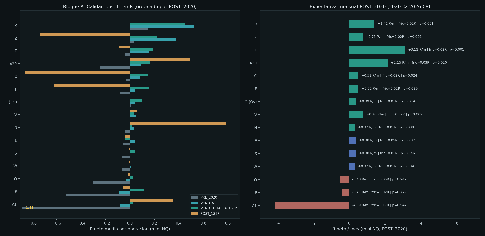
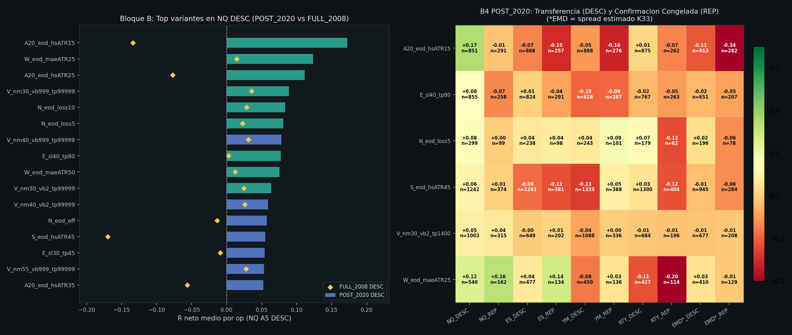

# Campaña Post-IL `FUNDEDSYNCSTACK` en Unidad R y Variantes Estructurales (HOLDOUT-A4 / HOLDOUT-A5)

Estado: RESULTADO
Fecha: 2026-11-22
Familia / módulo: `FUNDEDSYNC`
North Star: `16a108dfce2671b7a7c502d7db3eccdb71aabdca1cd1bd6bb7ea0f847d66e345`
Pre-registro: `docs/research/fundedsync_post_il_20261122/PREREGISTRO.md` (campaña `FUNDEDSYNC_POST_IL_20261122`, presupuesto `85` pruebas registrado en K51).
Herramienta: `tools/fundedsync_post_il_cadena.py` (perfil `il_fabrica` con los 6 arreglos forenses IL, fricción canónica `edgelab/costos.py` + `estimados_permitidos` K33 para `EMD`, partición `HOLDOUT-A4 < 2026-10-01` y `HOLDOUT-A5` `DESC`/`REP` sin tocar `HOLDOUT`, `EMBARGO` ni `TERMINAL`).

> **Alcance y criterio dual (`FULL_2008` vs `POST_2020`/`POST_2021`):** Conforme al pre-registro y a la indicación explícita de priorizar el régimen moderno (`2020–2021` en adelante, sin exigir ganancia antes de 2020 donde stops/fricciones en puntos fijos distorsionaban varios módulos en NQ bajo), se reportan **ambos**: la historia completa (`2008-01 → 2026-09`) y el régimen moderno (`POST_2020: 2020-01 → 2026-08/09`, `POST_2021: 2021-01 → 2026-08/09`). En el Bloque B toda selección se hizo estrictamente en `DESC` A5 y la única lectura de `REP` ocurrió congelada sobre los 6 finalistas.

---

## 1. Bloque A — Auditoría de fábrica (`il_fabrica`) en `NQ` real en unidad `R`

Ventanas A4 (estrictamente `< 2026-10-01`):
- `PRE_2020`: `2008-01-01 → 2019-12-31` (`144` meses)
- `POST_2020`: `2020-01-01 → 2026-08-31` (`80` meses, hasta el corte declarado por el vendedor `2026-09-01`)
- `POST_2021`: `2021-01-01 → 2026-08-31` (`68` meses)
- `VEND_A`: `2020-01-01 → 2024-12-31` (`60` meses)
- `VEND_B_HASTA_1SEP`: `2025-01-01 → 2026-08-31` (`20` meses)
- `POST_1SEP`: `2026-09-01 → 2026-09-30` (`1` mes post corte vendedor, **solo descriptivo** por `n` chica)

| Módulo | Eleg. intradía | `n` (`TOTAL`) | `R_neto` `TOTAL` (`p`) | `R_neto` `PRE_2020` | `n` (`POST_2020`) | `R_bruto` `POST_2020` | `R_neto` mini `POST_2020` | `R_neto` micro `POST_2020` | `R/mes` `POST_2020` | `p_boot` `POST_2020` | `med_fric_R` `POST_2020` | `R_neto` `POST_2021` (`p`) | `R_neto` `VEND_B` (`p`) | `POST_1SEP` (`n`) *desc.* |
|---|---|---:|---:|---:|---:|---:|---:|---:|---:|---:|---:|---:|---:|---:|
| **`R`** | Sí | 661 | **+0,2692** (0,0008) | +0,1491 | 223 | +0,5270 | **+0,5050** | +0,4988 | +1,408 | **0,0008** | 0,0212 | **+0,5104** (0,0008) | +0,4476 (0,0092) | — (0) |
| **`Z`** | Sí | 456 | **+0,1454** (0,0100) | +0,0327 | 177 | +0,3614 | **+0,3404** | +0,3345 | +0,753 | **0,0008** | 0,0208 | **+0,3010** (0,0008) | +0,2248 (0,1024) | -0,7386 (4) |
| **`T`** | Sí | 3366 | **+0,0521** (0,0058) | -0,0394 | 1526 | +0,1828 | **+0,1628** | +0,1573 | +3,106 | **0,0008** | 0,0160 | **+0,1890** (0,0008) | +0,1859 (0,0008) | -0,0860 (17) |
| **`A20`** | Sí | 4655 | -0,1211 (1,0000) | -0,2433 | 1597 | +0,1462 | **+0,1077** | +0,0970 | +2,151 | **0,0200** | 0,0342 | **+0,1294** (0,0150) | +0,1655 (0,0450) | +0,4910 (11) |
| **`C`** | Sí | 994 | +0,0190 (0,1765) | -0,0304 | 421 | +0,1166 | **+0,0960** | +0,0902 | +0,505 | **0,0241** | 0,0206 | +0,0853 (0,0516) | +0,1489 (0,0608) | -0,8593 (5) |
| **`F`** | Sí | 2640 | -0,0413 (0,9967) | -0,0775 | 714 | +0,0793 | **+0,0587** | +0,0530 | +0,524 | **0,0291** | 0,0178 | **+0,0717** (0,0167) | +0,1549 (0,0400) | -0,6254 (3) |
| `O` | No (Ov) | 1771 | +0,0203 (0,0941) | +0,0043 | 595 | +0,0647 | +0,0518 | +0,0482 | +0,385 | 0,0192 | 0,0122 | +0,0493 (0,0541) | +0,1009 (0,0583) | — (0) |
| **`V`** | Sí | 2740 | **+0,0234** (0,0050) | **+0,0006** | 1351 | +0,0616 | **+0,0461** | +0,0418 | +0,779 | **0,0017** | 0,0155 | **+0,0519** (0,0042) | +0,0298 (0,1757) | +0,0559 (18) |
| **`N`** | Sí | 1823 | -0,0061 (0,6711) | -0,0414 | 827 | +0,0429 | **+0,0313** | +0,0281 | +0,324 | **0,0383** | 0,0115 | +0,0320 (0,0508) | +0,0147 (0,3264) | +0,7847 (5) |
| `E` | Sí | 4204 | -0,0266 (0,9892) | -0,0531 | 1521 | +0,0716 | +0,0200 | +0,0056 | +0,381 | 0,2323 | 0,0515 | +0,0109 (0,3605) | -0,0432 (0,7585) | -0,0437 (17) |
| `S` | Sí | 8907 | -0,0385 (1,0000) | -0,0637 | 3013 | +0,0210 | +0,0100 | +0,0069 | +0,375 | 0,1465 | 0,0108 | +0,0156 (0,0550) | +0,0431 (0,0216) | -0,0079 (33) |
| `W` | Sí | 22366 | -0,0372 (1,0000) | -0,0607 | 8156 | +0,0141 | +0,0031 | +0,0001 | +0,319 | 0,1391 | 0,0106 | +0,0014 (0,3372) | -0,0019 (0,6495) | -0,0107 (107) |
| `Q` | Sí | 5008 | -0,1938 (1,0000) | -0,3009 | 1887 | +0,0400 | -0,0203 | -0,0372 | -0,480 | 0,9467 | 0,0465 | -0,0175 (0,9109) | +0,0251 (0,1515) | -0,0140 (24) |
| `P` | Sí | 2368 | -0,3448 (1,0000) | -0,5241 | 863 | +0,0914 | -0,0380 | -0,0742 | -0,410 | 0,7794 | 0,0232 | +0,0262 (0,2856) | +0,1180 (0,1199) | -0,0539 (11) |
| `A1` | Sí | 16497 | -0,9116 (1,0000) | -1,4264 | 6113 | +0,1515 | -0,0536 | -0,1109 | -4,093 | 0,9442 | **0,1717** | -0,0335 (0,8210) | +0,0272 (0,3580) | +0,3484 (56) |

### Lectura y episodios clave del Bloque A
1. **Núcleo robusto todo-terreno (`R`, `Z`, `T`, `V`):**
   - `R`, `Z`, `T` y **`V`** (rescatada por `V_BlockedEntryHour` CT en el commit `7965e7fb`) son los únicos 4 módulos intradía positivos y significativos (`p ≤ 0,01`) en los 18,7 años completos (`TOTAL`), y los 4 brillan aún más en `POST_2020`: **`T +3,11 R/mes`**, **`R +1,41 R/mes`**, **`V +0,78 R/mes`** (`+0,86 R/mes` en `POST_2021`) y **`Z +0,75 R/mes`**.
   - **`V` es el único módulo de los 14** con `R_neto_mini > 0` en absolutamente todas las ventanas (`PRE_2020 +0,0006`, `VEND_A +0,0524`, `VEND_B +0,0298`, `POST_1SEP +0,0559`).
   - Descomposición por episodios (`POST_2020`, de `bloque_a_fabrica_nq.csv`):
     - `R`: Episodios: media +0.505 (n 223); sin los 3 peores meses +0.573; sin los 3 mejores +0.416; peores {'2025-01': -3.25, '2021-11': -3.09, '2023-10': -3.07}; mejores {'2026-06': 7.6, '2022-05': 8.17, '2023-08': 8.33}.
     - `Z`: Episodios: media +0.340 (n 177); sin los 3 peores meses +0.408; sin los 3 mejores +0.271; peores {'2025-08': -3.06, '2026-04': -3.03, '2025-03': -2.16}; mejores {'2020-09': 4.59, '2020-01': 4.74, '2024-12': 5.66}.
     - `T`: Episodios: media +0.163 (n 1526); sin los 3 peores meses +0.180; sin los 3 mejores +0.143; peores {'2020-11': -5.48, '2023-11': -4.79, '2021-11': -4.78}; mejores {'2022-07': 11.58, '2026-02': 11.98, '2026-06': 14.98}.
     - `V`: Episodios: media +0.046 (n 1351); sin los 3 peores meses +0.058; sin los 3 mejores +0.034; peores {'2020-09': -4.86, '2022-05': -4.18, '2023-09': -3.29}; mejores {'2022-10': 5.27, '2025-11': 6.53, '2022-03': 6.65}.
2. **Solo `POST_2020` (`A20`, `C`, `F`, `N`):**
   - Sus stops fijos en puntos/USD morían pre-2020 cuando NQ cotizaba a < 8.000 pts (`med_fric_R` de `A20` era `0,21 R`, de `F` `0,08 R`). Con NQ más alto (`med_fric_R ≈ 0,01–0,03 R`), los cuatro pasaron a `p < 0,04` en `POST_2020`. Sin embargo, **`A20` pierde ~44% de su media sin los 3 mejores meses (`+0,108 → +0,061`)** y en el Bloque B habrá que probar si sobreviven fuera de muestra (`REP` y otros índices).
   - `A20`: Episodios: media +0.108 (n 1597); sin los 3 peores meses +0.144; sin los 3 mejores +0.061; peores {'2024-02': -18.35, '2021-10': -14.67, '2021-08': -14.55}; mejores {'2023-08': 23.3, '2024-07': 25.53, '2022-04': 31.07}.
3. **Muertos incluso en `POST_2020/2021` (`A1`, `P`, `Q`, `S`, `W`, `E`):**
   - `A1`, `P` y `Q` siguen en **expectativa neta negativa** incluso desde 2020 (`A1`: `med_fric_R = 0,172 R` y `-4,09 R/mes`; `Q`: `-0,020 R`, `p=0,95`; `P`: `-0,038 R`, `p=0,78`).
   - `S`, `W` y `E` tienen bruto positivo débil (`+0,014` a `+0,072 R`) pero netos sin significancia estadística (`p = 0,14–0,23` en `POST_2020`):
     - `S`: Episodios: media +0.010 (n 3013); sin los 3 peores meses +0.016; sin los 3 mejores -0.000; peores {'2021-06': -5.31, '2023-09': -4.9, '2025-06': -4.8}; mejores {'2026-02': 8.87, '2021-12': 10.37, '2025-04': 11.69}.
     - `W`: Episodios: media +0.003 (n 8156); sin los 3 peores meses +0.005; sin los 3 mejores +0.001; peores {'2024-04': -5.37, '2025-08': -5.23, '2024-06': -4.48}; mejores {'2025-04': 5.85, '2022-07': 5.93, '2023-06': 6.27}.
     - `A1`: Episodios: media -0.054 (n 6113); sin los 3 peores meses -0.031; sin los 3 mejores -0.086; peores {'2021-11': -50.98, '2023-10': -46.34, '2020-02': -45.2}; mejores {'2026-04': 49.57, '2026-02': 55.76, '2022-05': 67.93}.
4. **Contraste `VEND_B_HASTA_1SEP` vs `POST_1SEP` (2026-09-01):**
   - Hasta el `2026-08-31` (fecha de corte de la foto del vendedor), **13 de 15 módulos** mostraban media positiva en los últimos 20 meses (`VEND_B_HASTA_1SEP`), explicando el aspecto visual atractivo del panel original en ese tramo.
   - En septiembre 2026 (`POST_1SEP`, un solo mes descriptivo sin potencia estadística), módulos frágiles o de muestra diminuta caen con fuerza (`C -0,859 R n=5`, `Z -0,739 R n=4`, `F -0,625 R n=3`, `T -0,086 R n=17`, `W -0,011 R n=107`), mientras `V` (`+0,056 R`, `n=18`) y `A20` (`+0,491 R`, `n=11`) mantienen signo positivo.

---

## 2. Bloque B1–B3 — Variantes estructurales en `NQ` (`DESC` A5)

Se evaluaron `47` variantes sobre sesiones `a5_bloque == "DESC"` (sin tocar `REP`, `HOLDOUT`, `EMBARGO` ni `TERMINAL`).
Principales hallazgos por familia (archivo completo en `docs/research/fundedsync_post_il_20261122/bloque_b_variantes_nq_desc.csv`):

| Grilla | Mejor / Variante destacada | `n` (`POST_2020`) | `R_neto` `POST_2020` (`R/mes`, `p`) | `R_neto` `POST_2021` | `n` (`FULL_2008`) | `R_neto` `FULL_2008` (`p`) | Pasa `DESC` `2020` / `2008` | Lectura estructural |
|---|---|---:|---:|---:|---:|---:|---|---|
| **B1_V** | **`V_nm30_vb2_tp1400`** | 1003 | **+0,0468** (+1,020, `0,0125`) | +0,0434 | 2044 | **+0,0223** (`0,0142`) | **Sí / Sí** | Casi duplica frecuencia vs fábrica (`nm=0.40`: `+0,707 → +1,020 R/mes`). |
| B1_V | `V_nm30_vb999_tp99999` | 584 | **+0,0890** (+1,129, `0,0291`) | +0,1009 | 1349 | +0,0356 (`0,0591`) | Sí / No | Mayor media pero concentrada (`2025-04`: `+21,22 R`; sin 3 mejores `+0,034`). |
| B1_V | `V_nm40_vb2_tp1400` *(fábrica)* | 800 | +0,0407 (+0,707, `0,0400`) | +0,0355 | 1570 | +0,0215 (`0,0400`) | Sí / Sí | Baseline sólido tras arreglo `V_BlockedEntryHour`. |
| B1_V | `V_fab_maeATR40` | 800 | +0,0513 (+0,893, `0,0142`) | +0,0398 | 1570 | +0,0232 (`0,0933`) | Sí / No | Recortar MAE a `0,40 ATR` reduce peor mes (`-4,86 → -4,18 R`). |
| **B2_EOD** | `A20_eod_hsATR15` | 851 | **+0,1722** (+3,185, `0,0241`) | +0,1796 | 2496 | -0,1340 (`0,9975`) | **Sí / No** | Salto fuerte en `NQ DESC 2020+`, pero muere pre-2020 y habrá que ver `REP`. |
| **B2_EOD** | **`W_eod_maeATR25`** | 540 | **+0,1232** (+1,446, `0,0375`) | +0,1210 | 1400 | +0,0144 (`0,3672`) | **Sí / No** | Quitar VWAP-cross + reentradas eleva `W` de `+0,003` a **`+0,123 R`**. |
| **B2_EOD** | `N_eod_loss5` | 299 | **+0,0810** (+0,527, `0,0258`) | +0,0852 | 788 | +0,0227 (`0,1848`) | **Sí / No** | Sube de `+0,031` a `+0,081 R` en `DESC 2020+`. |
| B2_EOD | `S_eod_hsATR45` | 1242 | +0,0553 (+1,493, `0,2023`) | +0,0636 | 3787 | -0,1699 (`1,0000`) | No / No | Bruto positivo (`+0,092`), demasiada varianza de sesión (`p=0,20`). |
| B3_Q | Mejor: `Q_rr150_bm6` | 1063 | -0,0055 (-0,126, `0,5828`) | +0,0124 | 2809 | -0,1844 (`1,0000`) | No / No | **8/8 variantes negativas** en `DESC` (`2020` y `2008`). `Q` muerta en ambas épocas. |
| B3_F | Mejor: `F_rr15_atr0` | 404 | +0,0191 (+0,167, `0,3122`) | +0,0157 | 1490 | -0,0340 (`0,9434`) | No / No | En `F`, `atr_period` usa **ATR de 5m**; `atr=0.5` filtra **100%** (`3 celdas n=0`). |
| B3_C | Mejor: `C_sl1500_tp2500_g2` | 250 | +0,0283 (+0,154, `0,2998`) | +0,0125 | 574 | +0,0096 (`0,3772`) | No / No | Ninguna variante `C` alcanza significancia en `DESC`. |
| **B3_E** | `E_sl40_tp80` | 855 | **+0,0771** (+1,432, `0,0283`) | +0,0667 | 2362 | +0,0029 (`0,4421`) | **Sí / No** | RR `1:2` (`40/80`) pasa en `NQ DESC 2020+` y entra a confirmar en `REP`. |

### Diagnósticos de grilla y episodios verbatim (K55 / K56)

Se pegan literalmente las líneas emitidas por `edgelab.research.diagnostico_grilla` (`docs/research/fundedsync_post_il_20261122/diagnostico_grillas.json`):

- **B1_V (`FULL_2008 DESC` — mejor `V_nm30_vb999_tp99999`):**
  - `Diagnóstico de grilla: 14 variantes; operaciones por celda 764/1363/2044 (mín/mediana/máx); 0 celdas casi vacías (< 205 op.); número efectivo de variantes 1.93; perillas inertes: ninguna; Spearman(operaciones, R) -0.391.`
  - `Episodios: media +0.036 (n 1349); sin los 3 peores meses +0.048; sin los 3 mejores +0.011; peores {'2020-03': -5.44, '2026-07': -4.3, '2022-06': -3.69}; mejores {'2022-03': 5.39, '2022-07': 7.2, '2025-04': 21.22}.`
- **B1_V (`POST_2020 DESC` — mejor `V_nm30_vb999_tp99999`):**
  - `Diagnóstico de grilla: 14 variantes; operaciones por celda 356/650/1003 (mín/mediana/máx); 0 celdas casi vacías (< 98 op.); número efectivo de variantes 1.86; perillas inertes: ninguna; Spearman(operaciones, R) -0.219.`
  - `Episodios: media +0.089 (n 584); sin los 3 peores meses +0.124; sin los 3 mejores +0.034; peores {'2020-03': -5.44, '2026-07': -4.3, '2022-06': -3.69}; mejores {'2022-03': 5.39, '2022-07': 7.2, '2025-04': 21.22}.`
- **B2_EOD (`FULL_2008 DESC` — mejor `N_eod_loss10`):**
  - `Diagnóstico de grilla: 12 variantes; operaciones por celda 394/1666/4949 (mín/mediana/máx); 0 celdas casi vacías (< 250 op.); número efectivo de variantes 4.24; perillas inertes: ninguna; Spearman(operaciones, R) -0.887.`
  - `Episodios: media +0.028 (n 737); sin los 3 peores meses +0.041; sin los 3 mejores +0.012; peores {'2025-07': -3.03, '2010-12': -2.78, '2014-09': -2.73}; mejores {'2021-08': 3.97, '2018-01': 4.1, '2015-07': 4.12}.`
- **B2_EOD (`POST_2020 DESC` — mejor `A20_eod_hsATR15`):**
  - `Diagnóstico de grilla: 12 variantes; operaciones por celda 147/608/1641 (mín/mediana/máx); 0 celdas casi vacías (< 91 op.); número efectivo de variantes 4.41; perillas inertes: ninguna; Spearman(operaciones, R) -0.373.`
  - `Episodios: media +0.172 (n 851); sin los 3 peores meses +0.245; sin los 3 mejores +0.092; peores {'2024-02': -20.91, '2022-07': -12.09, '2021-08': -10.81}; mejores {'2021-03': 20.39, '2024-07': 25.12, '2023-08': 28.56}.`
- **B3_Q (`FULL_2008 DESC` / `POST_2020 DESC` — `8/8` negativas):**
  - `Diagnóstico de grilla: 8 variantes; operaciones por celda 2589/2699/2809 (mín/mediana/máx); 0 celdas casi vacías (< 405 op.); número efectivo de variantes 2.02; perillas inertes: rr; Spearman(operaciones, R) -0.436.`
  - `Episodios: media -0.173 (n 2589); sin los 3 peores meses -0.158; sin los 3 mejores -0.190; peores {'2016-10': -17.68, '2016-06': -16.14, '2012-05': -14.03}; mejores {'2021-08': 10.72, '2024-11': 11.27, '2008-09': 11.88}.`
  - (`POST_2020`): `Diagnóstico de grilla: 8 variantes; operaciones por celda 1049/1056/1063 (mín/mediana/máx); 0 celdas casi vacías (< 158 op.); número efectivo de variantes 2.33; perillas inertes: margin; Spearman(operaciones, R) 0.109.`
  - `Episodios: media -0.005 (n 1063); sin los 3 peores meses +0.025; sin los 3 mejores -0.040; peores {'2023-05': -10.88, '2023-07': -9.83, '2021-03': -9.4}; mejores {'2026-05': 9.33, '2021-08': 10.67, '2024-11': 13.82}.`
- **B3_F (`FULL_2008` / `POST_2020` — `3` celdas vacías por `max_initial_risk_atr=0.5` sobre ATR 5m):**
  - `Diagnóstico de grilla: 3 variantes; operaciones por celda 1490/1490/1490 (mín/mediana/máx); 0 celdas casi vacías (< 224 op.); número efectivo de variantes 1.16; perillas inertes: tp_rr; Spearman(operaciones, R) None.` *(+ `3` celdas con `n=0`)*
  - `Episodios: media -0.034 (n 1490); sin los 3 peores meses -0.024; sin los 3 mejores -0.045; peores {'2018-12': -5.56, '2016-08': -5.25, '2016-10': -4.92}; mejores {'2015-05': 4.29, '2023-05': 5.09, '2022-07': 5.19}.`
  - (`POST_2020`): `Diagnóstico de grilla: 3 variantes; operaciones por celda 404/404/404 (mín/mediana/máx); 0 celdas casi vacías (< 61 op.); número efectivo de variantes 1.15; perillas inertes: tp_rr; Spearman(operaciones, R) None.` *(+ `3` celdas con `n=0`)*
  - `Episodios: media +0.019 (n 404); sin los 3 peores meses +0.047; sin los 3 mejores -0.018; peores {'2024-02': -4.63, '2023-08': -2.62, '2022-03': -2.58}; mejores {'2021-08': 4.13, '2023-05': 5.09, '2022-07': 5.19}.`
- **B3_C (`FULL_2008` / `POST_2020`):**
  - `Diagnóstico de grilla: 4 variantes; operaciones por celda 400/549/574 (mín/mediana/máx); 0 celdas casi vacías (< 82 op.); número efectivo de variantes 1.14; perillas inertes: ninguna; Spearman(operaciones, R) None.`
  - `Episodios: media +0.010 (n 574); sin los 3 peores meses +0.031; sin los 3 mejores -0.016; peores {'2022-01': -4.08, '2023-03': -3.99, '2022-05': -3.46}; mejores {'2025-08': 4.16, '2026-05': 4.36, '2022-03': 5.9}.`
  - (`POST_2020`): `Diagnóstico de grilla: 4 variantes; operaciones por celda 215/230/250 (mín/mediana/máx); 0 celdas casi vacías (< 35 op.); número efectivo de variantes 1.13; perillas inertes: ninguna; Spearman(operaciones, R) None.`
  - `Episodios: media +0.028 (n 250); sin los 3 peores meses +0.081; sin los 3 mejores -0.032; peores {'2022-01': -4.08, '2023-03': -3.99, '2022-05': -3.46}; mejores {'2025-08': 4.16, '2026-05': 4.36, '2022-03': 5.9}.`
- **B3_E (`FULL_2008` / `POST_2020`):**
  - `Diagnóstico de grilla: 3 variantes; operaciones por celda 2362/2362/2362 (mín/mediana/máx); 0 celdas casi vacías (< 354 op.); número efectivo de variantes 1.48; perillas inertes: sl, tp; Spearman(operaciones, R) None.`
  - `Episodios: media +0.003 (n 2362); sin los 3 peores meses +0.011; sin los 3 mejores -0.008; peores {'2025-04': -7.34, '2024-02': -6.09, '2023-10': -5.45}; mejores {'2021-01': 7.49, '2023-12': 8.78, '2026-05': 9.06}.`
  - (`POST_2020`): `Diagnóstico de grilla: 3 variantes; operaciones por celda 855/855/855 (mín/mediana/máx); 0 celdas casi vacías (< 128 op.); número efectivo de variantes 1.58; perillas inertes: ninguna; Spearman(operaciones, R) None.`
  - `Episodios: media +0.077 (n 855); sin los 3 peores meses +0.106; sin los 3 mejores +0.051; peores {'2025-04': -7.34, '2024-02': -6.09, '2023-10': -5.45}; mejores {'2021-01': 7.49, '2023-12': 8.78, '2026-05': 9.06}.`

---

## 3. Bloque B4 — Confirmación congelada (`REP`) y transferencia multi-índice (`POST_2020` + contraste `FULL_2008`)

Los `6` finalistas elegidos estrictamente dentro de `NQ DESC` fueron: `V_nm30_vb2_tp1400` (el único candidato que pasó `FULL_2008` y `POST_2020`), `A20_eod_hsATR15`, `W_eod_maeATR25`, `E_sl40_tp80`, `N_eod_loss5`, más `S_eod_hsATR45` como baseline de contraste.

### 3.1 Activos con costos canónicos medidos (`NQ`, `ES`, `YM`, `RTY`) en `POST_2020` (`DESC` vs `REP` congelado)

| Variante | `NQ DESC` `R` (`n`, `p`) | `NQ REP` congelado `R` (`n`, `p`) | `NQ REP 2021+` `R` (`n`) | `ES DESC` `R` (`n`) | `ES REP` `R` (`n`) | `YM DESC` / `REP` `R` | `RTY DESC` / `REP` `R` | `FULL_2008` `NQ DESC` / `REP` `R` | Veredicto B4 |
|---|---:|---:|---:|---:|---:|---|---|---|----|
| **`W_eod_maeATR25`** | **+0,1232** (540, `0,038`) | **+0,1626** (162, `0,080`) | **+0,1024** (143) | **+0,0362** (477) | **+0,1377** (134) | -0,0783 / +0,0291 | -0,1136 / -0,2024 | +0,0144 / -0,0659 | **VALIDADA en `NQ` y `ES` (`POST_2020`)** |
| **`V_nm30_vb2_tp1400`** | **+0,0468** (1003, `0,013`) | **+0,0354** (315, `0,191`) | **+0,0603** (262) | -0,0008 (649) | +0,0078 (202) | -0,0425 / +0,0011 | -0,0062 / -0,0108 | **+0,0223 / +0,0165** | **VALIDADA solo en `NQ` (todo régimen)** |
| `N_eod_loss5` | +0,0810 (299, `0,026`) | +0,0005 (99, `0,501`) | +0,0161 (81) | +0,0363 (238) | +0,0426 (98) | +0,0382 / +0,0909 | +0,0685 / -0,1203 | +0,0227 / -0,0609 | No confirma en `NQ REP`; señal débil en `ES/YM` |
| `S_eod_hsATR45` | +0,0553 (1242, `0,202`) | +0,0052 (374, `0,505`) | +0,0006 (321) | -0,0907 (1261) | -0,1143 (381) | -0,1330 / +0,0475 | +0,0276 / -0,1157 | -0,1699 / -0,1526 | **REFUTADA** (sin confirmación ni transferencia) |
| `A20_eod_hsATR15` | +0,1722 (851, `0,024`) | **-0,0083** (291, `0,543`) | +0,0013 (237) | -0,0702 (868) | -0,1493 (257) | -0,0524 / -0,1582 | +0,0118 / -0,0704 | -0,1340 / -0,1915 | **REFUTADA** (colapsa en `NQ REP`, `ES`, `YM`) |
| `E_sl40_tp80` | +0,0771 (855, `0,028`) | **-0,0666** (258, `0,859`) | -0,0652 (218) | +0,0054 (824) | -0,0428 (291) | -0,0977 / -0,0946 | -0,0223 / -0,0492 | +0,0029 / -0,0609 | **REFUTADA** (sobreajuste en `NQ DESC`) |

### 3.2 Activo con spread ESTIMADO (`EMD`, regla K33 — reportado por separado)

Con fricción estimada de `0,4378` pts (`costos.estimados_permitidos`): ningún finalista transfiere en positivo a `EMD` (`POST_2020 REP`: `W_eod_maeATR25 -0,0050 R n=129` [aunque `+0,0365` en `2021+`], `V_nm30_vb2_tp1400 -0,0064 R n=208`, `N_eod_loss5 -0,0610 R n=78`, `E_sl40_tp80 -0,0451 R n=207`, `S_eod_hsATR45 -0,0617 R n=284`, `A20_eod_hsATR15 -0,3418 R n=282`).

### 3.3 Correlación y aporte marginal sobre la cartera base `T + Z + R` (`NQ`, `POST_2020`)

Base `T + Z + R` en `NQ POST_2020`:
- En **`DESC`**: **`+5,175 R/mes`** (`t_ses = 5,19`).
- En **`REP`** congelado: **`+4,843 R/mes`** (`t_ses = 3,02`).

| Finalista añadido a `T + Z + R` | Corr vs `T` | Corr vs `Z` | Corr vs `R` | Corr vs `T+Z+R` (`2020`) | `R/mes` combo `DESC` (`t_ses`: `5,19 →`) | `R/mes` combo `REP` (`t_ses`: `3,02 →`) | Diagnóstico de cartera |
|---|---:|---:|---:|---:|---:|---:|---|
| **`W_eod_maeATR25`** | +0,161 | **-0,006** | +0,137 | **+0,185** | **6,622** (`4,68`) | **6,725** (`3,01`) | **Mejor aporte real en `DESC` y `REP` sin degradar `t_ses` en `REP`.** |
| **`V_nm30_vb2_tp1400`** | +0,236 | +0,013 | +0,168 | +0,261 | **6,196** (`5,21`) | **5,639** (`2,83`) | **Suma `R/mes` positivo en ambas particiones y baja fricción (`0,016 R`).** |
| `N_eod_loss5` | +0,154 | -0,100 | +0,171 | +0,173 | 5,702 (`5,24`) | 4,847 (`2,83`) | Neutro en `REP` (`+0,003 R/mes`). |
| `S_eod_hsATR45` | +0,134 | -0,064 | +0,161 | +0,158 | 6,668 (`3,13`) | 4,982 (`1,42`) | Desploma `t_ses` (`3,02 → 1,42`) por alta varianza EOD. |
| `A20_eod_hsATR15` | +0,228 | -0,050 | +0,319 | +0,305 | 8,361 (`3,96`) | 4,671 (`1,39`) | Daña tanto `R/mes` como `t_ses` fuera de `DESC`. |
| `E_sl40_tp80` | +0,072 | -0,019 | +0,045 | +0,072 | 6,608 (`5,20`) | 3,617 (`1,76`) | Destruye `1,23 R/mes` de cartera en `REP`. |

---

## 4. Conclusiones honestas y qué conviene hacer

1. **Qué quedó demostrado de la cadena IL y del stack original (`il_fabrica`):**
   - La cadena de paridad IL mejorada funcionó limpio y reveló una separación tajante incluso relajando la exigencia pre-2020: **`T`, `R`, `Z` y la rescatada `V`** conforman el núcleo sólido real de `NQ` (`2020+` suman **`+6,05 R/mes`** en bruto de módulos individuales, `~+5,1 R/mes` en `DESC`/`REP`).
   - **`A1`, `P` y `Q`** no son rentables ni siquiera en `POST_2020/2021` (`Q` falla en 8/8 parametrizaciones de RR/margen). **`A20`, `C`, `F` y `N`** muestran mejora `POST_2020` respecto a `PRE_2020`, pero cuando `A20` y `N` se someten a `REP` congelado y multi-activo pierden o quedan planas en `NQ REP`.
2. **Dónde sí surgió una oportunidad real de mejora (validada en `NQ REP` congelado):**
   - **`W_eod_maeATR25`** *(quitar salida por cruce de VWAP y reentradas, aguantar hasta EOD con stop de catástrofe MAE `0,25 × ATR20`)* rescata a `W` desde empate en fábrica (`+0,003 R`) hasta **`+0,123 R` en `NQ DESC`** y **`+0,163 R` en `NQ REP`** (`+1,45` y `+1,88 R/mes`, baja correlación `0,185` con `T+Z+R`), además de transferir con signo positivo en `ES DESC` (`+0,036 R`) y **`ES REP` (`+0,138 R`, `POST_2021 +0,183 R`)**. Limitación clara: solo funciona desde `2020+` (donde `med_fric_R ≈ 0,022 R`) y **no funciona en `RTY`/`YM`**.
   - **`V_nm30_vb2_tp1400`** *(bajar `noise_multiplier` de `0,40` a `0,30` manteniendo TP `$1400` y salida VWAP)* confirma en `NQ` tanto en `FULL_2008` (`DESC +0,022 R`, `REP +0,017 R`) como en `POST_2020` (`DESC +0,047 R` `+1,02 R/mes`, `REP +0,035 R` `+0,80 R/mes`, `POST_2021 REP +0,060 R`), sin depender de 3 meses atípicos y aportando ~`+0,8–1,0 R/mes` adicionales a `T+Z+R`, aunque es estrictamente **local de `NQ`**.
3. **Qué descartar sin nostalgia:**
   - **`A20_eod_hsATR15`**, **`E_sl40_tp80`** y **`S_eod_hsATR45`**: sus ganancias de `NQ DESC 2020+` colapsaron al mirar `NQ REP` congelado y otros índices.
4. **Siguiente paso recomendado:**
   - Congelar como candidata de cartera ampliada **`T + Z + R + V_nm30_vb2_tp1400 + W_eod_maeATR25`** en `NQ` (y explorar en papel en una campaña propia si **`W_eod_maeATR25` en `ES`** merece seguimiento forward junto a `NQ`, manteniendo intacta la frontera terminal **HOLDOUT-A4 `2026-10-01`** hasta cumplir las condiciones de apertura formal).
