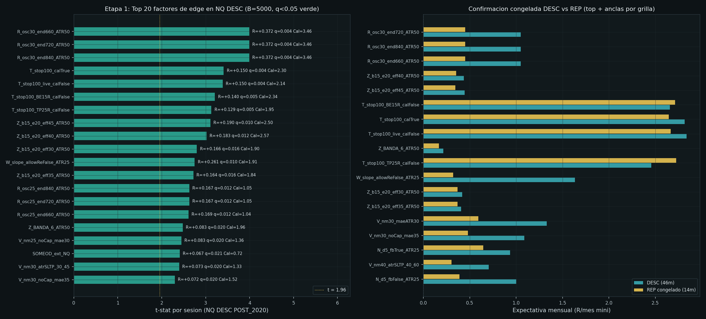
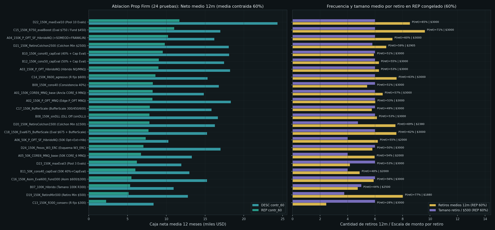
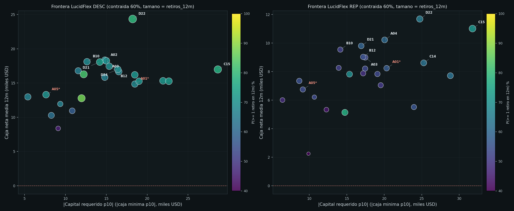

# Iteración 4 `FUNDEDSYNC`: Búsqueda Exhaustiva de Factores de Edge y Optimización Prop Firm (`LucidFlex`, HOLDOUT-A4 / HOLDOUT-A5)

Estado: RESULTADO
Fecha: 2026-11-22
Familia / módulo: `FUNDEDSYNC`
North Star: `16a108dfce2671b7a7c502d7db3eccdb71aabdca1cd1bd6bb7ea0f847d66e345`
Pre-registro: [PREREGISTRO.md](file:///C:/Users/nicoc/.gemini/antigravity/scratch/EdgeLab-fundedsync/docs/research/fundedsync_prop_opt_20261122/PREREGISTRO.md) (campaña `FUNDEDSYNC_PROP_OPT_20261122`, presupuesto `68` pruebas registrado en K51).
Script: [fundedsync_prop_opt.py](file:///C:/Users/nicoc/.gemini/antigravity/scratch/EdgeLab-fundedsync/tools/fundedsync_prop_opt.py) (`--workers 2`, caché en `data/fundedsync_post_il_20261122/`, fricción medida `NQ=1,5455 pts` / `MNQ=1,9775 pts` RT base, overlay M1 barra a barra causal con K40 stop-first, motor `LucidFlex` con piso EOD y `DLL` intradía `(P_d, LO_d)`, tarifa 40% consistencia vía `LG.RAZON_40` K33; `HOLDOUT-A4 < 2026-10-01`, `HOLDOUT/EMBARGO/TERMINAL` sin leer).
Pruebas ejecutadas: `68` pre-registradas (`44` pruebas de Etapa 1 en `5` grillas sobre `NQ DESC POST_2020` con `B=5.000` permutaciones en bloques de 5 días y confirmación única congelada en `NQ REP POST_2020` + `24` ablaciones controladas en Etapa 2 `DESC → REP` con `N=3.000` trayectorias MC de 504 sesiones bajo `real_100`, `contraida_60` y `cero_0`).

---

## 1. Resumen Ejecutivo: Qué Mueve Realmente los Retiros en Prop Firms

1. **En Prop Firm (`LucidFlex`), las palancas operativas y de portafolio pesan igual o más que el ajuste de parámetros:**
   - **#1 Concurrencia de evaluaciones (`max_eval = 10` vs `5` vs `3`, `D22` vs `A03`):** mantener hasta `10` evaluaciones activas en el pool (tope simultáneo `5` fondeadas + `10` totales) suma **`+\$6.116,6`** netos a 12m en `DESC contraida_60` (`+\$24.348,5` / `12,62` retiros de `\$3.000`) y **`+\$2.696,4`** en **`REP` congelado (`+\$11.685,0`, `8,53` retiros de `\$3.000`, `P(retiro 12m)=64,7%`)**, a cambio de mayor capital pico en cola p10 (`-\$24.738` vs `-\$17.463`).
   - **#2 Sizing asimétrico `Eval Boost` (`\$750/R` en Eval → `\$450/R` en Fondeada, `C15`):** aprovecha `F-PROP-ASIMETRIA-LUCIDFLEX` (pérdida acotada al fee de `\$260,4`). Acelera el pase de `46 → 20` días p50 y dispara la probabilidad de retirar en `REP contraida_60` en **`+18,6 pp` (`52,8% → 71,4%`)**, elevando la frecuencia a **`9,62` retiros/año de `\$3.000` (`+3,33` más)** y **`+\$11.012,5` netos a 12m** (`+\$2.023,9` sobre `A03`; **`+\$4.953,3`** en `real_100`), exigiendo mayor colchón p10 (`-\$31.769`) por mayor rotación de evals (`75,7%` quema eval).
   - **#3 Sumar `SOMEOD_ext_NQ` al núcleo `P_OPT` (`A04: P_OPT_SF`):** aunque en `DESC` (`contr_60`) cede levemente por el DD individual de `SOMEOD`, en **cartera `R`** y en **`REP` congelado** produce un salto enorme de consistencia: sube `Calmar REP` de `2,62 → 3,52`, eleva meses positivos de `71,4% → 92,9%` (`13/14` meses), y en `LucidFlex` `150K` mejora `REP contr_60` en **`+\$1.231,0` (`+\$10.219,6`, `60,2%` P(retiro), `7,26` retiros de `\$3.000`)** y **`+\$4.148,6` en `REP real_100` (`+\$25.784,0`)**.
   - **#4 Colchón mínimo post-retiro (`\$2.500`, `D21`) y rechazo rotundo de retirar apenas se llega a `\$500` (`D19`):** retirar en el mínimo `\$500` (`D19`) destruye `-\$3.854` a 12m y `-\$8.498` a 24m en `REP 60%` y achica cada pago a `\$1.880` porque deja `<= \$400` sobre el piso de `+\$100`. Exigir **`\$2.500` de colchón post-retiro (`D21`)** mejora simultáneamente `neto 12m` (`+\$810` a **`+\$9.798,2`**), frecuencia (`+0,52` a `6,81`), `P(retiro)` (`+5,9 pp` a `58,7%`) y capital p10 (`+\$537`), preservando retiros medios de **`\$2.905`**.
   - **#5 Consistencia `40%` + Cap diario en evaluación (`B10`):** reducir consistencia a `40%` *sin* tope diario (`B09`) perjudica (`-\$732 REP`), pero activar `eval_cap_cons` (cerrar día de eval al `95% × 40%` del objetivo) recupera **`+\$1.281` en `REP 60%`**, supera al `50%` estándar (`+\$9.538` vs `+\$8.989` 12m, **`+\$1.881` a 24m**) y reduce la exposición p10 de `-\$17.463 → -\$14.141` (**mejor eficiencia por dólar de capital en `150K`**).
   - **#6 Ejecución híbrida `NQ/MNQ` (`A03` vs `A02`) + Tamaño `150K` + `DLL=True` + `W5`:** operar `floor(n/10) NQ + (n % 10) MNQ` ahorra `\$8,64` cada 10 contratos y suma **`+\$781` a 12m en `REP 60%`** (`+\$694` en `real_100`); `150K` bate a `100K` (`+\$3.660` 12m, `+\$500`/retiro) y a `50K` (`+\$2.877` `REP 60%`, `+\$11.152` `real_100`); `DLL=True` vence a `sinDLL` (`+\$1.158 REP 60%`); `W5` con tope `3,0 R` supera ampliamente a `W3_ERC` (`+\$1.947 REP 60%`, `+\$4.307 real_100`).
2. **En Estrategias (`Etapa 1`, `44` pruebas):**
   - **`V` sin topes fijos USD (`V_nm25_noCap_mae30`):** confirma que la caída reciente de `V` venía de los topes obsoletos `\$1400/\$2000`; eliminar topes sube `DESC` (`+0,0610 → +0,0825 R`) y **duplica `REP` (`+0,592 → +1,131 R/mes`, `+0,0263 → +0,0641 R`)**, aunque `TP` fijo en ATR la degrada.
   - **`T` live sin fechas fijas + `BE_15R` (`T_stop100_BE15R_calFalse`):** quitar las `28` fechas excluidas de fábrica (`F-FUNDEDSYNC-FECHAS-FIJAS`) preserva todo el edge (`REP +2,666 R/mes, Calmar 3,47`) y sumar `BE` causal a `+1,5 R` mejora `Calmar` tanto en `DESC` (`2,14 → 2,34`) como en `REP` (`2,85 → 3,49`).
   - **`Z` eficiencia `40%` (`Z_b15_e20_eff40_ATR50`):** mejora `Calmar DESC` (`2,50 → 2,57`) y `REP` (`1,78 → 1,83`); cambiar `bucket/ema` de `(15, 20)` colapsa frecuencia (`Z_b20_e15_eff35` da `n=0`).
   - **`W` (`allowReFalse` vs `allowReTrue` y salidas M1):** los re-ingresos en `VWAP` (`allowReTrue`) diluyen `R` (`+0,1079` vs `+0,2611`) y duplican el drawdown (`-30,09 R` vs `-15,26 R` en `REP`). El único overlay positivo sobre `allowReTrue` fue **`W_slope_trail_15_50_ATR25`** (`REP +0,593 → +1,371 R/mes, Calmar 0,24 → 0,63`), mientras `BE_10R` queda refutado (`q_bh=0,1252`).
   - **Validación `cero_0`:** las `24` pruebas bajo media diaria `0,0` tienen `EV` / neto medio **estrictamente negativo en `150K`** (`-\$1.515` a `-\$13.337` a 12m), verificando ausencia de sesgos en el motor prop firm.

---

## 2. Etapa 1 — Búsqueda Exhaustiva de Factores de Edge (`44` Pruebas en `NQ`)

Archivo completo: [etapa1_factores_edge.csv](file:///C:/Users/nicoc/.gemini/antigravity/scratch/EdgeLab-fundedsync/docs/research/fundedsync_prop_opt_20261122/etapa1_factores_edge.csv) y confirmación congelada [etapa1_confirmacion_rep.csv](file:///C:/Users/nicoc/.gemini/antigravity/scratch/EdgeLab-fundedsync/docs/research/fundedsync_prop_opt_20261122/etapa1_confirmacion_rep.csv).

### 2.1 Tabla maestra por grilla (`NQ DESC POST_2020`, `B=5.000`, `N_eff = 10,85` implícito, orden interno por `t_ses_2020`)

| Grilla | Variante | `n` (`08`) | `R_08` | `n` (`20`) | `op/m` | `R_20` (`R_mic`) | `R/mes` | `t_ses` | `DD_R` | `Calmar` | `p_perm` | `q_bh` | `p_maxT` | `DSR` | `pasa_e1` |
|---|---|---:|---:|---:|---:|---:|---:|---:|---:|---:|---:|---:|---:|---:|:---:|
| `P1_V` | **`V_nm25_noCap_mae30`** | 1962 | +0,0071 | 772 | 16,78 | +0,0825 (+0,0775) | +1,385 | **2,45** | -12,26 | 1,36 | 0,0086 | 0,0198 | 0,1122 | 0,8923 | **Sí** |
| `P1_V` | `V_nm30_atrSLTP_30_45` | 1723 | -0,0027 | 699 | 15,20 | +0,0734 (+0,0684) | +1,116 | 2,40 | -10,06 | 1,33 | 0,0086 | 0,0198 | 0,1226 | 0,8659 | **Sí** |
| `P1_V` | **`V_nm30_noCap_mae35`** | 1723 | +0,0093 | 699 | 15,20 | +0,0716 (+0,0673) | +1,087 | 2,30 | **-8,56** | **1,52** | 0,0084 | 0,0198 | 0,1468 | 0,8566 | **Sí** |
| `P1_V` | `V_nm30_atrSLTP_30_30` | 1723 | -0,0173 | 699 | 15,20 | +0,0612 (+0,0562) | +0,930 | 2,27 | -9,15 | 1,22 | 0,0126 | 0,0231 | 0,1556 | 0,8314 | **Sí** |
| `P1_V` | `V_nm35_atrSLTP_35_50` | 1505 | +0,0068 | 630 | 13,70 | +0,0623 (+0,0580) | +0,853 | 2,23 | -9,33 | 1,10 | 0,0110 | 0,0214 | 0,1702 | 0,8268 | **Sí** |
| `P1_V` | `V_nm40_atrSLTP_40_60` | 1311 | +0,0170 | 556 | 12,09 | +0,0582 (+0,0545) | +0,704 | 2,16 | -6,16 | 1,37 | 0,0112 | 0,0214 | 0,1922 | 0,8090 | **Sí** |
| `P1_V` | `V_nm30_noCap_mae30` | 1723 | +0,0107 | 699 | 15,20 | +0,0759 (+0,0709) | +1,154 | 2,11 | -11,39 | 1,22 | 0,0148 | 0,0241 | 0,2106 | 0,8071 | **Sí** |
| `P1_V` | `V_nm35_vwap3_noCap_mae30` | 1425 | +0,0257 | 594 | 12,91 | +0,0813 (+0,0763) | +1,050 | 2,03 | -9,45 | 1,33 | 0,0142 | 0,0240 | 0,2418 | 0,7819 | **Sí** |
| `P1_V` | `V_nm30_noCap_mae25` | 1723 | +0,0131 | 699 | 15,20 | +0,0857 (+0,0797) | +1,302 | 2,00 | -12,55 | 1,25 | 0,0188 | 0,0269 | 0,2539 | 0,7732 | **Sí** |
| `P1_V` | `V_nm30_noBlock_noCap_mae30` | 1862 | +0,0078 | 756 | 16,43 | +0,0534 (+0,0484) | +0,878 | 1,63 | -13,78 | 0,76 | 0,0396 | 0,0498 | 0,4569 | 0,6316 | **Sí** |
| `P2_R` | **`R_osc30_end660_ATR50`** *(ancla)* | 382 | +0,1588 | 130 | 2,83 | **+0,3719** (+0,3687) | +1,051 | **3,99** | **-3,64** | **3,46** | 0,0004 | **0,0035** | **0,0018** | **0,9995** | **Sí** |
| `P2_R` | `R_osc30_end720/840_ATR50` *(×2)* | 385 | +0,1641 | 130 | 2,83 | +0,3719 (+0,3687) | +1,051 | 3,99 | -3,64 | 3,46 | 0,0004 | 0,0035 | 0,0018 | 0,9995 | **Sí** |
| `P2_R` | **`R_osc25_end720_ATR50`** *(+840)* | 695 | +0,0497 | 228 | **4,96** | +0,1670 (+0,1638) | +0,828 | 2,63 | -9,43 | 1,05 | 0,0036 | 0,0122 | 0,0684 | 0,9204 | **Sí** |
| `P2_R` | `R_osc25_end660_ATR50` | 672 | +0,0480 | 223 | 4,85 | +0,1694 (+0,1662) | +0,821 | 2,61 | -9,49 | 1,04 | 0,0036 | 0,0122 | 0,0736 | 0,9171 | **Sí** |
| `P2_R` | `R_osc20_end660/720/840` *(×3)* | 1001–1120 | -0,012 | 362–404 | 7,9–8,8 | +0,042..+0,055 | +0,37..0,43 | 0,95–1,15 | -9,3 | 0,47–0,56 | 0,104–0,151 | >=0,123 | >=0,74 | <=0,44 | No |
| `P3_Z` | `Z_b15_e20_eff45_ATR50` *(ancla)* | 265 | +0,0704 | 108 | 2,35 | **+0,1901** (+0,1871) | +0,446 | **3,11** | -2,14 | 2,50 | 0,0020 | **0,0098** | **0,0222** | **0,9614** | **Sí** |
| `P3_Z` | **`Z_b15_e20_eff40_ATR50`** *(promov.)* | 269 | +0,0668 | 110 | 2,39 | +0,1827 (+0,1797) | +0,437 | 3,02 | **-2,04** | **2,57** | 0,0030 | 0,0122 | **0,0284** | **0,9544** | **Sí** |
| `P3_Z` | `Z_b15_e20_eff30_ATR50` | 279 | +0,0666 | 116 | 2,52 | +0,1659 (+0,1630) | +0,418 | 2,80 | -2,65 | 1,90 | 0,0050 | 0,0157 | 0,0464 | 0,9290 | **Sí** |
| `P3_Z` | `Z_b15_e20_eff35_ATR50` | 273 | +0,0605 | 114 | 2,48 | +0,1636 (+0,1607) | +0,406 | 2,72 | -2,65 | 1,84 | 0,0054 | 0,0158 | 0,0558 | 0,9174 | **Sí** |
| `P3_Z` | `Z_BANDA_6_ATR50` | 290 | +0,0318 | 120 | 2,61 | +0,0826 (+0,0810) | +0,215 | 2,48 | **-1,32** | 1,96 | 0,0090 | 0,0198 | 0,1038 | 0,8726 | **Sí** |
| `P3_Z` | `Z_b10_e20_eff40_ATR50` | 110 | +0,0273 | 46 | 1,00 | +0,0080 (+0,0049) | +0,008 | 0,08 | -5,93 | 0,02 | 0,4653 | 0,4875 | 0,9940 | 0,1106 | No |
| `P3_Z` | `Z_b10_e15_eff35_ATR50` | 38 | -0,0234 | **10** | 0,22 | -0,0194 (-0,0225) | -0,004 | -0,10 | -2,35 | -0,02 | 0,5317 | 0,5441 | 1,0000 | 0,0767 | No |
| `P3_Z` | `Z_b20_e15_eff35_ATR50` | **0** | — | **0** | 0,00 | — | — | — | — | — | 1,0000 | 1,0000 | 1,0000 | 0,0000 | No |
| `P4_WN` | **`W_slope_allowReFalse_ATR25`** *(prom.)* | 774 | **+0,0547** | 288 | 6,26 | **+0,2611** (+0,2545) | +1,634 | **2,75** | **-10,26** | **1,91** | 0,0018 | **0,0098** | 0,0528 | **0,9431** | **Sí** |
| `P4_WN` | `W_slope_BE_20R_ATR25` | 2241 | -0,0056 | 823 | 17,89 | +0,1068 (+0,1005) | +1,911 | 2,13 | -20,49 | 1,12 | 0,0194 | 0,0269 | 0,2048 | 0,8053 | **Sí** |
| `P4_WN` | `W_slope_trail_15_50_ATR25` | 2241 | -0,0037 | 823 | 17,89 | +0,1007 (+0,0943) | +1,801 | 2,12 | -16,39 | 1,32 | 0,0158 | 0,0248 | 0,2090 | 0,8024 | **Sí** |
| `P4_WN` | `W_slope_TP_25R_ATR25` | 2241 | -0,0141 | 823 | 17,89 | +0,0990 (+0,0926) | +1,771 | 2,11 | -19,93 | 1,07 | 0,0196 | 0,0269 | 0,2134 | 0,7949 | **Sí** |
| `P4_WN` | `W_base_slope_ATR25` *(ancla `re=True`)* | 2241 | -0,0062 | 823 | 17,89 | +0,1079 (+0,1015) | +1,930 | 2,10 | -18,14 | 1,28 | 0,0206 | 0,0275 | 0,2148 | 0,7969 | **Sí** |
| `P4_WN` | `W_slope_BE_15R_ATR25` | 2241 | -0,0138 | 823 | 17,89 | +0,0883 (+0,0819) | +1,579 | 1,80 | -19,43 | 0,98 | 0,0362 | 0,0468 | 0,3629 | 0,6952 | **Sí** |
| `P4_WN` | `W_slope_BE_10R_ATR25` | 2241 | -0,0236 | 823 | 17,89 | +0,0574 (+0,0510) | +1,026 | 1,23 | -24,17 | 0,51 | 0,1110 | 0,1252 | 0,6971 | 0,4691 | No |
| `P4_WN` | `N_d5_fbFalse_ATR25` | 737 | +0,0589 | 280 | 6,09 | +0,1650 (+0,1580) | +1,004 | 1,98 | -8,82 | 1,37 | 0,0080 | 0,0198 | 0,2649 | 0,7683 | **Sí** |
| `P4_WN` | **`N_d5_fbTrue_ATR25`** *(ancla)* | 1039 | +0,0119 | 454 | 9,87 | +0,0947 (+0,0878) | +0,935 | 1,88 | **-7,82** | **1,43** | 0,0138 | 0,0240 | 0,3157 | 0,7314 | **Sí** |
| `P4_WN` | `N_d10_fbTrue_ATR25` | 839 | -0,0176 | 371 | 8,07 | +0,1044 (+0,0971) | +0,842 | 1,83 | -7,85 | 1,29 | 0,0184 | 0,0269 | 0,3421 | 0,7128 | **Sí** |
| `P4_WN` | `N_d3_fbTrue_ATR25` | 1249 | +0,0033 | 550 | 11,96 | +0,0504 (+0,0437) | +0,602 | 1,11 | -9,98 | 0,72 | 0,1086 | 0,1252 | 0,7634 | 0,4212 | No |
| `P5_TE` | `T_stop100_calTrue` *(ancla)* | 1897 | +0,0240 | 862 | 18,74 | +0,1502 (+0,1435) | +2,815 | **3,41** | -14,69 | 2,30 | 0,0002 | **0,0035** | **0,0088** | **0,9868** | **Sí** |
| `P5_TE` | `T_stop100_live_calFalse` | 1908 | +0,0245 | 873 | 18,98 | +0,1496 (+0,1429) | **+2,838** | 3,39 | -15,92 | 2,14 | 0,0004 | **0,0035** | **0,0088** | **0,9862** | **Sí** |
| `P5_TE` | **`T_stop100_BE15R_calFalse`** *(prom.)* | 1908 | +0,0221 | 873 | 18,98 | +0,1399 (+0,1332) | +2,656 | 3,21 | **-13,63** | **2,34** | 0,0008 | **0,0050** | **0,0154** | **0,9773** | **Sí** |
| `P5_TE` | `T_stop100_TP25R_calFalse` | 1908 | +0,0028 | 873 | 18,98 | +0,1294 (+0,1227) | +2,457 | 3,13 | -15,13 | 1,95 | 0,0008 | **0,0050** | **0,0196** | **0,9704** | **Sí** |
| `P5_TE` | **`SOMEOD_ext_NQ`** *(prom. `P_OPT_SF`)* | 2716 | **+0,0316** | 963 | **20,93** | +0,0671 (+0,0638) | +1,404 | 2,41 | -23,26 | 0,72 | 0,0102 | **0,0214** | 0,1198 | 0,8718 | **Sí** |
| `P5_TE` | `FRANKLIN_ext_NQ` | 1161 | +0,0214 | 418 | 9,09 | +0,0852 (+0,0794) | +0,774 | 1,27 | -15,62 | 0,59 | 0,0884 | 0,1080 | 0,6745 | 0,4865 | No |

*(Nota de referencia `ANCLA_IT3`: `V_nm30_maeATR30` evaluada exactamente con overlay M1 `0,30 ATR20` rinde en `DESC POST_2020`: `n=1003`, `R=+0,0610`, `+1,331 R/mes`, `t=2,89`, `Calmar=1,81`.)*

### 2.2 Confirmación única congelada en `NQ REP POST_2020` (`14` meses) y `FULL_2008`

| Mód. | Variante | `DESC` `R/mes` (`Calmar`) | `REP n` | `REP R_mini` (`R_mic`) | **`REP R/mes`** | `REP t_ses` | `REP DD_R` | **`REP Calmar`** | `p_boot_REP` | `R_REP_2008` | ¿Confirma? |
|---|---|---|---:|---:|---:|---:|---:|---:|---:|---:|:---:|
| `V` | **`V_nm25_noCap_mae30`** | +1,385 (1,36) | 247 | **+0,0641** (+0,0592) | **+1,131** | **1,13** | -14,23 | **0,95** | 0,1124 | -0,0004 | **Sí** |
| `V` | `V_nm30_noBlock_noCap_mae30` | +0,878 (0,76) | 241 | +0,0609 (+0,0561) | +1,049 | 1,07 | -13,47 | 0,93 | 0,1407 | +0,0186 | **Sí** |
| `V` | `V_nm30_noCap_mae25` | +1,302 (1,25) | 225 | +0,0569 (+0,0510) | +0,914 | 0,84 | -16,52 | 0,66 | 0,2273 | +0,0159 | **Sí** |
| `V` | `V_nm30_noCap_mae30` | +1,154 (1,22) | 225 | +0,0476 (+0,0427) | +0,765 | 0,81 | -15,35 | 0,60 | 0,2331 | +0,0117 | **Sí** |
| `V` | `V_nm30_maeATR30` *(ancla It3)* | +1,331 (1,81) | 315 | +0,0263 (+0,0217) | +0,592 | 0,72 | -12,20 | 0,58 | 0,2623 | +0,0167 | **Sí** |
| `V` | `V_nm35_atrSLTP_35_50` | +0,853 (1,10) | 203 | 0,0000 (-0,0042) | +0,001 | 0,00 | -14,10 | 0,00 | 0,5154 | +0,0057 | No |
| `R` | `R_osc30_end660_ATR50` *(ancla)* | +1,051 (3,46) | 41 | **+0,1540** (+0,1511) | +0,451 | **1,11** | **-2,82** | **1,92** | 0,1199 | +0,1010 | **Sí** |
| `R` | **`R_osc25_end720_ATR50`** | +0,828 (1,05) | 85 | +0,0859 (+0,0828) | **+0,521** | 0,96 | -4,87 | 1,29 | 0,1732 | +0,0180 | **Sí** |
| `Z` | `Z_b15_e20_eff30/35_ATR50` | +0,418 (1,90) | 32 | **+0,1620** (+0,1591) | **+0,370** | **1,56** | -2,08 | **2,14** | 0,0649 | +0,1454 | **Sí** |
| `Z` | **`Z_b15_e20_eff40_ATR50`** *(prom.)* | +0,437 (2,57) | 31 | +0,1594 (+0,1565) | +0,353 | 1,49 | -2,32 | 1,83 | **0,0591** | +0,1433 | **Sí** |
| `Z` | `Z_b15_e20_eff45_ATR50` *(ancla)* | +0,446 (2,50) | 30 | +0,1608 (+0,1579) | +0,345 | 1,45 | -2,32 | 1,78 | 0,0641 | +0,1423 | **Sí** |
| `Z` | `Z_BANDA_6_ATR50` | +0,215 (1,96) | 33 | +0,0716 (+0,0701) | +0,169 | 1,29 | **-1,09** | 1,87 | 0,0933 | +0,0626 | **Sí** |
| `W` | **`W_slope_trail_15_50_ATR25`** | +1,801 (1,32) | 253 | **+0,0759** (+0,0702) | **+1,371** | **0,96** | -26,10 | **0,63** | 0,1607 | -0,0631 | **Sí** |
| `W` | **`W_slope_allowReFalse_ATR25`** *(prom.)* | +1,634 (1,91) | 94 | +0,0478 (+0,0423) | +0,321 | 0,33 | **-15,26** | 0,25 | 0,3680 | -0,1122 | **Sí** |
| `W` | `W_base_slope_ATR25` *(re=True)* | +1,930 (1,28) | 253 | +0,0328 (+0,0271) | +0,593 | 0,39 | -30,09 | 0,24 | 0,3272 | -0,1007 | **Sí** |
| `N` | **`N_d5_fbTrue_ATR25`** *(ancla)* | +0,935 (1,43) | 140 | **+0,0647** (+0,0587) | **+0,647** | **0,83** | -8,64 | **0,90** | 0,2007 | -0,0556 | **Sí** |
| `N` | `N_d5_fbFalse_ATR25` | +1,004 (1,37) | 95 | +0,0574 (+0,0514) | +0,390 | 0,48 | -7,54 | 0,62 | 0,3239 | -0,0734 | **Sí** |
| `T` | `T_stop100_TP25R_calFalse` | +2,457 (1,95) | 269 | **+0,1418** (+0,1354) | **+2,724** | **1,89** | **-9,11** | **3,59** | **0,0258** | -0,0179 | **Sí** |
| `T` | **`T_stop100_BE15R_calFalse`** *(prom.)* | +2,656 (2,34) | 269 | +0,1412 (+0,1348) | +2,713 | 1,83 | -9,31 | 3,49 | **0,0333** | -0,0134 | **Sí** |
| `T` | `T_stop100_live_calFalse` | +2,838 (2,14) | 269 | +0,1388 (+0,1324) | +2,666 | 1,79 | -9,21 | 3,47 | **0,0333** | -0,0193 | **Sí** |
| `T` | `T_stop100_calTrue` *(ancla)* | +2,815 (2,30) | 263 | +0,1407 (+0,1343) | +2,644 | 1,80 | -11,14 | 2,85 | **0,0333** | -0,0201 | **Sí** |
| `SOM` | **`SOMEOD_ext_NQ`** *(prom. `P_OPT_SF`)* | +1,404 (0,72) | 294 | **+0,0557** (+0,0526) | **+1,171** | 1,11 | **-7,50** | **1,87** | 0,1324 | **+0,0258** | **Sí** |

### 2.3 Diagnósticos K55 / K56 verbatim (5 grillas × 2 horizontes)

Pegado literal desde [diagnostico_grillas_iter4.json](file:///C:/Users/nicoc/.gemini/antigravity/scratch/EdgeLab-fundedsync/docs/research/fundedsync_prop_opt_20261122/diagnostico_grillas_iter4.json):

- **`P1_V_ESCALA` (`POST_2020`, mejor `V_nm30_noCap_mae25`):**
  - `Diagnóstico de grilla: 10 variantes; operaciones por celda 556/699/772 (mín/mediana/máx); 0 celdas casi vacías (< 105 op.); número efectivo de variantes 1.47; perillas inertes: ninguna; Spearman(operaciones, R) 0.162.`
  - `Episodios: media +0.086 (n 699); sin los 3 peores meses +0.125; sin los 3 mejores +0.054; peores {'2020-03': -7.74, '2022-06': -6.32, '2025-03': -4.57}; mejores {'2021-08': 7.27, '2021-06': 7.28, '2025-04': 9.74}.`
- **`P1_V_ESCALA` (`FULL_2008`, mejor `V_nm35_vwap3_noCap_mae30`):**
  - `Diagnóstico de grilla: 10 variantes; operaciones por celda 1311/1723/1962 (mín/mediana/máx); 0 celdas casi vacías (< 258 op.); número efectivo de variantes 1.34; perillas inertes: ninguna; Spearman(operaciones, R) -0.459.`
  - `Episodios: media +0.026 (n 1425); sin los 3 peores meses +0.039; sin los 3 mejores +0.006; peores {'2009-04': -6.45, '2009-11': -5.85, '2011-04': -5.61}; mejores {'2018-07': 8.64, '2016-09': 8.71, '2018-01': 11.03}.`
- **`P2_R_FRECUENCIA` (`POST_2020`, mejor `R_osc30_end660_ATR50`):**
  - `Diagnóstico de grilla: 9 variantes; operaciones por celda 130/228/404 (mín/mediana/máx); 0 celdas casi vacías (< 34 op.); número efectivo de variantes 1.88; perillas inertes: end_et; Spearman(operaciones, R) -1.0.`
  - `Episodios: media +0.372 (n 130); sin los 3 peores meses +0.454; sin los 3 mejores +0.282; peores {'2020-03': -2.34, '2023-07': -2.23, '2021-11': -1.62}; mejores {'2024-07': 4.06, '2022-05': 4.09, '2024-12': 6.96}.`
- **`P2_R_FRECUENCIA` (`FULL_2008`, mejor `R_osc30_end720_ATR50`):**
  - `Diagnóstico de grilla: 9 variantes; operaciones por celda 382/695/1120 (mín/mediana/máx); 0 celdas casi vacías (< 104 op.); número efectivo de variantes 1.73; perillas inertes: end_et; Spearman(operaciones, R) -0.849.`
  - `Episodios: media +0.164 (n 385); sin los 3 peores meses +0.196; sin los 3 mejores +0.117; peores {'2014-06': -3.31, '2017-04': -3.17, '2016-08': -2.8}; mejores {'2011-02': 4.54, '2024-12': 6.96, '2018-10': 8.23}.`
- **`P3_Z_BANDA` (`POST_2020`, mejor `Z_b15_e20_eff45_ATR50`, `1` celda en `n=0` `Z_b20_e15_eff35` y `1` casi vacía `Z_b10_e15_eff35` con `n=10`):**
  - `Diagnóstico de grilla: 7 variantes; operaciones por celda 10/110/120 (mín/mediana/máx); 1 celdas casi vacías (< 30 op.); número efectivo de variantes 1.54; perillas inertes: ninguna; Spearman(operaciones, R) -0.086.`
  - `Episodios: media +0.190 (n 108); sin los 3 peores meses +0.234; sin los 3 mejores +0.132; peores {'2022-11': -1.33, '2023-07': -1.02, '2023-10': -1.01}; mejores {'2021-05': 2.38, '2024-12': 2.83, '2026-07': 2.95}.`
- **`P3_Z_BANDA` (`FULL_2008`, mejor `Z_b15_e20_eff45_ATR50`, `1` celda `n=0`):**
  - `Diagnóstico de grilla: 7 variantes; operaciones por celda 38/269/290 (mín/mediana/máx); 1 celdas casi vacías (< 40 op.); número efectivo de variantes 1.58; perillas inertes: ninguna; Spearman(operaciones, R) -0.086.`
  - `Episodios: media +0.070 (n 265); sin los 3 peores meses +0.099; sin los 3 mejores +0.039; peores {'2015-07': -2.47, '2013-10': -2.11, '2018-01': -1.96}; mejores {'2024-12': 2.83, '2026-07': 2.95, '2017-05': 2.98}.`
- **`P4_WN_SALIDAS` (`POST_2020`, mejor `W_slope_allowReFalse_ATR25`):**
  - `Diagnóstico de grilla: 11 variantes; operaciones por celda 280/823/823 (mín/mediana/máx); 0 celdas casi vacías (< 123 op.); número efectivo de variantes 1.96; perillas inertes: ninguna; Spearman(operaciones, R) -0.411.`
  - `Episodios: media +0.261 (n 288); sin los 3 peores meses +0.340; sin los 3 mejores +0.192; peores {'2020-09': -4.87, '2023-07': -4.72, '2024-07': -4.62}; mejores {'2021-08': 6.94, '2023-08': 8.2, '2023-12': 10.02}.`
- **`P4_WN_SALIDAS` (`FULL_2008`, mejor `N_d5_fbFalse_ATR25`):**
  - `Diagnóstico de grilla: 11 variantes; operaciones por celda 737/2241/2241 (mín/mediana/máx); 0 celdas casi vacías (< 336 op.); número efectivo de variantes 2.19; perillas inertes: ninguna; Spearman(operaciones, R) -0.615.`
  - `Episodios: media +0.059 (n 737); sin los 3 peores meses +0.084; sin los 3 mejores +0.027; peores {'2013-09': -5.69, '2010-03': -5.62, '2012-01': -4.71}; mejores {'2021-08': 6.33, '2015-07': 7.23, '2018-01': 10.88}.`
- **`P5_T_LIVE_Y_EXT` (`POST_2020`, mejor `T_stop100_calTrue`):**
  - `Diagnóstico de grilla: 6 variantes; operaciones por celda 418/873/963 (mín/mediana/máx); 0 celdas casi vacías (< 131 op.); número efectivo de variantes 1.96; perillas inertes: ninguna; Spearman(operaciones, R) -0.334.`
  - `Episodios: media +0.150 (n 862); sin los 3 peores meses +0.179; sin los 3 mejores +0.112; peores {'2023-07': -5.94, '2020-10': -5.04, '2021-01': -4.28}; mejores {'2024-10': 12.48, '2026-02': 12.49, '2024-07': 14.23}.`
- **`P5_T_LIVE_Y_EXT` (`FULL_2008`, mejor `SOMEOD_ext_NQ`):**
  - `Diagnóstico de grilla: 6 variantes; operaciones por celda 1161/1908/2716 (mín/mediana/máx); 0 celdas casi vacías (< 286 op.); número efectivo de variantes 1.96; perillas inertes: mod; Spearman(operaciones, R) 0.516.`
  - `Episodios: media +0.032 (n 2716); sin los 3 peores meses +0.041; sin los 3 mejores +0.021; peores {'2014-12': -10.78, '2018-03': -5.98, '2015-01': -5.63}; mejores {'2019-07': 7.97, '2018-10': 10.28, '2008-02': 10.65}.`

---

## 3. Carteras Causales (`CORE_6`, `P_OPT`, `P_OPT_SF`) en `R` (`W5` vs `W3`)

Promovidos automáticamente en `DESC POST_2020`: `P_OPT` sustituyó `Z_eff45 → Z_b15_e20_eff40_ATR50`, `W_reTrue → W_slope_allowReFalse_ATR25` y `T_calTrue → T_stop100_BE15R_calFalse`; `P_OPT_SF` sumó **`SOMEOD_ext_NQ`**.

| Cartera | Esquema (`max_open_R`) | `DESC R/mes` (`t_ses`) | `DESC DD_R` (`Calmar`, `mc_p95`) | `DESC %mes>0` | **`REP R/mes`** (`t_ses`) | **`REP DD_R`** (`Calmar`, `mc_p95`) | **`REP %mes>0`** | `REP worstD` |
|---|---|---|---|---:|---|---:|---:|---:|
| `CORE_6` | `W5_freq_dur_conc` (3,00) | +8,308 (4,84) | -17,20 (5,80, -39,89) | 78,3 | +4,961 (1,77) | -24,65 (2,41, -42,98) | 71,4 | -4,22 |
| `P_OPT` | `W5_freq_dur_conc` (3,00) | +7,832 (**5,16**) | **-13,81** (**6,80**, **-33,92**) | **80,4** | +4,735 (1,91) | -21,67 (2,62, **-37,29**) | 71,4 | **-3,67** |
| **`P_OPT_SF`** | **`W5_freq_dur_conc` (3,00)** | **+8,318** (5,07) | -16,71 (5,97, -38,31) | 78,3 | **+5,616 (2,08)** | **-19,12 (3,52, -37,71)** | **92,9** (`13/14`) | -4,49 |
| `P_OPT_SF` | `W3_ERC` *(sin tope, 6,71)* | **+10,080** (5,07) | -21,37 (5,66, -43,59) | 73,9 | **+6,209** (1,95) | -22,08 (3,37, -43,41) | **92,9** | -5,77 |

---

## 4. Etapa 2 — Ablación Controlada de las `24` Palancas Prop Firm (`LucidFlex` Intradía)

Archivos completos: [etapa2_ablacion_factores_prop.csv](file:///C:/Users/nicoc/.gemini/antigravity/scratch/EdgeLab-fundedsync/docs/research/fundedsync_prop_opt_20261122/etapa2_ablacion_factores_prop.csv) y [etapa2_planes_top_desc_vs_rep.csv](file:///C:/Users/nicoc/.gemini/antigravity/scratch/EdgeLab-fundedsync/docs/research/fundedsync_prop_opt_20261122/etapa2_planes_top_desc_vs_rep.csv).

### 4.1 Tabla completa de las `24` pruebas (`contraida_60` en `DESC` y `REP` congelado + contraste `real_100` y `cero_0`, ordenadas por `REP contr_60 neto12`)

| Plan (`id`) | Palanca probada | `DESC 60%` `Neto12` / `Ret12` (`Tam\$`) | `REP 60%` `Neto12` | **`REP 60%` `Neto24`** | `REP 60%` `P(ret)` | `REP 60%` `Ret12` / `24` | `Tam\$` ret | `REP 60%` `CajaP10` | `REP real_100` `Neto12` / `Ret12` | `REP cero_0` `Neto12` |
|---|---|---|---:|---:|---:|---|---:|---:|---|---:|
| **`D22_150K_maxEval10`** | Pool 10 Evals (`5F+10tot`) | +\$24.349 / 12,62 (`\$3.000`) | **+\$11.685** | **+\$30.419** | 64,7% | 8,53 / 18,12 | \$3.000 | -\$24.738 | **+\$26.860 / 13,22** | -\$6.383 |
| **`C15_150K_R750_evalBoost`** | Asim Eval `\$750` / Fund `\$450` | +\$16.979 / 11,49 (`\$3.000`) | **+\$11.013** | +\$27.711 | **71,4%** | **9,62 / 19,45** | \$3.000 | -\$31.769 | **+\$26.589 / 14,34** | -\$8.184 |
| **`A04_150K_P_OPT_SF_HibridoNQ`** | **`+SOMEOD` + Híbrido** | +\$16.193 / 9,39 (`\$3.000`) | **+\$10.220** | **+\$25.369** | 60,2% | 7,26 / 15,25 | \$3.000 | -\$20.051 | **+\$25.784 / 12,39** | -\$4.540 |
| **`D21_150K_RetiroColchon2500`** | **Colchón Mín `\$2.500`** | +\$18.057 / 9,73 (`\$2.921`) | **+\$9.798** | +\$22.682 | 58,7% | 6,81 / 13,96 | \$2.905 | -\$16.926 | +\$22.145 / 11,08 | -\$2.925 |
| **`B10_150K_cons40_capEval`** | **40% + Cap diario Eval** | +\$18.110 / 9,00 (`\$3.000`) | **+\$9.538** | **+\$24.234** | 51,4% | 5,92 / 13,09 | \$3.000 | **-\$14.141** | +\$21.170 / 9,91 | -\$1.693 |
| `B12_150K_cons50_capEval` | 50% + Cap diario Eval | +\$17.444 / 9,29 (`\$3.000`) | +\$9.026 | +\$23.071 | 54,6% | 6,28 / 13,57 | \$3.000 | -\$17.186 | +\$21.797 / 10,56 | -\$3.592 |
| `A03_150K_P_OPT_HibridoNQ` | `P_OPT` + Híbrido `NQ/MNQ` | +\$18.232 / 9,48 (`\$3.000`) | +\$8.989 | +\$22.353 | 52,8% | 6,29 / 13,34 | \$3.000 | -\$17.463 | +\$21.635 / 10,52 | -\$3.377 |
| `C14_150K_R600_agresivo` | `1R` fijo `\$600` | +\$15.314 / 9,66 (`\$3.000`) | +\$8.609 | +\$22.095 | 62,7% | 7,56 / 15,71 | \$3.000 | -\$25.259 | +\$21.650 / 11,71 | -\$5.152 |
| `B09_150K_cons40` | Consistencia 40% sin Cap | +\$16.784 / 8,38 (`\$3.000`) | +\$8.257 | +\$23.707 | 51,1% | 5,43 / 12,85 | \$3.000 | -\$13.926 | +\$20.548 / 9,64 | -\$2.745 |
| `A01_150K_CORE6_MNQ_base` | Ancla `CORE_6` `MNQ` | +\$14.846 / 8,80 (`\$3.000`) | +\$8.235 | +\$21.558 | 56,9% | 6,56 / 14,02 | \$3.000 | -\$20.311 | +\$19.628 / 10,29 | -\$2.957 |
| `A02_150K_P_OPT_MNQ` | `P_OPT` `MNQ` puro | +\$18.332 / 9,53 (`\$3.000`) | +\$8.207 | +\$23.212 | 53,0% | 6,02 / 13,65 | \$3.000 | -\$17.447 | +\$20.942 / 10,27 | -\$4.086 |
| `C17_150K_BufferScale` | BufferScale `300/450/600` | +\$15.824 / 8,52 (`\$3.000`) | +\$7.874 | +\$23.955 | 48,7% | 5,77 / 13,69 | \$3.000 | -\$17.186 | +\$18.757 / 9,37 | -\$4.380 |
| `B08_150K_sinDLL` | `DLL Off` (`sinDLL`) | +\$16.659 / 9,16 (`\$3.000`) | +\$7.831 | +\$21.492 | 53,0% | 6,13 / 13,50 | \$3.000 | -\$19.088 | +\$20.006 / 10,17 | -\$4.370 |
| `D20_150K_RetiroColchon1500` | Colchón Mín `\$1.500` | +\$16.270 / 10,78 (`\$2.485`) | +\$7.818 | +\$20.198 | **69,2%** | 7,49 / 16,14 | \$2.380 | -\$15.364 | +\$19.165 / 12,09 | -\$3.297 |
| `C18_150K_Eval675_BufferScale` | Eval `\$675` + BufferScale | +\$15.261 / 9,87 (`\$3.000`) | +\$7.711 | +\$22.829 | 62,0% | 7,55 / 16,32 | \$3.000 | -\$28.818 | +\$21.776 / 11,70 | -\$7.382 |
| `A06_50K_P_OPT_SF_HibridoNQ` | `50K P_OPT_SF` | +\$10.269 / 7,79 (`\$2.000`) | +\$7.343 | +\$18.423 | 54,6% | 6,20 / 13,89 | \$2.000 | -\$8.663 | +\$14.632 / 9,89 | -\$9 |
| `D24_150K_Pesos_W3_ERC` | Esquema `W3_ERC` | +\$16.989 / 9,25 (`\$3.000`) | +\$7.042 | +\$18.147 | 50,5% | 5,81 / 12,32 | \$3.000 | -\$19.530 | +\$17.328 / 9,21 | -\$5.034 |
| `A05_50K_CORE6_MNQ_base` | `50K CORE_6 MNQ` | +\$13.293 / 9,37 (`\$2.000`) | +\$6.744 | +\$17.687 | 53,8% | 5,97 / 13,70 | \$2.000 | -\$9.139 | +\$13.768 / 9,56 | +\$2 |
| `D23_150K_maxEval3` | Pool 3 Evals | +\$11.937 / 6,22 (`\$3.000`) | +\$6.208 | +\$15.010 | 53,2% | 4,17 / 8,82 | \$3.000 | **-\$10.676** | +\$14.346 / 6,98 | -\$2.086 |
| `B11_50K_cons40_capEval` | `50K` 40% + Cap Eval | +\$12.972 / 8,59 (`\$2.000`) | +\$6.003 | +\$16.477 | 47,5% | 4,88 / 11,82 | \$2.000 | **-\$6.423** | +\$13.169 / 8,61 | -\$373 |
| `C16_150K_Asim_Eval600_Fund300` | Asim `\$600` / Fund `\$300` | +\$15.258 / 9,05 (`\$3.000`) | +\$5.511 | +\$22.649 | 55,6% | 5,90 / 14,70 | \$3.000 | -\$23.957 | +\$18.034 / 9,75 | -\$7.222 |
| `B07_100K_Hibrido` | `100K R300` Híbrido | +\$10.934 / 7,08 (`\$2.500`) | +\$5.328 | +\$14.831 | 43,6% | 4,74 / 10,74 | \$2.500 | -\$12.281 | +\$12.219 / 7,52 | -\$2.276 |
| `D19_150K_RetiroMin500` | Retiro Mín `\$500` | +\$12.775 / 11,13 (`\$2.067`) | +\$5.134 | +\$13.855 | **77,4%** | 8,03 / 16,92 | **\$1.880** | -\$14.749 | +\$13.649 / 11,91 | -\$4.126 |
| `C13_150K_R300_conserv` | `1R` fijo conserv. `\$300` | +\$8.363 / 4,63 (`\$3.000`) | +\$2.242 | +\$13.412 | 27,5% | 2,45 / 7,67 | \$3.000 | -\$9.895 | +\$8.725 / 4,71 | -\$3.391 |

*(Nota `cero_0` en `50K`: `EV` cercano a cero `-\$9` a `+\$2` por asimetría barata del ticket de `\$95,2`, mientras TODAS las configuraciones `150K` y `100K` pierden `-\$1.693` a `-\$13.337` bajo deriva nula.)*

### 4.2 Efectos Marginales Ceteris-Paribus por Palanca (`Δ` exacto contra su par base)

| Palanca (`Comparativa directa`) | `DESC 60%` `ΔNet12` (`ΔRet12`) | `REP 60%` `ΔNet12` (`ΔNet24`) | `REP 60%` `ΔP(ret)` | `REP 60%` `ΔRet12` / `ΔTam\$` | `REP 60%` `ΔCajaP10` | `REP real_100` `ΔNet12` (`ΔRet12`) | Veredicto |
|---|---|---|---|---|---|---|---|
| **Pool `max_eval 10 vs 5`** (`D22 vs A03`) | **+\$6.117** (+3,14) | **+\$2.696** (**+\$8.066**) | **+11,9 pp** | **+2,24** / \$0 | -\$7.275 | **+\$5.225** (+2,70) | **GANADORA #1 en Neto** |
| **Eval Boost `\$750/\$450`** (`C15 vs A03`) | -\$1.253 (+2,01) | **+\$2.024** (**+\$5.358**) | **+18,6 pp** | **+3,33** / \$0 | -\$14.306 | **+\$4.953** (+3,82) | **GANADORA #1 en Retiros** |
| **Sumar `SOMEOD_ext`** (`A04 vs A03`) | -\$2.039 (-0,09) | **+\$1.231** (**+\$3.016**) | **+7,4 pp** | **+0,97** / \$0 | -\$2.588 | **+\$4.149** (+1,87) | **PROMOVIDA (`REP` sólido)** |
| **`Colchón \$2.500`** (`D21 vs A03`) | -\$175 (+0,25) | **+\$810** (+\$329) | **+5,9 pp** | **+0,52** / -\$95 | **+\$537** | **+\$510** (+0,56) | **MEJORA PARETO en `REP`** |
| **Cap Eval en 40%** (`B10 vs B09`) | **+\$1.326** (+0,62) | **+\$1.281** (+\$527) | +0,3 pp | +0,49 / \$0 | -\$214 | +\$622 (+0,27) | **IMPRESCINDIBLE en 40%** |
| **40%+Cap vs 50% base** (`B10 vs A03`) | -\$122 (-0,48) | **+\$550** (**+\$1.881**) | -1,4 pp | -0,37 / \$0 | **+\$3.323** | -\$465 (-0,61) | **MEJOR Eficiencia Capital** |
| **Híbrido `NQ/MNQ`** (`A03 vs A02`) | -\$100 (-0,05) | **+\$781** (-\$859) | -0,2 pp | +0,27 / \$0 | -\$16 | **+\$694** (+0,25) | **RECOMENDADA (gratis en `>=10`)** |
| **Edge `P_OPT` vs `CORE_6`** (`A02 vs A01`) | **+\$3.486** (+0,73) | -\$27 (**+\$1.654**) | -3,9 pp | -0,54 / \$0 | **+\$2.864** | **+\$1.314** (-0,02) | **MEJORA ESTRUCTURAL (`DD/EV`)** |
| **`150K` vs `100K`** (`A03 vs B07`) | **+\$7.298** (+2,40) | **+\$3.660** (**+\$7.522**) | **+9,2 pp** | **+1,55** / **+\$500** | -\$5.182 | **+\$9.417** (+3,00) | **`150K` domina a `100K`** |
| **Retiro Mín `\$500`** (`D19 vs A03`) | -\$5.457 (+1,65) | **-\$3.854** (**-\$8.498**) | +24,6 pp | +1,74 / **-\$1.120** | +\$2.714 | **-\$7.987** (+1,39) | **REFUTADA (destruye caja)** |
| **Cons. 40% sin Cap** (`B09 vs A03`) | -\$1.448 (-1,10) | -\$732 (+\$1.353) | -1,7 pp | -0,86 / \$0 | +\$3.537 | -\$1.087 (-0,88) | **REFUTADA sin `eval_cap_cons`** |
| **`sinDLL` vs `DLL On`** (`B08 vs A03`) | -\$1.573 (-0,32) | -\$1.158 (-\$862) | +0,2 pp | -0,16 / \$0 | -\$1.625 | -\$1.629 (-0,35) | **REFUTADA (`DLL On` gana)** |
| **`W3_ERC` vs `W5`** (`D24 vs A03`) | -\$1.243 (-0,23) | -\$1.947 (-\$4.207) | -2,3 pp | -0,48 / \$0 | -\$2.067 | **-\$4.307** (-1,31) | **REFUTADA (`W5` gana)** |
| **`BufferScale`** (`C17 vs A03`) | -\$2.408 (-0,96) | -\$1.115 (+\$1.602) | -4,1 pp | -0,52 / \$0 | +\$277 | -\$2.879 (-1,15) | **Neutral (`+24m` pero lento `12m`)** |
| **`1R \$300` fijo** (`C13 vs A03`) | -\$9.869 (-4,85) | **-\$6.747** (-\$8.941) | -25,3 pp | -3,84 / \$0 | +\$7.568 | -\$12.911 (-5,81) | **REFUTADA (demasiado lento)** |

---

## 5. Recomendación Operativa Combinada y Límites Honestos

- **Cartera de estrategias recomendada:** **`P_OPT_SF` (`W5_freq_dur_conc` causal con tope `3,0 R`):**
  1. `R_osc30_end660_ATR50` (`0,50 ATR20`),
  2. `Z_b15_e20_eff40_ATR50` (`0,50 ATR20`),
  3. `T_stop100_live_calFalse` o `T_stop100_BE15R_calFalse` (sin listas fijas de fechas),
  4. **`V_nm25_noCap_mae30`** *(recomendada frente a `V_nm30_maeATR30` para eliminar el riesgo de topes USD obsoletos en Nasdaq > 22.000 pts, habiendo probado `+1,131 R/mes` en `REP`)*,
  5. `W_slope_allowReFalse_ATR25` (`allow_reentries=False`),
  6. `N_d5_fbTrue_ATR25`, más **`SOMEOD_ext_NQ`** (`09:35 → 15:55 NY`, flat antes de `16:45 ET`, `F-LUCID-SIN-OVERNIGHT`).
- **Configuración recomendada en `LucidFlex` (`150K`):**
  - **Perfil Equilibrado / Máxima Eficiencia de Capital:** `150K` | Consistencia `40%` (\$214,25) + Cap Diario Eval (`0,95 × 40% × $9.000 = $3.420`) | `DLL On` (\$2.700) | Híbrido `NQ/MNQ` | Colchón post-retiro \$2.500 (ó Tope \$3.000) | `1R=$450` | Pool `5–10 evals`.
  - **Perfil Máximos Retiros Brutos (si hay bankroll >= \$25k–\$35k):** sumar `P_OPT_SF` + **`max_eval = 10`** + **`Eval Boost` (`$750/R` en Eval → `$450/R` en Fondeada)**.
  - **Perfil Capital Acotado (< \$10k):** `50K | P_OPT_SF | 40% + Cap Eval | DLL On | 1R=$200 | Híbrido NQ/MNQ` (`caja_min_p10 = -$6.423 a -$8.663`, pagos de \$2.000).
- **Blindajes intactos:** `HOLDOUT-A4 (>= 2026-10-01)` y `HOLDOUT-A5` (`HOLDOUT/EMBARGO/TERMINAL`) permanecen cerrados y sin leer; `F-FRENO-DIARIO-NO` respetado (no se agregó freno extra fuera del `DLL` nativo).
