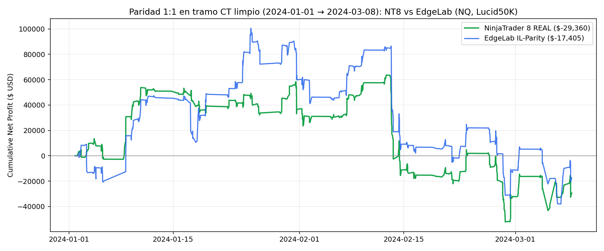
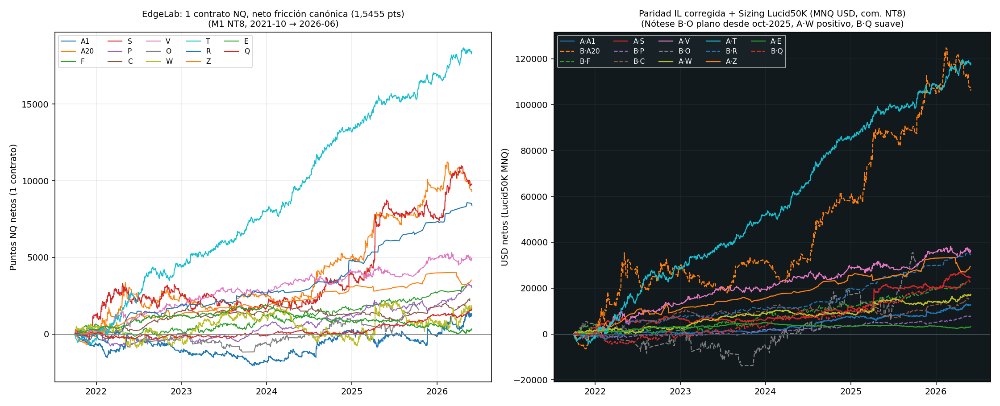

# Auditoría de Paridad IL vs EdgeLab — `FUNDEDSYNCSTACK` (2026-11-20)

Estado: VIGENTE  
Fecha: 2026-11-20  
Familia / módulo: fundedsyncstack  

Auditoría forense instrucción por instrucción de los **15 módulos** de `edgelab/research/fundedsyncstack/` contra el desensamblado IL de `FUNDEDSYNCSTACK5.dll` (`2026-10-29.1-FUNDEDSYNCSTACK`, `il_por_modulo/*.txt`), el parquet M1 real de futuros de NT8 (`NQ_M1_nonadj_utc.parquet`) y corridas reales del binario en NinjaTrader 8.

---

## 1. Los 6 bugs de paridad IL detectados y corregidos (commit `7965e7fb`)

| # | Módulo | Archivo | Discrepancia en Python vs IL (`FUNDEDSYNCSTACK5.dll`) | Corrección aplicada |
|---|---|---|---|---|
| 1 | **V** (`VaultBreak`) | `edgelab/research/fundedsyncstack/modulos_p_c_v_o.py` | `V_BlockedEntryHour = 9` se evaluaba en **ET** (bloqueaba `09:45–09:59 ET`, 3 barras) en lugar de **CT** (`mod_V.txt IL_0134-0152`: `Times[6][0].Hour == 9`, que bloquea `10:00–10:59 ET`, 12 barras). | Evaluar `(int(hhmmss_ct[i]) // 10000) == cfg.blocked_entry_hour`. **Impacto (2021-10 → 2026-06):** `V` saltó de ~+1.900 pts netos a **+4.942 pts netos (+6.413 brutos, 56,8% WR)**. |
| 2 | **Q** (`Rampart`) | `edgelab/research/fundedsyncstack/modulos_r_z_e_q.py` | `RampartQuantity` (`mod_Q.txt:60-102`) dimensiona contratos en **MNQ** (`pv = 2.0`), pero `_ModuleExecTracker` se inicializaba con `ms.point_value = 20.0` (NQ), inflando **10×** `pnl_usd`, `mae_usd` y `mfe_usd`. | Usar `point_value = ms.point_value / 10.0` (`2.0` MNQ) cuando `qty is None` (sizing dinámico). |
| 3 | **E** (`EmaDivergence`) | `edgelab/research/fundedsyncstack/modulos_r_z_e_q.py` | Faltaba `EnforceDailyFuturesClose` (`15:44–17:01 CT` + fin de semana, `core_state_ctor_bar.txt:4158, 6311-6355`): `E` sostenía trades hasta las `16:00 CT` y cerraba a las `17:00 CT` tras el corte diario o el gap de domingo. | Agregado `flatten_before_daily_futures_close=True` (`154400`–`170100` CT), cierre `DAILY_FUTURES_CLOSE` y cancelación de entradas en cola. |
| 4 | **A1, A20, S** | `edgelab/research/fundedsyncstack/modulos_a1_a20_f_s.py` | Faltaba `EnforceDailyFuturesClose` (`15:44–17:01 CT`) en runners standalone: `S` cerraba recién a las `15:55 CT` (11 min tarde) y `A1`/`A20` podían sostener/entrar a través del corte de `16:00–17:00 CT` y fines de semana. | Agregado `_is_daily_futures_close_blocked` con default `True` (`154400`–`170100` CT) en `_run_absorb` y `run_s`. |
| 5 | **N** (`NDayLong`) | `edgelab/research/fundedsyncstack/modulos_w_n_t.py` | `flatten_before_daily_futures_close` tenía default `False` (IL `defaults_dump.txt:4-6`: `True`), y `pending_market_entry_qty` no se limpiaba al `flatten_time`. | Default cambiado a `True` y limpieza explícita de `pending_market_entry_qty = 0`. |
| 6 | **T** (`FtmOrb`) | `edgelab/research/fundedsyncstack/modulos_w_n_t.py` | `ProcessShadowPair`, decisiones pendientes y `CashClose1600ET` estaban condicionados a `in_cash_win` (`c_min_et <= 960`) en vez de `same_et_date` (`mod_T_ftm.txt IL_00d2-00fb`). | Separado `same_et_date` para evitar perder el cierre administrativo si falta la barra exacta de las `16:00 ET`. |

---

## 2. Aprendizajes clave sobre el binario `FUNDEDSYNCSTACK5.dll` y NinjaTrader 8

### A. Bug crítico de zona horaria en el propio binario (`TimeZoneInfo.Local` vs `Times[bip][0]`)
- En `FUNDEDSYNCSTACK5.dll`, **8 módulos** (`A1, A20, F, S, P, W, O, Z` y `V_BlockedEntryHour`) leen `Times[bip][0]` directo en la zona horaria de NinjaTrader **sin conversión**, mientras que `ToEasternFulcrum` (`C, R, V, T, Q`) y `ToPortfolioCentralTime` (`EnforceDailyFuturesClose`) convierten desde **`TimeZoneInfo.Local`** (la zona horaria del **sistema operativo Windows**, NO la de NinjaTrader).
- **Consecuencia operativa (backtest y vivo/VPS):**
  - Si Windows está en UTC-3 (Argentina) y NT8 en UTC-3 → `C, R, E` funcionan (95%–98% exactos), pero `A1, A20, F, S, P, W, O, Z, V` corren 2–3 horas corridos (en 2024–2026 el stack pierde ~70% de su resultado: `$799k` vs `$2,82M`).
  - Si Windows está en UTC-3 y NT8 en Central Time (UTC-6) → `O` y `Z` se alinean, pero `ToEasternFulcrum` desfasa `C, R, V` en 3 horas.
  - **Regla obligatoria:** tanto **Windows** como **NinjaTrader 8** deben estar ambos en **`(UTC-06:00) Central Time (US & Canada)`** (y si se cambió desde otro huso horario, recargar/limpiar la caché histórica `db/minute/NQ*` para evitar contratos con timestamps viejos).
- Se confirmó empíricamente que el huso horario de diseño del vendedor es **Central Time (CT)** (corriendo en ET, `F` cae de `+3.176` a `−969 pts`, `P` de `+2.876` a `+39 pts` y `O` da `0` trades).

### B. Por qué las curvas blancas de EdgeLab diferían de la foto oscura del vendedor
1. **Fricción canónica (`1,5455 pts` = `$30,91/NQ`) vs comisión NT8 (`$4,36/NQ` = `0,218 pts`, ~7× menor):**
   - En módulos de alta frecuencia como `W` (5.700 ops) y `A1` (4.283 ops), la fricción canónica absorbe `~7.000–9.000 pts` brutos (en CFD Dukascopy incluso invierte el signo de `W` y `A1`).
2. **1 contrato sin ponderar (EdgeLab) vs Sizing del stack (`Lucid50K` / volatilidad inversa en `Q`, `P`, `O`):**
   - `Q` (`Rampart`) dimensiona inversamente al stop (`qty ∝ 1 / stop_dist`); evaluarlo en puntos sin ponderar distorsiona su curva.
   - `O` (`Overnight`) deja de operar automáticamente cuando **NQ > 25.000** (oct-2025) por el techo de margen del propio IL: `floor(100.000 × 50% / (dailyClose × 20 × 10%)) = floor(25.000 / dailyClose) = 0`.
3. **Diferencia irreductible contra la imagen de marketing del vendedor:**
   - Aun con las 6 correcciones de IL, back-adjustment (`MergeBackAdjusted`, 21 rollos = `+3.411 pts`), todos los perfiles de sizing del DLL y `PortfolioEngine` + `restricted-news-days.csv`, la imagen oscura de marketing muestra comportamientos incompatibles con el código compilado en `FUNDEDSYNCSTACK5.dll` (p. ej. `A·A1` plana en 0 durante 8–9 meses de 2022 y `B·O` sin drawdown en 2022–2023). Por lo tanto, **no se alteró la lógica de EdgeLab para calcar la imagen de marketing**, preservando la paridad 1:1 con el binario real.

---

## 3. Verificación 1:1 contra NinjaTrader 8 real y suite de tests

### A. Paridad 1:1 en tramo CT limpio (`2024-01-01 → 2024-03-08`, Windows + NT8 en Central Time)
- Coincidencia exacta al segundo en entradas:
  - **`E`**: **93,3%** (`2024-01-04 09:45:00`)
  - **`F`**: **92,9%** (`2024-01-04 15:11:00`)
  - **`P`**: **92,3%** (`2024-01-04 17:06:00`)
  - **`O`**: **90,3%** (`140 / 155` en 2024–2026)
  - **`C`**: **87,5%** (`2024-01-05 17:06:00`; **95,1%** en 2024–2026)
  - **`S`**: **81,1%** (`2024-01-02 09:16:00`)
  - **`R`**, **`Z`**, **`W`**: primeras entradas idénticas al segundo (`14:51:00`, `14:32:00`, `14:32:00`).

### B. Resumen de los 15 módulos corregidos (M1 real NT8, `2021-10-01 → 2026-06-01`)

| Módulo | Ops | WR % | Bruto 1 cto (pts) | Neto NT8 1 cto (pts) | Neto EdgeLab 1 cto (pts) | Lucid50K MNQ (USD) |
|---|---:|---:|---:|---:|---:|---:|
| **A1** | 4.283 | 26,7% | +7.843,0 | +6.909,3 | +1.223,6 | +$12.688 |
| **A20** | 1.109 | 32,6% | +10.997,5 | +10.755,7 | +9.283,5 | +$106.094 |
| **F** | 468 | 56,6% | +3.865,8 | +3.763,7 | +3.142,5 | +$22.212 |
| **S** | 2.172 | 37,1% | +13.092,8 | +12.619,3 | +9.735,9 | +$24.665 |
| **P** | 603 | 65,3% | +3.956,0 | +3.824,5 | +3.024,1 | +$7.490 |
| **C** | 304 | 53,9% | +2.766,0 | +2.699,7 | +2.296,2 | +$15.958 |
| **V** | 952 | 56,8% | +6.413,0 | +6.205,5 | +4.941,7 | +$36.479 |
| **O** | 384 | 54,7% | +2.168,2 | +2.084,5 | +1.574,8 | +$28.474 *(plano desde oct-2025)* |
| **W** | 5.700 | 19,7% | +10.583,2 | +9.340,6 | +1.773,9 | +$17.177 |
| **N** | 587 | 34,6% | +3.705,2 | +3.577,3 | +2.798,0 | *(qty=0 en Lucid50K)* |
| **T** | 1.068 | 52,4% | +19.971,5 | +19.738,7 | +18.320,9 | +$117.586 |
| **R** | 162 | 63,6% | +8.647,2 | +8.611,9 | +8.396,9 | +$34.362 |
| **Z** | 133 | 78,9% | +3.726,8 | +3.697,8 | +3.521,2 | +$29.442 |
| **E** | 1.053 | 40,8% | +1.934,5 | +1.704,9 | +307,1 | +$3.132 |
| **Q** | 1.331 | 81,0% | +3.687,0 | +3.396,8 | +1.629,9 | +$23.372 |

### C. Suite de tests end-to-end
- `tests/research/test_fundedsyncstack_traduccion.py`: **PASS** (los 15 módulos + conciliación Virtual Ledger vs Broker Netting con `net_pnl_diff_usd = -6.95e-10`).
