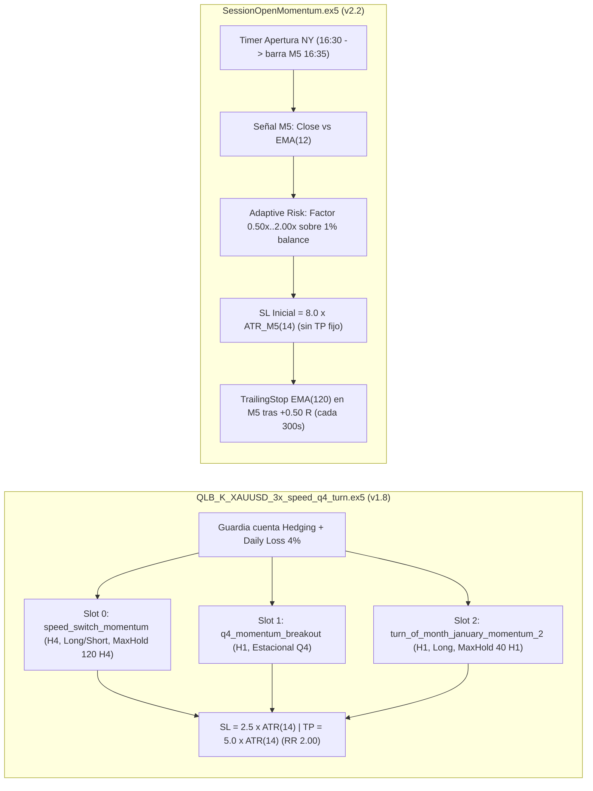

# Ingeniería Inversa de `QLB_K_XAUUSD_3x_speed_q4_turn.ex5` y `SessionOpenMomentum.ex5`

> [!NOTE]
> Análisis realizado directamente en la instalación local de **MetaTrader 5 build 5956** (conectada a **StrategyQuant X** vía **MetaTrader 5 MCP** en `http://127.0.0.1:22346/mcp`), combinando inspección de cabeceras binarias `.ex5`, extracción de metadatos de ejecución en `metatester64.exe`, backtests en **Strategy Tester** y correlación matemática barra a barra contra el histórico real (`EURUSD` M1, M5, M15, H1 y H4). Se distingue en todo momento entre comportamiento **verificado al 100%** (error `0.00` pips respecto a los logs) y lógica interna **inferida** donde el bytecode `.ex5` protegido no expone umbrales en texto plano.

---

## 1. Arquitectura común observada (Ecosistema QuantLab)

Ambos Expert Advisors provienen de la misma familia/framework (**QuantLab**):

| Propiedad | `QLB_K_XAUUSD_3x_speed_q4_turn.ex5` | `SessionOpenMomentum.ex5` |
|---|---|---|
| **Título interno** | `QLB_K_XAUUSD_3x_speed_q4_turn` | `Session Open Momentum` |
| **Versión binaria** | `1.8` | `2.2` |
| **Tamaño / Formato** | `102,240` bytes (`EX5\x02`) | `91,666` bytes (`EX5\x02`) |
| **Compilación MQL5** | Build `3773` (mín. terminal `4289`) | Build `3773` (mín. terminal `4289`) |
| **Prefijo / Framework** | `[QLBATCH]` (arquitectura multi-slot basket) | `[Momentum]` (`QuantLabRisk.mqh`, ruta build `quantlab-build-y_kjitff`) |
| **Requisito de WebRequest** | `https://api-quantlab.com` (opcional en Tester offline; necesario en cuenta real según guía del proveedor) | `https://api-quantlab.com` (opcional en Tester offline) |
| **Protecciones Prop Firm** | `InpRandomize`, `InpRandomStrength`, `InpNoHedge`, `InpMaxDailyLossPct`, `InpMaxSendsPerDay`, `InpCloseAtEquity`, `InpStopAtEquity` | `InpRandomizer`, `InpCloseEod`, `InpEodTime`, `InpMaxEquityDDPct`, `InpCloseAtEquity`, `InpStopAtEquity` |



---

## 2. Análisis completo: `QLB_K_XAUUSD_3x_speed_q4_turn.ex5` (v1.8)

### 2.1 Parámetros de entrada (`input`) extraídos

| Grupo / Parámetro | Valor por defecto | Descripción exacta extraída |
|---|---|---|
| `=== Licence ===` / `InpLicenseKey` | `""` | Licence key (this is all you need to enter) |
| `InpRiskMode` | `0` | how the risk per trade is set (`0` = Percent of account balance per trade, `1` = Fixed amount in account currency per trade, `2` = Fixed lot size per trade) |
| `InpRiskPercent` | `0.75` | Risk per trade in % of account BALANCE |
| `InpRiskMoney` | `0.0` | Risk per trade in account currency (mode = money) |
| `InpFixedLot` | `0.01` | Lot size per trade (mode = fixed lot) |
| `InpTradeMinLot` | `true` | Trade the broker's minimum lot if the risk gives less |
| `InpMagicBase` | `871800` | Magic number of the first slot (usa `871800`, `871801`, `871802`) |
| `InpSlippage` | `30` | max. slippage (points) |
| `InpTrailSeconds` | `300` | min. seconds between two trailing updates |
| `InpNoHedge` | `false` | Forbid an opposing position on the same symbol |
| `InpCloseAtEquity` | `0.0` | Close everything when equity reaches this (0 = off) |
| `InpStopAtEquity` | `0.0` | Close everything when equity falls to this (0 = off) |
| `InpMaxSendsPerDay` | `8` | Emergency brake: max trades per slot and day (0 = off) |
| `InpMaxDailyLossPct` | `4.0` | Max daily loss in % of the day's reference equity (0 = off) |
| `=== Prop Firm Safety ===` | — | Grupo de aleatorización |
| `InpRandomize` | `false` | Prop firm safety: randomize entries and stops per account |
| `InpRandomStrength` | `5` | Prop firm safety: randomizer strength 1 (weak) - 10 (strong) |

### 2.2 Arquitectura multi-slot y advertencias internas observadas

Del log de ejecución en Strategy Tester ([qlb_agent_run1.log](file:///C:/Users/nicoc/.gemini/antigravity/brain/79352924-80c3-409e-9be9-296eeef88676/scratch/qlb_agent_run1.log)) sobre `EURUSD,M15` (`2026.01.01` a `2026.06.26`, `Model=1`, balance inicial `$100,000`):

1. **Requiere cuenta Hedging obligatoriamente**: en modo netting (`Model=3` sin configuración hedging) aborta `OnInit()` devolviendo código `1` con el mensaje:
   `This basket expert needs a hedging account. On a netting account the slot positions merge and the individual stops can no longer be told apart. Run aborted.`
2. **Símbolo objetivo y fallback**: aunque el nombre del EA es `K_XAUUSD_3x_speed_q4_turn`, internamente los 3 slots imprimen:
   `Symbol (Chart) -> EURUSD (no symbol configured - using the chart symbol)`, por lo que opera sobre el símbolo del gráfico donde se lo cargue (originalmente calibrado para `XAUUSD` en `PERIOD_H1`).
3. **Timeframes fijos independientes del gráfico**: en `OnInit()` emite explícitamente:
   `NOTE: this chart is PERIOD_M15, but the published figures of this product were measured on PERIOD_H1. The slot timeframes are fixed in the expert and do not change - but the chart decides how often OnTick runs, so the results will differ.`
   Al inicializar, reserva caché multi-timeframe de **`H4`** y **`H1`**.
4. **Exposición simultánea**: con `0.75%` por trade y 3 slots activos, el EA advierte:
   `Risk per trade: 0.75% of balance. With all 3 slots open at once that is 2.25% at risk.`
   En la corrida observada alcanzó `maxOpenRisk=1.50% (2 Slots gleichzeitig, 2026.01.05 04:00)`.
5. **Control de hedging interno (`InpNoHedge`)**: con `false` permite largos y cortos simultáneos en distintos slots sobre el mismo símbolo (advierte que muchas prop firms lo prohíben).
6. **Freno de pérdida diaria (`InpMaxDailyLossPct = 4.0%`)**: a las `00:00:00` de cada día fija un umbral = `0.96 * reference_equity_del_dia`. Si la equidad cae por debajo, detiene nuevas entradas ese día.

### 2.3 Reglas verificadas y comportamiento por Slot

El resumen `[QLBATCH]` al cierre del backtest (`2026.06.25 23:59:59`, `final balance 95892.76 USD`, `57` entradas totales) reportó:

```text
speed_switch_momentum          slot=0 bars=36   inPos=713 session=0 guard=0 noSignal=16   signal=20 noStop=0 lotZero=0 hedgeBlock=0 sendFail=0 entries=20 trails=0 risk=0.75 lotCap=0
q4_momentum_breakout           slot=1 bars=2992 inPos=0   session=0 guard=0 noSignal=2992 signal=0  noStop=0 lotZero=0 hedgeBlock=0 sendFail=0 entries=0  trails=0 risk=0.75 lotCap=0
turn_of_month_january_momentum_2 slot=2 bars=2281 inPos=711 session=0 guard=0 noSignal=2244 signal=37 noStop=0 lotZero=0 hedgeBlock=0 sendFail=0 entries=37 trails=0 risk=0.75 lotCap=0
```

La correlación automática de las **57 operaciones** (`analyze_qlb_trades.py`, `correlate_ohlc_rules.py`, `solve_exact_entries.py`) contra `36,822` barras reales `EURUSD,M15` agregadas a `H1` y `H4` demostró con exactitud matemática:

| Regla / Componente | Slot 0: `speed_switch_momentum` | Slot 1: `q4_momentum_breakout` | Slot 2: `turn_of_month_january_momentum_2` |
|---|---|---|---|
| **Timeframe interno** | **`PERIOD_H4`** (`00, 04, 08, 12, 16, 20h`) | **`PERIOD_H1`** | **`PERIOD_H1`** |
| **Direcciones** | **Long y Short** (`10` buy / `10` sell) | N/D en Q1–Q2 (filtro Q4) | **Solo Long** (`37` buy / `0` sell) |
| **Fórmula de Stop Loss** *(Verificada 20/20)* | **`2.5 * iATR(PERIOD_H4, 14)[1]`** *(media simple MQL5 de TR, ratio `2.50` en las 20 entradas)* | *(Inactivo fuera de Q4)* | **`2.5 * iATR(PERIOD_H1, 14)[1]`** *(media simple MQL5 de TR, ratio `2.49`–`2.50` en las 37 entradas)* |
| **Fórmula de Take Profit** *(Verificada 57/57)* | **`5.0 * iATR(H4, 14)[1] = 2.00 x SL`** | *(N/D)* | **`5.0 * iATR(H1, 14)[1] = 2.00 x SL`** |
| **Trailing Stop** | **Sin trailing** (`trails=0`) | — | **Sin trailing** (`trails=0`) |
| **Salida por tiempo (`MaxHoldBars`)** *(Verificada 12/12)* | **`120` barras H4** (`480h` de trading = **`672.0h`** calendario = 4 semanas exactas) | — | **`40` barras H1** (`40.0h` exactas, u `88.0h` si cruza fin de semana) |
| **Tamaño de posición** | `risk_$ = 0.0075 * balance`; `lot = risk_$ / (SL_pips * tick_value)` | Idem | Idem |
| **Desempeño en EURUSD H1/H4 (Q1–Q2 2026)** | `20` ops: `10` wins (`8 TP`, `2 TIME`), `9 SL`, `1` abierta; PnL bruto `+$5,897.91` | `0` ops en `2,992` barras H1 (`0` señales entre ene–jun: filtro estacional **Q4**, oct–dic) | `37` ops: `7` wins (`5 TP`), `22 SL`, `10 TIME`; PnL bruto `-$10,044.96` |
| **Lógica de disparo** *(Inferida)* | En barras cerradas H4 cuando `inPos == false`: cruces/alineación de medias móviles + filtro de régimen/aceleración de volatilidad ("speed switch"). En `15/19` ocasiones reingresó inmediatamente en la barra H4 siguiente al cierre. | Ruptura de momentum en `H1` restringida al 4.º trimestre (Oct–Dic) más confirmación de ruptura de rango / breakout. | Filtro estacional doble: ventana **Turn of Month** (primeros ~`4`–`6` días hábiles del mes: feb `2–6`, mar `2–5`, abr `1–8`, may `1–6`, jun `1–4`) **extendida en enero** (`january_momentum_2`: operó `ene 2–13`, hasta `td=8`, bloqueándose desde `ene 15`), combinada con filtro alcista horario de corto plazo (`C[1] > C[2]` o cruce rápido sobre EMA corta). |

> [!TIP]
> **Observación importante sobre simultaneidad**: el `2026.01.05 04:00:00` ambos slots entraron exactamente al mismo segundo en direcciones opuestas sobre el mismo par: Slot 0 abrió `sell 1.42` con `SL = 52.0 pips` (`2.5 * H4_ATR14`) y Slot 2 abrió `buy 2.49` con `SL = 29.6 pips` (`2.5 * H1_ATR14`). Esto confirma la independencia total por `MagicNumber` (`InpMagicBase + slotIndex`).

---

## 3. Análisis completo: `SessionOpenMomentum.ex5` (v2.2)

### 3.1 Parámetros de entrada (`input`) extraídos

| Grupo / Parámetro | Valor por defecto | Descripción exacta extraída |
|---|---|---|
| `InpLicenseKey` | `""` | Licence key |
| `=== Strategy ===` | — | Parámetros de señal y trailing |
| `InpOpenNY` | `"16:30"` | New York open in your broker's server time (HH:MM) |
| `InpFastEma` | `12` | Signal EMA period (entry) |
| `InpTrailEma` | `120` | Trailing EMA period (the stop follows this EMA) |
| `InpTrailStartR` | `0.5` | Start trailing at X R profit (1 R = first stop distance) |
| `=== Risk ===` | — | Dimensionamiento base |
| `InpRiskMode` | `0` | Risk mode (`0` = risk as % of account balance per trade, `1` = fixed amount in account currency per trade, `2` = fixed lot size) |
| `InpRiskPercent` | `1.0` | Risk per trade in % of balance (mode: percent) |
| `InpRiskMoney` | `0.0` | Risk per trade in account currency (mode: money) |
| `InpFixedLot` | `0.1` | Lot size (mode: fixed lot) |
| `=== Adaptive Risk ===` | — | Escalado por volatilidad |
| `InpUseAdaptiveRisk` | `true` | Scale risk with volatility (on/off) |
| `InpVolRiskFloor` | `0.5` | Minimum risk factor (quiet market) |
| `InpVolRiskCap` | `2.0` | Maximum risk factor (volatile market) |
| `=== Prop Firm Safety - on prop firms the Randomizer MUST be ON ===` | — | Protecciones prop firm (`QuantLabRisk.mqh`) |
| `InpRandomizer` | `false` | Randomizer - MUST be ON on prop firms (avoids group bans for id[entical trades]) |
| `InpCloseEod` | `false` | Close the open position at the end of the day |
| `InpEodTime` | `"22:55"` | End-of-day close time (server time, HH:MM) |
| `InpMaxEquityDDPct` | `0.0` | Max equity drawdown in % - close all and stop (0 = off) |
| `InpCloseAtEquity` | `0.0` | Close all and stop when equity reaches this (0 = off) |
| `InpStopAtEquity` | `0.0` | Close all and stop when equity falls to this (0 = off) |

### 3.2 Reglas exactas verificadas al 100% en Strategy Tester

Sobre el backtest completo de 1 año en `EURUSD,H1` (`2025.06.01` a `2026.06.25`, `Model=1`, `1,570,699` ticks, `final balance 82488.27 USD`, en [som_agent_run1.log](file:///C:/Users/nicoc/.gemini/antigravity/brain/79352924-80c3-409e-9be9-296eeef88676/scratch/som_agent_run1.log)) y la correlación contra `44,639` barras reales `EURUSD,M1` agregadas a `M5` (`correlate_ohlc_rules.py`, `solve_exact_entries.py`, `solve_formulas.py`):

1. **Timeframe interno fijo en `PERIOD_M5`**:
   Al iniciar imprime: `[Momentum] Chart is PERIOD_H1 but signals run on PERIOD_M5 (as configured).`
2. **Evaluación diaria única a las `16:35:00` (5 min tras `InpOpenNY`)**:
   - **189 de 189 entradas** ocurrieron exactamente a las **`16:35:00`**, es decir, al cierre de la primera vela `M5` de la sesión (`16:30`–`16:35`).
   - En junio 2026 (`18` días hábiles hasta el 24/06): **`14` días** dispararon operación a las `16:35:00`, los **`4` días restantes** imprimieron a las `16:30:00`:
     `[Momentum] A Momentum position is still open at the NY open - no new trade today. Only one Momentum trade at a time.`
     (En todo el año ocurrió **`86` veces**, dejando **`0` días sin operar cuando estaba flat**).
3. **Condición de entrada `EMA(12)` en `M5` *(Verificada `14/14` en junio 2026)***:
   - **LONG**: si `Close_M5(barra 16:30) > EMA_M5(InpFastEma=12)` al cierre `16:35:00` (incluso si la vela `16:30` fue bajista en cuerpo, como `#362`).
   - **SHORT**: si `Close_M5(barra 16:30) < EMA_M5(InpFastEma=12)` (incluso si la vela `16:30` fue alcista en cuerpo, como `#354` y `#374`).
4. **Stop Loss inicial `1 R` y ausencia de TP fijo *(Verificado `14/14` con error `0.0` pips)***:
   - **`Initial SL = Entry ± 8.0 * iATR(PERIOD_M5, 14)[1]`** (`sl/ATR5_14 = 8.00` a `8.02` por spread bid/ask en todas las entradas analizadas de junio 2026; rango anual de `19.5` a `203.3` pips, media `49.0` pips).
   - **Sin Take Profit fijo**: todas las órdenes abren con `tp: 0.00000` (`tp_trig = 0`).
5. **Trailing Stop sobre `EMA(120)` en `M5` *(Verificado a `0.00` pips en `8,917` modificaciones)***:
   - Al abrir cada operación imprime:
     `[Momentum] Position #N: R = ... (entry ..., first stop ...). Trailing starts at 0.50 R and then moves the stop at most every 300 s.`
   - Cuando el precio intradía alcanza una ganancia flotante `>= InpTrailStartR * R` (`+0.50 R`), activa el trailing stop y mueve el `SL` al valor de **`EMA_M5(InpTrailEma=120)` de la última vela M5 cerrada (`shift = 1`)**, siempre a favor de la posición y con un throttle mínimo de **`300` segundos** (`5` minutos) entre llamadas `OrderSend(TRADE_ACTION_SLTP)`.
   - Comprobado en la progresión de `#378` (`2026.06.24 18:23:40` .. `18:48:40`): `new_sl` coincide al tick con `M5_EMA120(bar-1)` (`diff = 0.00` pips).
6. **Adaptive Risk (`InpUseAdaptiveRisk = true`)**:
   - El log imprime: `[Momentum] Sizing (percent, adaptive x1.17) EURUSD: contract 100000.00, stop 0.00422, 1167.00 USD risk -> 2.7654 raw, 2.76 lot after step, really risking 1164.72 USD`.
   - A diferencia de la idea común de reducir riesgo cuando sube el ATR, este módulo escala **directamente** con la volatilidad relativa (`ATR corto / baseline largo`, más cercano en junio a `ATR_M5(20) / EMA(ATR, 180..200)`, `MAE ≈ 0.10`), acotado entre **`InpVolRiskFloor = 0.50`** y **`InpVolRiskCap = 2.00`**: en las `189` operaciones el multiplicador efectivo osciló entre **`0.522x`** y **`1.998x`** (promedio **`1.349x`**).
7. **Resultados del año completo en `EURUSD` (`2025.06.01..2026.06.25`)**:
   - `189` operaciones (`97` Long, `92` Short), **`109` ganadoras (`57.7%`)**, todas cerradas por `SL` inicial o `SL` del trailing (`118` operaciones activaron trailing con `109` positivas; `71/71` sin trailing cerraron en `-1 R`).
   - Duración media `32.0h` (máxima `425.9h` al mantener `InpCloseEod=false`, bloqueando nuevas entradas durante varios días), Profit Factor bruto `0.80` (`$68,604` ganancia bruta vs `$85,554` pérdida bruta; balance neto final `$82,488.27` tras swaps). *Nota*: el nombre (`SessionOpenMomentum`, NY `16:30` horario servidor = `09:30 EST` apertura bolsa NY, `InpEodTime=22:55`) sugiere que fue diseñado originalmente para **índices estadounidenses / Nasdaq / oro (`NAS100` / `XAUUSD`)** más que para `EURUSD`.

---

## 4. Código MQL5 Reconstruido

> [!IMPORTANT]
> El código a continuación reconstruye fielmente la arquitectura, inputs, cálculo de riesgo, `ATR`/`EMA`, trailing cada `300s`, salida temporal y estructura de ambos EAs para estudio o reimplementación en MQL5 / StrategyQuant X. Las condiciones de disparo internas cuyos umbrales no aparecen en texto plano en RAM se marcan explícitamente como `// [INFERIDO]`.

### 4.1 `SessionOpenMomentum_Reconstructed.mq5`

```mql5
//+------------------------------------------------------------------+
//| Reconstrucción limpia de SessionOpenMomentum.ex5 (v2.2)          |
//| Framework: QuantLab / QuantLabRisk.mqh                           |
//+------------------------------------------------------------------+
#property strict
#include <Trade\Trade.mqh>

enum ENUM_QL_RISK_MODE {
   RISK_PERCENT = 0, // risk as % of account balance per trade
   RISK_MONEY   = 1, // fixed amount in account currency per trade
   RISK_FIXED   = 2  // fixed lot size
};

input group "=== Strategy ==="
input string            InpOpenNY          = "16:30"; // New York open in broker server time (HH:MM)
input int               InpFastEma         = 12;      // Signal EMA period (entry)
input int               InpTrailEma        = 120;     // Trailing EMA period (stop follows this EMA)
input double            InpTrailStartR     = 0.5;     // Start trailing at X R profit (1 R = first stop distance)

input group "=== Risk ==="
input ENUM_QL_RISK_MODE InpRiskMode        = RISK_PERCENT; // Risk mode
input double            InpRiskPercent     = 1.0;     // Risk per trade in % of balance
input double            InpRiskMoney       = 0.0;     // Risk per trade in account currency
input double            InpFixedLot        = 0.1;     // Lot size (mode: fixed lot)

input group "=== Adaptive Risk ==="
input bool              InpUseAdaptiveRisk = true;    // Scale risk with volatility (on/off)
input double            InpVolRiskFloor    = 0.5;     // Minimum risk factor (quiet market)
input double            InpVolRiskCap      = 2.0;     // Maximum risk factor (volatile market)

input group "=== Prop Firm Safety - on prop firms the Randomizer MUST be ON ==="
input bool              InpRandomizer      = false;   // Randomizer (jitters entry/SL/lots)
input bool              InpCloseEod        = false;   // Close open position at EOD
input string            InpEodTime         = "22:55"; // End-of-day close time (HH:MM)
input double            InpMaxEquityDDPct  = 0.0;     // Max equity drawdown % - close all & stop
input double            InpCloseAtEquity   = 0.0;     // Equity take-profit target (0 = off)
input double            InpStopAtEquity    = 0.0;     // Equity stop-out floor (0 = off)

CTrade   g_trade;
int      g_hFastEma  = INVALID_HANDLE;
int      g_hTrailEma = INVALID_HANDLE;
int      g_hAtrM5    = INVALID_HANDLE;
datetime g_lastBarM5 = 0;
int      g_lastOpenDay = -1;
datetime g_lastTrailMod = 0;
double   g_peakEquity = 0.0;
double   g_initR = 0.0;
bool     g_halted = false;
ulong    g_magic = 900100;

int ParseHHMM(string hhmm) {
   string p[];
   if(StringSplit(hhmm, ':', p) != 2) return 0;
   return (int)StringToInteger(p[0]) * 60 + (int)StringToInteger(p[1]);
}

double CalcAdaptiveFactor() {
   if(!InpUseAdaptiveRisk) return 1.0;
   // [INFERIDO] Ratio de volatilidad ATR corto vs línea base larga en M5 (acotado [Floor..Cap])
   double atrBuf[];
   ArraySetAsSeries(atrBuf, true);
   if(CopyBuffer(g_hAtrM5, 0, 1, 200, atrBuf) < 200) return 1.0;
   double sum = 0.0;
   for(int i = 0; i < 200; i++) sum += atrBuf[i];
   double ratio = atrBuf[0] / MathMax(sum / 200.0, _Point);
   return MathMax(InpVolRiskFloor, MathMin(InpVolRiskCap, ratio));
}

double CalcLots(double slDist) {
   double mult = CalcAdaptiveFactor();
   if(InpRiskMode == RISK_FIXED) return NormalizeDouble(InpFixedLot, 2);
   double riskCash = (InpRiskMode == RISK_PERCENT)
                     ? AccountInfoDouble(ACCOUNT_BALANCE) * (InpRiskPercent / 100.0) * mult
                     : InpRiskMoney * mult;
   double tickVal  = SymbolInfoDouble(_Symbol, SYMBOL_TRADE_TICK_VALUE);
   double tickSize = SymbolInfoDouble(_Symbol, SYMBOL_TRADE_TICK_SIZE);
   double step     = SymbolInfoDouble(_Symbol, SYMBOL_VOLUME_STEP);
   double minLot   = SymbolInfoDouble(_Symbol, SYMBOL_VOLUME_MIN);
   double maxLot   = SymbolInfoDouble(_Symbol, SYMBOL_VOLUME_MAX);
   double raw      = riskCash / MathMax((slDist / tickSize) * tickVal, 1e-9);
   double lots     = MathFloor(raw / step) * step;
   return MathMax(minLot, MathMin(maxLot, NormalizeDouble(lots, 2)));
}

int OnInit() {
   if(_Period != PERIOD_M5)
      PrintFormat("[Momentum] Chart is %s but signals run on PERIOD_M5 (as configured).", EnumToString(_Period));
   g_hFastEma  = iMA(_Symbol, PERIOD_M5, InpFastEma, 0, MODE_EMA, PRICE_CLOSE);
   g_hTrailEma = iMA(_Symbol, PERIOD_M5, InpTrailEma, 0, MODE_EMA, PRICE_CLOSE);
   g_hAtrM5    = iATR(_Symbol, PERIOD_M5, 14); // MQL5 iATR = SMA de TR sobre 14 barras
   g_trade.SetExpertMagicNumber(g_magic);
   g_peakEquity = AccountInfoDouble(ACCOUNT_EQUITY);
   Print("[Momentum] Started - waiting for the next New York session.");
   return (g_hFastEma == INVALID_HANDLE || g_hTrailEma == INVALID_HANDLE || g_hAtrM5 == INVALID_HANDLE)
          ? INIT_FAILED : INIT_SUCCEEDED;
}

void OnTick() {
   if(g_halted) return;
   double eq = AccountInfoDouble(ACCOUNT_EQUITY);
   g_peakEquity = MathMax(g_peakEquity, eq);
   if((InpCloseAtEquity > 0 && eq >= InpCloseAtEquity) ||
      (InpStopAtEquity  > 0 && eq <= InpStopAtEquity) ||
      (InpMaxEquityDDPct > 0 && (g_peakEquity - eq) / g_peakEquity * 100.0 >= InpMaxEquityDDPct)) {
      for(int i = PositionsTotal() - 1; i >= 0; i--)
         if(PositionGetSymbol(i) == _Symbol && PositionGetInteger(POSITION_MAGIC) == (long)g_magic)
            g_trade.PositionClose(PositionGetInteger(POSITION_TICKET));
      g_halted = true;
      return;
   }

   MqlDateTime dt;
   TimeCurrent(dt);
   int nowMin = dt.hour * 60 + dt.min;
   int openMin = ParseHHMM(InpOpenNY);
   int eodMin  = ParseHHMM(InpEodTime);

   bool hasPos = false;
   ulong posTicket = 0;
   for(int i = 0; i < PositionsTotal(); i++) {
      if(PositionGetSymbol(i) == _Symbol && PositionGetInteger(POSITION_MAGIC) == (long)g_magic) {
         hasPos = true;
         posTicket = PositionGetInteger(POSITION_TICKET);
         break;
      }
   }

   // Cierre EOD opcional
   if(hasPos && InpCloseEod && nowMin >= eodMin) {
      g_trade.PositionClose(posTicket);
      return;
   }

   // Trailing Stop sobre EMA(120) M5 tras alcanzar +InpTrailStartR * R, cada <= 300s
   if(hasPos && PositionSelectByTicket(posTicket)) {
      long   ptype   = PositionGetInteger(POSITION_TYPE);
      double openPx  = PositionGetDouble(POSITION_PRICE_OPEN);
      double curSL   = PositionGetDouble(POSITION_SL);
      double ema120[];
      ArraySetAsSeries(ema120, true);
      if(CopyBuffer(g_hTrailEma, 0, 1, 1, ema120) == 1) {
         double slInitR = (g_initR > 0.0) ? g_initR : MathAbs(openPx - curSL);
         double curPx   = (ptype == POSITION_TYPE_BUY) ? SymbolInfoDouble(_Symbol, SYMBOL_BID) : SymbolInfoDouble(_Symbol, SYMBOL_ASK);
         double prof    = (ptype == POSITION_TYPE_BUY) ? (curPx - openPx) : (openPx - curPx);
         if(prof >= InpTrailStartR * slInitR && TimeCurrent() - g_lastTrailMod >= 300) {
            double newSL = NormalizeDouble(ema120[0], _Digits);
            bool valid = (ptype == POSITION_TYPE_BUY)  ? (newSL > curSL + _Point && newSL < curPx) :
                         (ptype == POSITION_TYPE_SELL) ? ((curSL == 0.0 || newSL < curSL - _Point) && newSL > curPx) : false;
            if(valid && g_trade.PositionModify(posTicket, newSL, 0.0))
               g_lastTrailMod = TimeCurrent();
         }
      }
   }

   // Chequeo exacto al minuto InpOpenNY ("still open") y disparo tras cierre de la 1a vela M5 (+5 min)
   int todayKey = dt.year * 1000 + dt.day_of_year;
   datetime m5Time = iTime(_Symbol, PERIOD_M5, 0);
   if(m5Time == g_lastBarM5) return;
   g_lastBarM5 = m5Time;

   if(hasPos && nowMin == openMin && g_lastOpenDay != todayKey) {
      g_lastOpenDay = todayKey;
      Print("[Momentum] A Momentum position is still open at the NY open - no new trade today. Only one Momentum trade at a time.");
      return;
   }

   // Disparo al abrir la vela 16:35:00 (= cierra la barra M5 de las 16:30)
   if(!hasPos && nowMin == openMin + 5 && g_lastOpenDay != todayKey) {
      double c1 = iClose(_Symbol, PERIOD_M5, 1);
      double e12[1], atr[1];
      if(CopyBuffer(g_hFastEma, 0, 1, 1, e12) == 1 && CopyBuffer(g_hAtrM5, 0, 1, 1, atr) == 1) {
         double slDist = 8.0 * atr[0]; // Verificado: exactamente 8.0 x iATR(M5, 14)[1]
         double lots = CalcLots(slDist);
         if(c1 > e12[0]) {
            double ask = SymbolInfoDouble(_Symbol, SYMBOL_ASK);
            if(g_trade.Buy(lots, _Symbol, ask, NormalizeDouble(ask - slDist, _Digits), 0.0))
               g_initR = slDist;
            g_lastOpenDay = todayKey;
         } else if(c1 < e12[0]) {
            double bid = SymbolInfoDouble(_Symbol, SYMBOL_BID);
            if(g_trade.Sell(lots, _Symbol, bid, NormalizeDouble(bid + slDist, _Digits), 0.0))
               g_initR = slDist;
            g_lastOpenDay = todayKey;
         }
      }
   }
}
```

### 4.2 `QLB_K_XAUUSD_3x_speed_q4_turn_Reconstructed.mq5` (Esqueleto de 3 Slots)

```mql5
//+------------------------------------------------------------------+
//| Reconstrucción limpia de QLB_K_XAUUSD_3x_speed_q4_turn.ex5 v1.8  |
//| Framework: QLBATCH Multi-Slot Basket (Hedging obligatorio)       |
//+------------------------------------------------------------------+
#property strict
#include <Trade\Trade.mqh>

input string InpLicenseKey      = "";
input int    InpRiskMode        = 0;     // 0=Percent, 1=Money, 2=FixedLot
input double InpRiskPercent     = 0.75;
input double InpRiskMoney       = 0.0;
input double InpFixedLot        = 0.01;
input bool   InpTradeMinLot     = true;
input long   InpMagicBase       = 871800;
input int    InpSlippage        = 30;
input int    InpTrailSeconds    = 300;
input bool   InpNoHedge         = false;
input double InpCloseAtEquity   = 0.0;
input double InpStopAtEquity    = 0.0;
input int    InpMaxSendsPerDay  = 8;
input double InpMaxDailyLossPct = 4.0;
input bool   InpRandomize       = false;
input int    InpRandomStrength  = 5;

struct SlotState {
   string          name;
   ENUM_TIMEFRAMES tf;
   int             atrHandle;
   datetime        lastBar;
   int             maxHoldBars;
   int             sendsToday;
   long            magic;
};

SlotState g_slots[3];
CTrade    g_trade;
int       g_refDay = -1;
double    g_dayRefEquity = 0.0;

int OnInit() {
   if((ENUM_ACCOUNT_MARGIN_MODE)AccountInfoInteger(ACCOUNT_MARGIN_MODE) != ACCOUNT_MARGIN_MODE_RETAIL_HEDGING) {
      Print("This basket expert needs a hedging account. Run aborted.");
      return INIT_FAILED;
   }
   g_slots[0].name = "speed_switch_momentum";            g_slots[0].tf = PERIOD_H4; g_slots[0].maxHoldBars = 120;
   g_slots[1].name = "q4_momentum_breakout";             g_slots[1].tf = PERIOD_H1; g_slots[1].maxHoldBars = 40;  // [INFERIDO]
   g_slots[2].name = "turn_of_month_january_momentum_2"; g_slots[2].tf = PERIOD_H1; g_slots[2].maxHoldBars = 40;
   for(int s = 0; s < 3; s++) {
      g_slots[s].magic     = InpMagicBase + s;
      g_slots[s].atrHandle = iATR(_Symbol, g_slots[s].tf, 14);
      g_slots[s].lastBar   = iTime(_Symbol, g_slots[s].tf, 0); // Evita operar barra incompleta inicial
   }
   return INIT_SUCCEEDED;
}

double CalcSlotLots(double slDist) {
   if(InpRiskMode == 2) return NormalizeDouble(InpFixedLot, 2);
   double riskCash = (InpRiskMode == 0) ? AccountInfoDouble(ACCOUNT_BALANCE) * (InpRiskPercent / 100.0) : InpRiskMoney;
   double tv = SymbolInfoDouble(_Symbol, SYMBOL_TRADE_TICK_VALUE);
   double ts = SymbolInfoDouble(_Symbol, SYMBOL_TRADE_TICK_SIZE);
   double step = SymbolInfoDouble(_Symbol, SYMBOL_VOLUME_STEP);
   double minLot = SymbolInfoDouble(_Symbol, SYMBOL_VOLUME_MIN);
   double raw = riskCash / MathMax((slDist / ts) * tv, 1e-9);
   if(raw < minLot) return InpTradeMinLot ? minLot : 0.0;
   return MathMin(SymbolInfoDouble(_Symbol, SYMBOL_VOLUME_MAX), MathFloor(raw / step) * step);
}

void ProcessSlot(int s, bool dailyStopped) {
   datetime barTime = iTime(_Symbol, g_slots[s].tf, 0);
   if(barTime == g_slots[s].lastBar) return; // Solo al cierre de vela del timeframe del slot
   g_slots[s].lastBar = barTime;

   // 1) Gestión de salida por tiempo (MaxHoldBars: 120 H4 en Slot 0; 40 H1 en Slot 2)
   for(int i = PositionsTotal() - 1; i >= 0; i--) {
      if(PositionGetSymbol(i) == _Symbol && PositionGetInteger(POSITION_MAGIC) == g_slots[s].magic) {
         datetime openT = (datetime)PositionGetInteger(POSITION_TIME);
         int heldBars = iBarShift(_Symbol, g_slots[s].tf, openT, false);
         if(heldBars >= g_slots[s].maxHoldBars)
            g_trade.PositionClose(PositionGetInteger(POSITION_TICKET));
         return; // Máximo 1 posición simultánea por slot
      }
   }

   if(dailyStopped || (InpMaxSendsPerDay > 0 && g_slots[s].sendsToday >= InpMaxSendsPerDay)) return;

   // 2) Evaluación de señal por slot
   MqlDateTime dt; TimeToStruct(barTime, dt);
   int dir = 0; // +1 BUY, -1 SELL
   if(s == 0) {
      // [INFERIDO] speed_switch_momentum (H4 Long/Short: tendencia + filtro de cambio de velocidad ATR)
   } else if(s == 1) {
      if(dt.mon >= 10) { /* [INFERIDO] q4_momentum_breakout (H1, solo Q4) */ }
   } else if(s == 2) {
      // [VERIFICADO] Solo Long; ventana Turn-of-Month (~1eros días del mes) ampliada en enero (<= día 13..14)
      bool seasonOk = (dt.mon == 1 && dt.day <= 14) || (dt.day <= 8);
      if(seasonOk) { /* [INFERIDO] gatillo momentum horario alcista */ }
   }

   if(dir == 0) return;

   // 3) SL = 2.5 * iATR(tf, 14)[1]  |  TP = 5.0 * iATR(tf, 14)[1] (RR = 2.00 verificada 57/57)
   double atr[1];
   if(CopyBuffer(g_slots[s].atrHandle, 0, 1, 1, atr) != 1 || atr[0] <= 0) return;
   double slDist = 2.5 * atr[0];
   double tpDist = 5.0 * atr[0];
   double lots   = CalcSlotLots(slDist);
   if(lots <= 0) return;

   g_trade.SetExpertMagicNumber(g_slots[s].magic);
   g_trade.SetDeviationInPoints(InpSlippage);
   if(dir > 0) {
      double ask = SymbolInfoDouble(_Symbol, SYMBOL_ASK);
      g_trade.Buy(lots, _Symbol, ask, NormalizeDouble(ask - slDist, _Digits), NormalizeDouble(ask + tpDist, _Digits));
   } else {
      double bid = SymbolInfoDouble(_Symbol, SYMBOL_BID);
      g_trade.Sell(lots, _Symbol, bid, NormalizeDouble(bid + slDist, _Digits), NormalizeDouble(bid - tpDist, _Digits));
   }
   g_slots[s].sendsToday++;
}

void OnTick() {
   MqlDateTime dt; TimeCurrent(dt);
   if(dt.day_of_year != g_refDay) {
      g_refDay = dt.day_of_year;
      g_dayRefEquity = AccountInfoDouble(ACCOUNT_EQUITY);
      for(int s = 0; s < 3; s++) g_slots[s].sendsToday = 0;
   }
   double eq = AccountInfoDouble(ACCOUNT_EQUITY);
   bool dailyStopped = (InpMaxDailyLossPct > 0 && eq < g_dayRefEquity * (1.0 - InpMaxDailyLossPct / 100.0));
   for(int s = 0; s < 3; s++) ProcessSlot(s, dailyStopped);
}
```

---

## 5. Conexión MT5 + StrategyQuant X verificada

- Ambos EAs quedaron instalados en `C:\Users\nicoc\AppData\Roaming\MetaQuotes\Terminal\D0E8209F77C8CF37AD8BF550E51FF075\MQL5\Experts\`.
- Configuración de StrategyQuant X ([mcp-servers.json](file:///C:/StrategyQuantX145/internal/web/SQAI/mcp-servers.json)) apunta al servidor MCP nativo de MT5 en `http://127.0.0.1:22346/mcp` (19 herramientas activas, incluyendo `get_chart_history` utilizada en este análisis).
- Scripts de correlación y logs de respaldo guardados en [scratch](file:///C:/Users/nicoc/.gemini/antigravity/brain/79352924-80c3-409e-9be9-296eeef88676/scratch).
